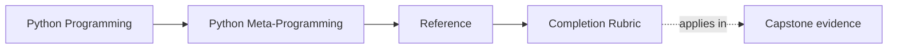

# Completion Rubric

<!-- page-maps:start -->
## Page Maps

<!-- page-maps:end -->

Use this page when you need to judge whether metaprogramming understanding has become
real design judgment rather than fascination with stronger runtime tools.

Completion in this course does not mean "I have seen descriptors, decorators, and metaclasses."
It means "I can choose among them honestly, defend the choice, and prove the result."

## The completion standard

You should be able to do all of the following:

- name the lowest-power runtime tool that honestly solves the current problem
- explain what extra blast radius a stronger mechanism would introduce
- preserve runtime evidence such as names, signatures, or manifest shape when a wrapper claims transparency
- distinguish descriptor, decorator, class-customization, and metaclass pressure clearly
- review a runtime mechanism by readability, inspectability, and governance instead of novelty
- choose one proof route that is strong enough without being theatrically oversized

## Four levels of completion

| Level | What it looks like | What is still missing |
| --- | --- | --- |
| recognition | you can identify the mechanism in code | you still confuse prestige with necessity |
| explanation | you can explain what the mechanism does | you still struggle to say why it belongs there |
| judgment | you can compare it with lower-power alternatives | you still may over-prove or under-prove the claim |
| reviewable mastery | you can justify the choice, name the first failing proof route, and explain the blast radius | this is the target level |

The course is aiming for reviewable mastery, not just recognition.

## Course outcomes by area

| Area | Completion signal | Weak signal that is not enough |
| --- | --- | --- |
| runtime observation | you can inspect runtime shape without changing it unnecessarily | you can run `inspect` tools but cannot say what executed |
| transparent wrappers | you can explain what metadata survived and why that matters | you can decorate functions but ignore signature loss |
| descriptor design | you can name which invariant belongs to attribute access itself | you can use descriptors only because they feel reusable |
| metaclass escalation | you can say which lower-power tool almost worked and why it failed | you jump to class-creation hooks without naming the missed rung |
| governance | you can justify one runtime mechanism choice in a way a reviewer could approve without a live walkthrough | you rely on trust in the author instead of observable proof |

## Capstone evidence

Use these as the minimum capstone evidence:

1. `make PROGRAM=python-programming/python-meta-programming manifest`
2. `make PROGRAM=python-programming/python-meta-programming registry`
3. `make PROGRAM=python-programming/python-meta-programming capstone-walkthrough`

Running them is not enough if you cannot explain which runtime boundary each route made visible.

## Questions a complete learner should be able to answer

- What lower-power tool almost solved this problem?
- What runtime fact still stays inspectable from the public surface?
- Which mechanism owns class-creation-time invariants here?
- Which proof route would fail first if this mechanism stopped being worth its cost?
- What would become easier to debug if the design moved down one rung?

## What incomplete understanding often looks like

| Incomplete pattern | Why it is incomplete |
| --- | --- |
| "Metaclasses are for advanced plugin systems." | prestige language is replacing a boundary argument |
| "The tests pass, so the design is good." | executable success is not the same as mechanism honesty |
| "The decorator is transparent enough." | "enough" is vague unless names, signatures, and traceability are named explicitly |
| "The runtime is observable." | that claim is weak unless you can say what can be inspected without execution |

## How to use this rubric honestly

- Use it after finishing a module cluster, not after every paragraph.
- Use it before claiming mastery in the capstone.
- Use it to downgrade your confidence when you can explain the mechanism but cannot yet defend the choice.
- Use it to decide whether the next move should be more practice, more proof, or a return to a lower-power module.

## Good stopping point

Stop when you can say:

- which level of completion you are currently at
- what one gap keeps you from reviewable mastery
- which module, reference page, or capstone route would close that gap next
