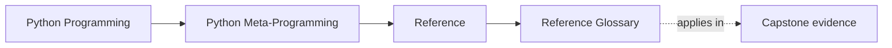

# Reference Glossary

<!-- page-maps:start -->
## Page Maps

<!-- page-maps:end -->

Use this glossary when a page, command, or review conversation starts to feel more vague
than the course intends. The goal is stable language, not extra theory and not dictionary theater.

## How to use this glossary

- Read the reference index first.
- Return here when a term starts carrying too many meanings at once.
- Prefer these local definitions over broad internet folklore when discussing this course.
- If two people are disagreeing, check whether they are using the same word for the same boundary.

## Core course terms

| Term | Meaning in this course |
| --- | --- |
| observability | the ability to inspect runtime shape or evidence without accidentally changing the behavior you are trying to understand |
| public surface | the commands, signatures, manifests, names, and outputs a reviewer can inspect without private implementation folklore |
| evidence | runtime facts you can inspect, save, or test directly, such as signatures, manifests, trace output, or deterministic registry state |
| folklore | claims about runtime behavior that depend on author memory or tribal knowledge more than on inspectable proof |
| lower-power tool | the least invasive mechanism that can honestly own the invariant, such as plain code before wrappers or descriptors before metaclasses |
| power ladder | the ordered review idea that compares explicit code, wrappers, descriptors, metaclasses, and process-wide dynamic mechanisms by blast radius |
| blast radius | how far a mechanism reaches into runtime timing, ownership, reviewability, and failure modes beyond its immediate local purpose |
| transparent wrapper | a wrapper that preserves enough callable identity and runtime evidence that a reviewer can still understand the callable honestly |
| descriptor pressure | a design need that truly belongs to attribute access, per-field validation, coercion, or storage rules |
| metaclass pressure | a design need that truly belongs to class-definition time rather than later runtime work |
| governance | the review discipline that asks whether a dynamic mechanism remains observable, reversible, bounded, and worth its cost |

## Reference shelf terms

| Term | Meaning on this shelf |
| --- | --- |
| Anti-Pattern Atlas | the recurring failure catalog used to recognize bad dynamic design shapes before they harden into local habits |
| Boundary Review Prompts | the question set used to decide whether behavior lives on the right boundary |
| Review Checklist | the compact reviewer route for keep, change, or reject decisions |
| Self-Review Prompts | the active-recall route for checking whether understanding has become operational |
| Completion Rubric | the page that defines what genuine course completion looks like beyond familiarity |
| Practice Map | the page that turns module understanding into the next honest practice loop |
| Topic Boundaries | the page that separates core course material from adjacent or out-of-scope material |

## Timing and ownership terms

| Term | Meaning in this course |
| --- | --- |
| definition time | the moment when decorators run, class bodies execute, and class-shape decisions are made |
| call time | the moment a callable actually runs and produces behavior or side effects |
| inspection time | the moment a reviewer examines runtime shape, metadata, or proof surfaces without intending to trigger business behavior |
| import-time work | behavior that happens while modules load, often dangerous when it becomes heavy, stateful, or surprising |
| ownership boundary | the line that answers which mechanism or file should own one invariant |
| review route | the smallest honest combination of guide, command, or test used to prove one claim |

## Misused words to watch for

| Word | Why it is dangerous | Better replacement |
| --- | --- | --- |
| magic | hides timing and ownership instead of explaining them | name the mechanism and boundary |
| advanced | flatters the tool instead of justifying it | say what invariant it owns |
| clean | often hides missing proof or missing alternatives | say what became more observable or more local |
| flexible | often hides unbounded power | say what kind of variation is actually supported |
| transparent | meaningless unless you name what remained visible | say which metadata or outputs survived |

## Good stopping point

Stop when you can replace vague praise or fear language with boundary language, evidence language, and mechanism language that another reviewer could actually use.
