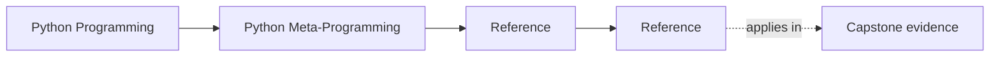

# Python Meta Programming Reference {#reference}

Use this course reference shelf for Python Meta Programming terminology, review prompts, and routes to the detailed reference pages.

<!-- page-maps:start -->
## Page Maps

<!-- page-maps:end -->

Use this shelf when the mechanism is no longer the hardest part.

The reference shelf is for the next level of difficulty:

- where a behavior should live
- how much power it deserves
- what proof would actually count
- what smell or failure pattern you are really seeing
- what to practice next so the course becomes usable judgment instead of stored vocabulary

This shelf is the course’s review brain. It is where a learner stops asking only "what is
this mechanism?" and starts asking "should I trust it, approve it, or move it downward?"

## What this shelf is meant to do

These pages should help you:

- stabilize the course vocabulary so one term does not carry five meanings at once
- compare lower-power and higher-power runtime choices honestly
- recognize familiar failure shapes before they harden into local superstition
- turn vague unease into named review questions
- choose the next practice loop after a module ends
- decide whether you are actually finished or only temporarily fluent

If you still need the mechanism itself explained from scratch, go back to the matching
module. This shelf is for judgment, not first exposure.

## Choose the page by question

| If your real question is... | Start here | Leave when you can... |
| --- | --- | --- |
| What does this term mean in this course? | [Glossary](glossary.md) | use the term in local course language instead of vague Python folklore |
| Where does this mechanism sit in the learning sequence? | [Module Dependency Map](module-dependency-map.md) | name the lower-power ideas it depends on |
| What should I practice or prove next? | [Practice Map](practice-map.md) | choose one concrete practice loop and one capstone follow-up |
| How should I review this mechanism? | [Review Checklist](review-checklist.md) | ask sharper questions than "does it work?" |
| Which ownership boundary is actually under pressure? | [Boundary Review Prompts](boundary-review-prompts.md) | name the specific boundary and the lower-power alternative |
| How do I test whether I really remember this? | [Self-Review Prompts](self-review-prompts.md) | answer without rereading everything first |
| What kind of bad dynamic design am I looking at? | [Anti-Pattern Atlas](anti-pattern-atlas.md) | name the smell and the repair direction |
| What counts as actual completion here? | [Completion Rubric](completion-rubric.md) | judge whether understanding has become reviewable judgment |
| How far up the power ladder should this design go? | [Runtime Power Ladder](runtime-power-ladder.md) | explain why the rung below is insufficient |
| Does this topic even belong in the course center? | [Topic Boundaries](topic-boundaries.md) | place the topic in core, adjacent, or outside scope |

## Best entry route for a solo learner

If you missed class and do not know where to enter the reference shelf, use this route:

1. Read [Runtime Power Ladder](runtime-power-ladder.md).
2. Read [Review Checklist](review-checklist.md).
3. Read [Boundary Review Prompts](boundary-review-prompts.md).
4. Read [Anti-Pattern Atlas](anti-pattern-atlas.md).
5. Use [Practice Map](practice-map.md) to decide the next concrete loop.

That route gives you review logic first, then smell recognition, then practice direction.

## What better use of this shelf should feel like

| Before using the shelf | After using the shelf |
| --- | --- |
| "This idea feels advanced." | "This belongs on rung 2, 3, or 4, and here is why." |
| "Something about this wrapper seems off." | "It erased signature evidence, so the callable contract stopped being reviewable." |
| "I finished the module, but I do not know what to do next." | "The next honest loop is field-proof practice, then a focused capstone follow-up." |
| "This topic sounds related, so it probably belongs here." | "This is adjacent support material, not part of the course spine." |

## When to leave this shelf

Do not turn reference reading into avoidance.

- Go back to a module when the mechanism itself is still blurry.
- Go into the capstone when the rule needs real runtime pressure.
- Go into tests or saved bundles when the claim is clear and now needs proof.
- Leave the course center when the question is mostly framework-specific, vendor-specific, or tooling-specific.

## Shelf pages

- [Glossary](glossary.md)
- [Runtime Power Ladder](runtime-power-ladder.md)
- [Module Dependency Map](module-dependency-map.md)
- [Practice Map](practice-map.md)
- [Review Checklist](review-checklist.md)
- [Boundary Review Prompts](boundary-review-prompts.md)
- [Self-Review Prompts](self-review-prompts.md)
- [Anti-Pattern Atlas](anti-pattern-atlas.md)
- [Completion Rubric](completion-rubric.md)
- [Topic Boundaries](topic-boundaries.md)

## Good stopping point

Leave this page when you can say:

- what question brought you into the reference shelf
- which page solves that question best
- what concrete next move follows
- whether that next move belongs in a module, a proof route, or the capstone
