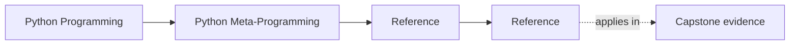

# Reference

<!-- page-maps:start -->
## Page Maps

<!-- page-maps:end -->

Use this shelf when the mechanism is already recognizable and the harder question is no
longer "what is this?" but "should this exist, where should it live, what should prove
it, and what should I practice next?"

This is not a fallback junk drawer. It is the course's judgment layer.

## What this shelf is for

Use the reference shelf to:

- stabilize vocabulary across modules, review, and capstone work
- choose the smallest honest mechanism for a runtime problem
- identify common failure shapes before they harden into local folklore
- decide what to practice next when one module is no longer enough
- turn a feeling that something is wrong into a clearer keep, change, or reject decision

If you still need the basic mechanism explained from scratch, go back to the matching
module before staying here too long.

## Start by the kind of question you have

| If your question is... | Start here | Stop when you can... |
| --- | --- | --- |
| "What does this term mean in this course?" | [Glossary](glossary.md) | say the term in local course language, not vague Python folklore |
| "Where does this mechanism sit in the course sequence?" | [Module Dependency Map](module-dependency-map.md) | explain which lower-power ideas it depends on |
| "What should I practice or prove next?" | [Practice Map](practice-map.md) | choose one concrete practice loop and one capstone follow-up |
| "How should I review this mechanism?" | [Review Checklist](review-checklist.md) | ask sharper review questions than "does it work?" |
| "Which sharper boundary question should I ask?" | [Boundary Review Prompts](boundary-review-prompts.md) | name the exact boundary under pressure |
| "How can I turn this idea into active recall?" | [Self-Review Prompts](self-review-prompts.md) | test your own understanding without rereading everything |
| "What failure shape am I seeing?" | [Anti-Pattern Atlas](anti-pattern-atlas.md) | name the smell and the likely repair direction |
| "What counts as genuinely complete understanding?" | [Completion Rubric](completion-rubric.md) | judge whether the knowledge has become reviewable judgment |
| "How far up the dynamic-power ladder should I go?" | [Runtime Power Ladder](runtime-power-ladder.md) | explain why a lower rung is insufficient |
| "Does this topic even belong in the course center?" | [Topic Boundaries](topic-boundaries.md) | say whether the topic is central, adjacent, or outside scope |

## A good route for missed-class learners

If you are studying alone and do not know where to enter this shelf, use this order:

1. Read [Runtime Power Ladder](runtime-power-ladder.md).
2. Read [Review Checklist](review-checklist.md).
3. Read [Boundary Review Prompts](boundary-review-prompts.md).
4. Read [Anti-Pattern Atlas](anti-pattern-atlas.md).
5. Return to [Practice Map](practice-map.md) or the current module.

That route gives you the review logic before the reference details start to blur together.

## What this shelf should help you do better

| Before using the shelf | After using the shelf |
| --- | --- |
| "This metaprogramming idea feels advanced." | "This idea belongs on rung 2, 3, or 4, and here is why." |
| "Something about this wrapper seems wrong." | "It erases metadata, so the callable contract is no longer reviewable." |
| "I finished the module, but I do not know what to practice now." | "The next honest loop is descriptor storage proof, then a field-focused capstone check." |
| "This topic might belong here, but I am not sure." | "It is adjacent support material, not central course spine." |

## When to leave the reference shelf

Do not stay here forever.

- Go back to a module when the mechanism itself is still unclear.
- Go into the capstone when you need to see the rule under real runtime pressure.
- Go into tests when the claim is clear and you need executable proof.
- Leave the course center when the question is mostly framework-specific or tooling-specific.

## Shelf pages

- [Glossary](glossary.md)
- [Runtime Power Ladder](runtime-power-ladder.md)
- [Module Dependency Map](module-dependency-map.md)
- [Practice Map](practice-map.md)
- [Review Checklist](review-checklist.md)
- [Boundary Review Prompts](boundary-review-prompts.md)
- [Self-Review Prompts](self-review-prompts.md)
- [Anti-Pattern Atlas](anti-pattern-atlas.md)
- [Completion Rubric](completion-rubric.md)
- [Topic Boundaries](topic-boundaries.md)

## Good stopping point

Stop here when you can answer:

- what question you brought into the shelf
- which page best answers that question
- what concrete next move follows from that answer
- whether the next move belongs in a module, the capstone, or a proof route
