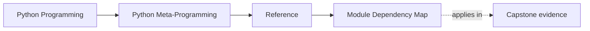
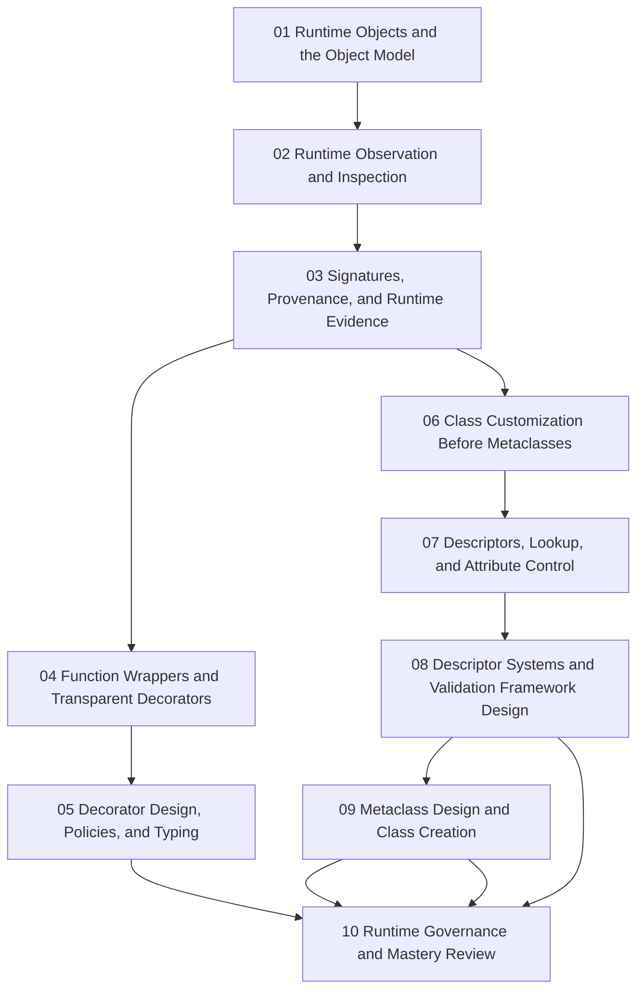

# Module Dependency Map

<!-- page-maps:start -->
## Page Maps

<!-- page-maps:end -->

Use this page when you remember a mechanism but no longer remember why the course placed it
where it did.

The point is not just sequencing. The point is dependency discipline. Later modules should
feel like consequences of earlier ones, not like disconnected advanced topics.

## How to use this map

Use it in one of three moments:

- before a module, to see what it depends on
- after a break, to find the last stable concept you still own
- during confusion, to locate the earlier boundary that a later mechanism is leaning on

If a late module feels magical, this page should help you find the missed floor beneath it.

## Main sequence

## Why the sequence looks like this

| Module | Depends most on | Reason |
| --- | --- | --- |
| 01 | none | the object model is the floor beneath every later runtime technique |
| 02 | 01 | observation should come before mutation or transformation |
| 03 | 01-02 | provenance and signature discipline depend on knowing what can be inspected honestly |
| 04 | 02-03 | wrappers only deserve trust if runtime evidence survives them |
| 05 | 04 | decorator policy is a design problem after transparent wrapping is already clear |
| 06 | 01-05 | lower-power class customization should be exhausted before metaclass pressure appears |
| 07 | 01-06 | descriptor behavior relies on the earlier object and lookup model |
| 08 | 06-07 | descriptor systems are safer after single-descriptor behavior is already legible |
| 09 | 06-08 | metaclasses belong late because class-creation invariants are the strongest escalation |
| 10 | all earlier modules | governance review requires the whole power ladder in view |

## Read the sequence as three dependency chains

### Observation chain

Modules 01 to 03 establish:

- what exists at runtime
- how to inspect it safely
- how runtime evidence becomes strong enough for review

Without that chain, wrappers and descriptors stop being inspectable and start feeling magical.

### Control chain

Modules 04 to 09 establish:

- what belongs at call boundaries
- what belongs at attribute boundaries
- what belongs at class-creation boundaries

Without that chain, stronger hooks begin solving problems that lower-power tools could have owned more honestly.

### Governance chain

Module 10 establishes:

- when the mechanism is still defensible
- when the blast radius is too high
- what proof and rollback expectations now apply

Without that chain, the course teaches power without teaching restraint.

## Safe routes through the sequence

- new to metaprogramming: read Modules 01 through 10 in order
- working maintainer: start with Modules 03, 04, 07, and 09, then backfill the lower-power dependencies when they are unclear
- runtime steward: start with Modules 05, 08, 09, and 10, then revisit earlier modules when transparency or blast-radius questions appear

## If you are lost in the sequence

| If you are stuck on... | Return to... | Because... |
| --- | --- | --- |
| observation versus execution | 01 and 02 | you need the inspection floor first |
| decorator honesty | 03 and 04 | wrapper trust depends on evidence surviving |
| descriptor ownership | 06 and 07 | attribute rules need lower-power class groundwork |
| descriptor systems | 07 and 08 | reusable field design is clearer after single-field behavior |
| metaclass justification | 06, 08, and 09 | the missed lower-power tools matter as much as the final hook |
| governance and rejection decisions | 05, 09, and 10 | review judgment needs the whole escalation ladder |

## Good stopping point

Stop when you can explain:

- what lower-power knowledge one module depends on
- why Modules 09 and 10 arrive late
- which earlier module you would revisit if a later mechanism still feels magical
