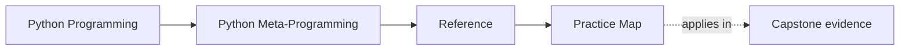

# Practice Map

<!-- page-maps:start -->
## Page Maps

<!-- page-maps:end -->

Use this page when you want to know what kind of exercise, proof loop, and capstone follow-up
fits each module. The goal is to keep practice cumulative instead of random.

## How to use this map

- Start from the module you just finished.
- Choose one primary practice surface.
- Choose one proof loop.
- Choose one capstone follow-up only after the module-level loop is clear.

That order prevents the capstone from replacing the learning path too early.

## Module practice surfaces

| Module | Primary practice surface | Main proof loop | Best capstone follow-up |
| --- | --- | --- | --- |
| 01 | object-model inspection exercises | explain one runtime fact without changing behavior | inspect manifest and registry outputs |
| 02 | inspection and introspection labs | compare what different inspection tools can observe honestly | inspect public runtime evidence before touching wrappers |
| 03 | signature and provenance exercises | preserve metadata while adding evidence | inspect callable surfaces and saved outputs |
| 04 | thin-wrapper refactors | wrap one function while keeping names, docs, and blame legible | inspect action wrappers and tests |
| 05 | decorator-policy exercises | compare policy-in-decorator versus explicit composition | inspect decorator seams and review routes |
| 06 | class-customization labs | solve a class problem without escalating to metaclasses yet | inspect framework edges before class-creation hooks |
| 07 | descriptor exercises | give one attribute rule an explicit owner and prove lookup behavior | inspect field descriptors and focused tests |
| 08 | descriptor-system design labs | compare one descriptor to a reusable descriptor framework | inspect validation and generated constructor behavior |
| 09 | metaclass escalation reviews | write down the lower-power tool that almost worked before using a metaclass | inspect registration and class-creation routes |
| 10 | runtime governance review | justify one mechanism choice against the whole power ladder | use the capstone as the final review specimen |

## Reusable proof loops

- observation loop: inspect shape first, then explain what changed, then decide whether transformation was necessary
- escalation loop: name the lowest honest tool, the invariant it could not own, and the new risk introduced by a stronger one
- governance loop: explain what a reviewer should still be able to understand one file at a time

## If you are stuck

| If you are stuck on... | Return to... | Before moving on, be able to... |
| --- | --- | --- |
| observation versus execution | Modules 01 and 02 | say what can be inspected without triggering behavior |
| wrapper honesty | Modules 03 through 05 | name which callable facts survived the wrapper |
| attribute ownership | Modules 06 through 08 | say why the rule belongs on attribute access |
| class-creation escalation | Modules 06 and 09 | name the lower-power tool that almost worked |
| runtime governance | Module 10 and the capstone | defend one mechanism choice with a proof route |

## Good stopping point

Stop when you can choose:

- one module-level practice task
- one proof loop
- one capstone follow-up

without defaulting to "just read more" or "just run the whole capstone."
