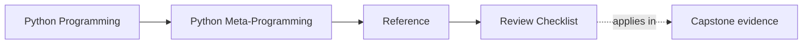

# Review Checklist

<!-- page-maps:start -->
## Page Maps

<!-- page-maps:end -->

Use this checklist when a dynamic design technically works but still needs an approval decision.

This page is not here to punish decorators, descriptors, or metaclasses. It is here to
make them earn trust. Good dynamic code should survive questions about ownership,
observability, rollback, and proof. If it cannot survive those questions, it is not ready.

## How to use this checklist

1. Name the mechanism under review.
2. Name the invariant it claims to own.
3. Walk the sections below in order.
4. Finish with one explicit decision: keep, tighten, move downward, or reject.

Do not skip to style arguments first. Start with necessity and evidence.

## 1. Mechanism choice

Ask:

- What lower-power tool was considered first?
- Which invariant actually requires this mechanism?
- Could the behavior still be explained clearly to a reviewer without a live walkthrough?

If you cannot answer those questions, the design is not justified yet.

## 2. Escalation

Ask:

- Could plain code, explicit objects, or a class decorator solve this before descriptors or metaclasses?
- If a descriptor or metaclass is involved, what exact invariant failed to fit at the lower rung?
- Is the stronger tool more invasive than the value it adds?

Advanced tools do not get credit just for existing.

## 3. Observability

Ask:

- Do signature, name, docstring, and traceback evidence survive wrapping?
- Can a reviewer inspect the runtime shape without executing business actions?
- Are import-time or class-definition-time side effects explicit and deterministic?

If observability falls apart, the design is already too expensive.

## 4. Testability

Ask:

- Is any registry, cache, or global hook resettable in tests?
- Are failure cases tested, not only happy paths?
- Can the proof route demonstrate the claim from the public surface instead of private folklore?

Passing tests are not enough if the tests still hide the real mechanism cost.

## 5. Security and governance

Ask:

- Is dynamic execution excluded from untrusted input paths?
- Are public hooks, names, and contracts stable enough to document?
- Is there a believable rollback or disable path if the mechanism causes trouble later?

The more global the mechanism, the stronger this section becomes.

## Rejection signals

Move toward rejection or redesign if:

- the mechanism was chosen mainly because it felt advanced
- import-time work is hidden behind vague contracts
- the code is harder to debug than an explicit alternative would be
- the proof route depends more on trust in the author than on inspectable evidence
- the design only sounds good while the author is narrating it

## Decision table

| Decision | When it fits |
| --- | --- |
| keep as is | the mechanism is necessary, observable, and proportionately proven |
| keep with tighter proof | the design may be acceptable, but its current evidence is too weak |
| move to a lower-power boundary | the invariant is real, but the current owner is too strong |
| reject outright | the mechanism is unjustified, unreviewable, or governance-hostile |

## Good stopping point

Leave this page when you can say:

- what the mechanism owns
- why that owner is justified or not
- what proof route supports the decision
- which decision you would record in a review
