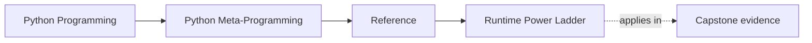

# Runtime Power Ladder

<!-- page-maps:start -->
## Page Maps

<!-- page-maps:end -->

Use this page when the mechanism looks powerful and the real question is:

> how far up the runtime ladder did this design climb, and did it actually need to?

The ladder is not a prestige chart. It is a review tool. Each upward move buys power but
also increases blast radius, proof cost, and the chance that a maintainer will need a live
tour just to understand what happens.

## The five rungs

From lower power to higher power:

1. explicit code and ordinary objects
2. wrappers and decorators
3. descriptors and attribute-level control
4. metaclasses and class-creation hooks
5. process-wide dynamic mechanisms such as import hooks, AST transforms, or dynamic execution

Going higher is not automatically wrong. It means the design now owes stronger answers
about ownership, observability, reversibility, and proof.

## Read the ladder as a review sequence

### 1. Explicit code and ordinary objects

Start here first.

Choose this rung when:

- a function, method, helper, or class can own the behavior directly
- the behavior is local enough that call timing and ownership stay obvious

Why this is the default:

- timing is visible
- ownership is explicit
- debugging tends to stay straightforward

### 2. Wrappers and decorators

Move here when call-time behavior really belongs around a callable.

Good uses:

- thin logging
- light validation
- explicit registration

What this rung owes:

- preserved metadata and signatures
- understandable tracebacks
- clear separation between transformation and policy sprawl

### 3. Descriptors and attribute-level control

Move here when attribute access is the real owner of the rule.

Good uses:

- field-level validation
- coercion at assignment or lookup
- reusable per-field contracts

What this rung owes:

- explicit source of truth for state
- inspectable per-instance behavior
- protection against turning one field abstraction into hidden framework architecture

### 4. Metaclasses and class-creation hooks

Move here only when the invariant must be owned before the class exists as a finished object.

Good uses:

- declaration-time namespace control
- deterministic registration at class definition time
- class-shape enforcement that lower rungs cannot own honestly

What this rung owes:

- visible import-time effects
- deterministic and resettable behavior
- a clear explanation of why decorators, helpers, or explicit registration were not enough

### 5. Process-wide dynamic mechanisms

Move here only for tooling-grade or tightly bounded trusted-runtime cases.

Good uses:

- instrumentation
- tracing or coverage support
- carefully bounded trusted code generation

What this rung owes:

- explicit process-wide blast radius
- disable and cleanup paths
- honest trust-boundary language instead of vague flexibility claims

## The approval question

For any rung above the first, ask:

> What does this rung own that the rung below it could not own honestly enough?

If the answer is vague, decorative, or mostly about elegance, the design should move downward.

## What to compare at each step

| Current rung | Ask what the rung below almost solved | Ask what new cost this rung introduced |
| --- | --- | --- |
| decorators | could explicit code have stayed clear enough | what metadata or debugging clarity might be lost |
| descriptors | could a property or explicit method have owned the rule | what lookup complexity and hidden storage risk appeared |
| metaclasses | could a class decorator or explicit registration have worked | what import-time or class-creation opacity appeared |
| process-wide mechanisms | could a bounded local mechanism have solved the problem | what global trust, rollback, or process-order risks appeared |

## Quick decisions

- Keep a descriptor when one field contract is truly the owner.
- Change a wrapper that hides signature or traceback evidence.
- Reject a metaclass when a class decorator or registration helper would stay clearer.
- Reject import-hook discovery when explicit imports or entry points keep the runtime more visible.

## Good stopping point

Leave this page when you can say:

- which rung the design is on
- what the rung below almost solved
- what extra blast radius the chosen rung introduced
- what proof route should pay for that extra power
