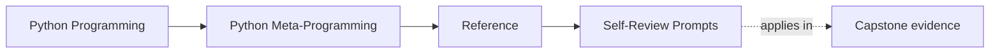

# Self-Review Prompts

<!-- page-maps:start -->
## Page Maps

<!-- page-maps:end -->

Use these prompts after each module cluster to check whether the course ideas are becoming
operational rather than merely familiar. A good self-review prompt should force you to explain,
compare, and justify, not just remember names.

## How to use these prompts

- Answer aloud or in writing without reopening the module first.
- If you stall, name exactly what kind of gap you hit: mechanism, boundary, proof, or sequence.
- Return only to the smallest surface that closes that gap.

## Modules 01 to 03

- Can I explain what exists at runtime before any decorator or descriptor changes behavior?
- Can I distinguish safe observation from value resolution that may execute user code?
- Can I say which callable facts are strong evidence and which provenance details are only best-effort?

## Modules 04 to 06

- Can I explain what a wrapper changed at definition time and at call time?
- Can I say why a class decorator or property might be enough before reaching for stronger hooks?
- Can I point to one example where moving behavior to a lower-power boundary would make the design clearer?

## Modules 07 to 09

- Can I trace one descriptor-backed attribute from declaration to per-instance storage?
- Can I explain why a descriptor or metaclass owns the rule better than a plainer alternative?
- Can I name the exact moment when class-creation control becomes necessary?

## Module 10 and mastery review

- Can I explain which runtime powers I would still reject even if they technically work?
- Can I point to one capstone surface that proves the runtime stayed observable?
- Can I describe how this design would be debugged by someone who did not write it?

## If you cannot answer yet

| If the gap is about... | Return to... |
| --- | --- |
| observation versus execution | Modules 01 and 02, then `make manifest` |
| wrapper honesty | Modules 03 through 05, then `make signatures` or `make trace` |
| attribute ownership | Modules 06 through 08, then `make field` |
| metaclass escalation | Modules 06 and 09, then `make registry` |
| governance judgment | Module 10, [Runtime Power Ladder](runtime-power-ladder.md), and the capstone review routes |

## Good stopping point

Stop when you can answer at least one prompt from each stage without reopening the lesson immediately and can name the smallest surface you would revisit for the next gap.
