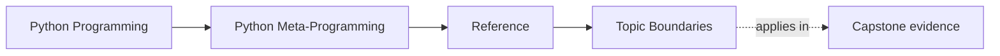

# Topic Boundaries

<!-- page-maps:start -->
## Page Maps

<!-- page-maps:end -->

Use this page when a topic seems related to metaprogramming but you are no longer sure
whether it belongs in the core of this course, on its edge, or outside it.

That matters because a course gets weak fast when every dynamic Python topic is treated as
equally central. The result is usually either a trick catalog or a framework tour. This
course is trying to stay narrower and more teachable than that.

## Core topic boundary

This course is centrally about runtime ownership, observability, and justified escalation.

Core topics are the ones that answer questions like:

- what exists at runtime
- how can it be inspected safely
- where should a dynamic behavior live
- what lower-power tool almost solved the problem
- when does a stronger hook become justified
- what proof and governance should a powerful mechanism owe

If the topic changes where runtime behavior lives, how observable it remains, or how a
higher-power hook is justified, it belongs in the center of the course.

## Adjacent but not central topics

These matter, but they support the course rather than define it:

- static typing details beyond what is needed for annotations and reviewability
- framework APIs beyond the runtime pressure they create
- packaging and deployment mechanics
- performance tuning after the mechanism choice is already honest
- implementation internals beyond the point where they clarify a runtime boundary

The course should touch these when they sharpen judgment, not turn into a survey of them.

## Outside the course center

These are not the main subject here:

- beginner Python syntax for functions, classes, decorators, or properties
- broad framework tutorials for Django, FastAPI, SQLAlchemy, or Pydantic
- a full security curriculum beyond the dynamic-execution boundaries taught here
- deep compiler, bytecode, or import-machinery work for its own sake
- general architecture that does not depend on metaprogramming choices

Those subjects may matter in life, but they are not where this course should spend most of
its depth budget.

## Common boundary confusions

| Confusion | Better boundary |
| --- | --- |
| metaprogramming means every dynamic trick Python allows | metaprogramming here means dynamic behavior that must stay observable, reviewable, and justified against lower-power alternatives |
| if a framework uses decorators or descriptors, the framework API is the curriculum | the framework is an example of pressure, not the subject of the course |
| using `inspect` automatically makes a design transparent | transparency also depends on what executes, what survives publicly, and who owns the behavior |
| metaclasses are the advanced destination | metaclasses are the narrowest justified high-power tool, not the prestige target |
| governance belongs outside a mechanics course | governance belongs here because runtime power becomes risky exactly when teams stop reviewing it well |

## Practical use

- Stay inside the course when the question is about ownership, escalation, observability, or proof.
- Use adjacent material when the question is mostly framework commands or vendor-specific APIs.
- Leave the course center when the topic is beginner syntax or deep implementation hacking for its own sake.

## Good stopping point

Leave this page when you can say:

- whether the topic is core, adjacent, or outside scope
- why it belongs there
- what kind of source should teach it next
