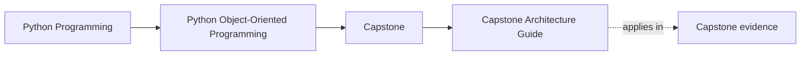
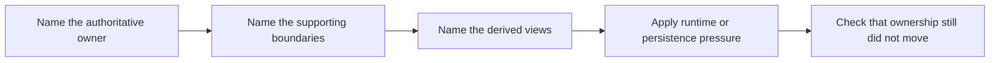

# Capstone Architecture Guide

<!-- page-maps:start -->
## Page Maps

<!-- page-maps:end -->

Use this guide when the real question is not "what does the code do" but "why is this
responsibility here instead of somewhere else?" The capstone is small, but its shape is
strict. That strictness is the lesson.

## The architectural claim

The monitoring system is built so that domain truth remains visible under change:

- the aggregate decides whether rules may be added, activated, evaluated, or retired
- policy objects vary how evaluation works without taking ownership away from the aggregate
- emitted events describe what happened after the domain acts
- projections and read models derive views from those events
- runtime code coordinates effects and persistence around the domain
- the unit of work protects rollback and persistence boundaries without becoming business logic

If that ownership split drifts, the system may still run, but the course stops teaching
good OOP.

## The six boundaries that matter

| Boundary | Main file | Owns | Does not own |
| --- | --- | --- | --- |
| application surface | `application.py` | learner-facing commands and scenario-level composition | lifecycle truth or evaluation semantics |
| aggregate | `model.py` | rule lifecycle, invariants, alert creation, and domain events | adapters, publication, or persistence flow |
| evaluation seam | `policies.py` | interchangeable rule-evaluation behavior | authority over when rules may exist or change state |
| derived views | `read_models.py` and `projections.py` | active-rule indexes, incident history, and open-incident views | the source of truth |
| runtime coordination | `runtime.py` | sourcing samples, publishing alerts, applying projections, and committing work | rule truth |
| persistence boundary | `repository.py` | snapshots, rollback, and commit mechanics | hidden domain policy |

## Read the architecture in the right order

1. `model.py`
2. `policies.py`
3. `events.py`
4. `read_models.py` and `projections.py`
5. `runtime.py`
6. `repository.py`
7. `tests/test_policy_lifecycle.py` and `tests/test_runtime.py`

That order keeps the authoritative owner visible before you introduce coordination and
rollback pressure.

## One design question per boundary

| Boundary | Ask this question |
| --- | --- |
| aggregate | Which state changes would be dangerous if another layer could perform them directly? |
| evaluation seam | Which variation can change without rewriting the aggregate? |
| events | What happened that downstream readers may know without becoming authoritative? |
| projections | Which views are helpful to read but dangerous to trust as source state? |
| runtime | Which effects must happen around the domain without redefining it? |
| repository and unit of work | Which failures should roll back the saved state without moving policy into storage code? |

## The architecture under real pressure

The runtime tests make the design pressure visible:

- `test_runtime_coordinates_activation_projection_and_alert_publication` shows that runtime code can activate rules, run evaluations, publish alerts, and update projections without becoming the rule owner.
- `test_runtime_retirement_updates_read_models` shows that a domain retirement event is what clears derived views, not a projection deciding to mutate the aggregate.
- `test_runtime_rolls_back_projection_updates_when_sink_fails` shows why rollback belongs with the unit of work and runtime coordination, not inside the aggregate.

The lifecycle tests make the aggregate pressure visible:

- the policy emits registration, activation, and retirement events
- duplicate active metric/window signatures are blocked in the aggregate
- timezone-aware UTC timestamps are created at the domain event layer
- retirement clears open incidents through downstream event handling

## Dependency direction that keeps the design honest

| Surface | May depend on | Should not depend on |
| --- | --- | --- |
| `application.py` | runtime, domain-facing command objects, and snapshots | projection internals as a source of truth |
| `model.py` | value types, domain events, and evaluation abstractions | runtime sinks, CLI surfaces, or repository details |
| `policies.py` | rules and samples | projection or persistence mechanics |
| `runtime.py` | repository, evaluator, sink, active-rule index, and incident ledger | projection state as authority for domain decisions |
| `read_models.py` and `projections.py` | emitted events | aggregate mutation paths |
| `repository.py` | aggregate snapshots and rollback coordination | business rules hidden from review |

## Drift signals to catch early

- `runtime.py` starts deciding whether a rule is legal instead of `model.py`
- a projection must be consulted before you know whether the aggregate may change
- a new evaluation mode forces edits in both `model.py` and `runtime.py`
- repository code becomes the only place where a domain rule is still visible
- tests prove behavior, but you can no longer point to a clear owner in the code

## Change placement rules

| If the change is... | Start here | Why |
| --- | --- | --- |
| new lifecycle restriction | `model.py` | lifecycle authority belongs to the aggregate |
| new evaluation mode | `policies.py` | replaceable behavior should stay at the evaluation seam |
| new derived view | `read_models.py` or `projections.py` | projections must stay downstream of events |
| new source or sink | `runtime.py` | coordination belongs outside the domain |
| stronger rollback or persistence policy | `repository.py` | storage pressure should adapt to the model |
| clearer public scenario command | `application.py` | the learner-facing surface should stay explicit |

## A fast architecture review loop

1. Name the current responsibility.
2. Point to the authoritative file.
3. Point to the nearest supporting file.
4. Point to the derived view, if any.
5. Point to the test or bundle that would fail first if ownership moved.

If you cannot do all five, the architecture answer is still blurry.

## Exit check

Leave this page only when you can say:

> The domain owner is ____, the support boundary is ____, the derived view is ____,
> and the first proof route I would check is ____.
