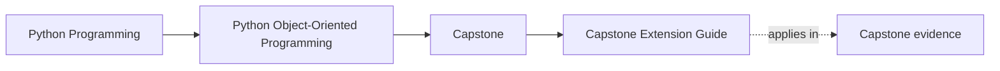
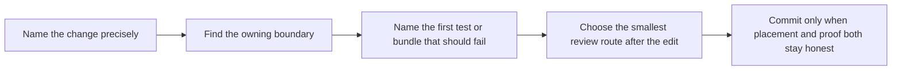

# Capstone Extension Guide

<!-- page-maps:start -->
## Page Maps

<!-- page-maps:end -->

Use this page before editing the capstone. The central extension question is not "where
can I make this work?" It is "where does this change belong if I still want the design
to be readable next year?"

## The first placement rule

If you cannot name the owning boundary before you touch a file, you are not ready to
edit the capstone yet.

## Where common changes belong

| Change type | Owning file or boundary | Why it belongs there |
| --- | --- | --- |
| new lifecycle restriction | `model.py` | lifecycle truth belongs to the aggregate |
| new evaluation mode | `policies.py` | evaluation variation should stay replaceable instead of widening the aggregate |
| new public command or scenario step | `application.py`, `demo.py`, or `cli.py` | the learner-facing surface should stay explicit |
| new source, sink, or orchestration path | `runtime.py` | integration flow belongs outside domain truth |
| new repository or rollback behavior | `repository.py` | persistence should adapt to the domain rather than redefine it |
| new derived view | `read_models.py` or `projections.py` | derived state must stay downstream of domain events |
| new proof or learner route | saved bundle route plus matching guide | review surfaces are part of the teaching contract |

## Extension questions that prevent drift

- Does this change alter what is true, or only how truth is evaluated?
- Does this change alter orchestration, or only how the story is presented?
- Does this change require a new derived view, or is it trying to move authority into one?
- Which test or saved bundle would expose a wrong placement choice first?

## High-risk extension smells

- a "small" feature requires simultaneous edits in aggregate, runtime, and projection code
- a new rule mode feels easier to implement in the runtime than in `policies.py`
- a persistence change is easier to explain in storage terms than in domain terms
- a new public route requires reaching into internals because the application surface is no longer enough
- the change passes tests, but the correct owning file now feels arguable

## Update obligations by surface

| If you change... | Recheck at minimum |
| --- | --- |
| `model.py` | lifecycle tests, walkthrough expectations, and the proof guide |
| `policies.py` | policy evaluation tests and `rate_of_change.txt` or equivalent variants |
| `runtime.py` | runtime tests, walkthrough bundle, and rollback behavior |
| `repository.py` | unit-of-work tests and verification bundle |
| `read_models.py` or `projections.py` | history, snapshot, and retirement outputs |
| `application.py`, `demo.py`, or `cli.py` | walkthrough bundle and learner-facing command routes |

## Minimum honest proof after an extension

1. Run the nearest test surface.
2. Run the smallest bundle route that a learner would use to inspect the changed behavior.
3. Escalate to `capstone-confirm` if the boundary itself changed.
4. Escalate to `proof` if the published teaching route changed.

## Extension route by question

| If you are asking... | Start here |
| --- | --- |
| "where should a new rule mode go?" | `policies.py` and policy evaluation tests |
| "where should a new invariant go?" | `model.py` and lifecycle tests |
| "where should a new integration go?" | `runtime.py` and runtime tests |
| "where should a new review surface go?" | `command-guide.md`, `capstone-proof-guide.md`, and bundle outputs |
| "where should a new read concern go?" | `read_models.py`, `projections.py`, and snapshot outputs |

## Before-you-commit checklist

- I can name the owning boundary in one sentence.
- I can name the first proof surface that should fail if placement is wrong.
- I can explain why a neighboring boundary should *not* own this change.
- I can point to the smallest route another reviewer should use after my edit.

## Exit check

Leave this page only when you can say:

> This change belongs in `____`, not `____`, because `____` owns the behavior and
> `____` would catch the wrong placement first.
