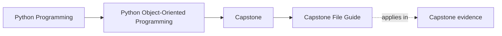
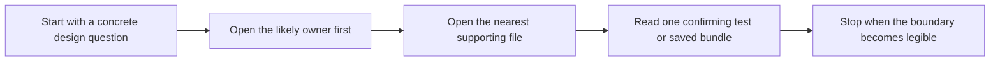

# Capstone File Guide

<!-- page-maps:start -->
## Page Maps

<!-- page-maps:end -->

Use this guide when you want a code-reading route that preserves the design. The wrong
way to read this capstone is alphabetically. The right way is to open the file most
likely to own the current behavior, then move outward only as far as needed.

## Read the package from authority outward

1. `src/service_monitoring/application.py`
2. `src/service_monitoring/model.py`
3. `src/service_monitoring/policies.py`
4. `src/service_monitoring/events.py`
5. `src/service_monitoring/read_models.py`
6. `src/service_monitoring/projections.py`
7. `src/service_monitoring/runtime.py`
8. `src/service_monitoring/repository.py`
9. `src/service_monitoring/scenario.py`, `demo.py`, and `cli.py`
10. `tests/`

That order deliberately delays infrastructure and tooling until the domain and its
derived views are already clear.

## What each file family is doing

| File or group | What it owns | What it should not own |
| --- | --- | --- |
| `application.py` | scenario-facing commands such as policy creation, rule registration, activation, retirement, and snapshot assembly | domain invariants or evaluation logic |
| `model.py` | value types, rule lifecycle, aggregate ownership, alert creation, and invariant enforcement | delivery concerns, storage mechanics, or projection state |
| `policies.py` | replaceable evaluation modes such as threshold, consecutive breach, and rate-of-change behavior | aggregate lifecycle decisions |
| `events.py` | durable statements about what happened | orchestration or projection logic |
| `read_models.py` | incident history and open-incident views derived from events | authoritative lifecycle decisions |
| `projections.py` | active-rule indexes derived from activation and retirement events | the domain model itself |
| `runtime.py` | coordination across repository, evaluator, sink, and projections after the domain has acted | the source of domain truth |
| `repository.py` | persistence and rollback mechanics through the in-memory repository and unit of work | business meaning of a rule or policy |
| `scenario.py`, `demo.py`, `cli.py` | review and learner-facing routes into the shipped scenarios and bundles | new ownership rules |
| `tests/` | executable proof of the ownership story | replacement for understanding the model |

## Read by question, not by filename

| If your question is... | Open first | Then open |
| --- | --- | --- |
| Who owns rule lifecycle transitions? | `model.py` | `tests/test_policy_lifecycle.py` |
| How does a learner drive the system without reaching into internals? | `application.py` | `demo.py` and `tests/test_application.py` |
| Where does evaluation variation live? | `policies.py` | `tests/test_policy_evaluation.py` |
| Which surfaces are derived instead of authoritative? | `events.py`, `read_models.py`, and `projections.py` | `tests/test_runtime.py` |
| Where does orchestration stop and domain ownership begin? | `runtime.py` | `application.py`, `model.py`, and the walkthrough bundle |
| How is rollback or persistence pressure represented? | `repository.py` | `tests/test_unit_of_work.py` |
| Which public routes are safe to expose or extend? | `application.py` and `cli.py` | `tests/test_public_api.py` and [Capstone Extension Guide](capstone-extension-guide.md) |

## The most common wrong reading orders

- starting with `runtime.py`, then assuming the domain lives there
- starting with tests and never locating the actual owner
- starting with projections before the emitted events are clear
- starting with CLI surfaces before the aggregate and application façade are visible

## A reader-first route for each stage of the course

| Course stage | Best first files | Why |
| --- | --- | --- |
| semantics and state | `model.py`, then `application.py` | the learner needs the owner of meaning before the delivery surface |
| collaboration and change | `application.py`, `policies.py`, `events.py`, `read_models.py`, `projections.py` | the learner needs to see who collaborates without flattening the model |
| runtime and persistence | `runtime.py`, `repository.py`, and unit-of-work tests | the learner now needs to see how support layers adapt to the model |
| proof and governance | `tests/`, `cli.py`, `demo.py`, and saved bundles | the learner needs to see how claims are defended publicly |

## A strong first reading loop

1. Open the likely owner.
2. Write one sentence describing what that file is authoritative for.
3. Open the nearest support file or test.
4. Check whether the support layer depends on the owner or tries to redefine it.
5. Stop when the ownership answer becomes stable.

## When to bring in the local capstone docs

- Use the package guide when the package boundary itself is the question.
- Use the architecture guide when ownership still feels fuzzy after reading two files.
- Use the proof guide when you understand the files but do not know which evidence route matches the claim.
- Use the extension guide when you can already see the owner and now need safe change placement.

## Exit check

Leave this page only when you can say:

> I know which file owns this behavior, which nearby file only supports it, and which test
> or bundle proves that split.
