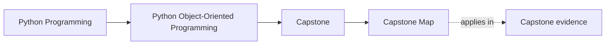
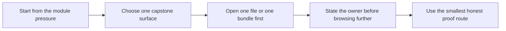

# Capstone Map

<!-- page-maps:start -->
## Page Maps

<!-- page-maps:end -->

Use this page when you know the current module pressure but do not yet know which
capstone surface should carry it. This page is not trying to summarize the whole
capstone. It is trying to answer one practical question:

> For this exact learning pressure, where should I enter the capstone first?

## The capstone offers four kinds of help

| Surface type | What it gives you | Best page |
| --- | --- | --- |
| story surfaces | the human scenario before file-reading begins | [Capstone Walkthrough](capstone-walkthrough.md) |
| code-reading surfaces | a disciplined file route that preserves boundaries | [Capstone File Guide](capstone-file-guide.md) |
| boundary-review surfaces | a way to name the authoritative owner of each responsibility | [Capstone Architecture Guide](capstone-architecture-guide.md) and [Capstone Review Worksheet](capstone-review-worksheet.md) |
| proof surfaces | executable routes and saved bundles that confirm the claim | [Command Guide](command-guide.md) and [Capstone Proof Guide](capstone-proof-guide.md) |

Choose the surface type that matches the question. Do not open all four by habit.

## Module-to-capstone bridge

| Module pressure | Open this first | Then use this page | Best first proof route |
| --- | --- | --- | --- |
| Module 1: semantics, identity, representation | `capstone/src/service_monitoring/model.py` | [Capstone File Guide](capstone-file-guide.md) | `inspect` |
| Module 2: role design, layering, ownership | `application.py` and `model.py` | [Capstone Architecture Guide](capstone-architecture-guide.md) | `capstone-walkthrough` |
| Module 3: state transitions and validation | `model.py` plus lifecycle tests or `rules.txt` | [Capstone Review Worksheet](capstone-review-worksheet.md) | `inspect` |
| Module 4: aggregates, events, derived views | `model.py`, `projections.py`, `read_models.py` | [Capstone Architecture Guide](capstone-architecture-guide.md) | `capstone-verify-report` |
| Module 5: failure handling, rollback, change pressure | `runtime.py`, `repository.py`, walkthrough or review outputs | [Capstone Review Worksheet](capstone-review-worksheet.md) | `capstone-verify-report` |
| Module 6: persistence, serialization, repository contracts | `repository.py` and unit-of-work tests | [Capstone File Guide](capstone-file-guide.md) | `capstone-verify-report` |
| Module 7: time, runtime boundaries, coordination | `runtime.py`, runtime tests, saved bundles | [Capstone Proof Guide](capstone-proof-guide.md) | `capstone-verify-report` |
| Module 8: tests, confidence, proof depth | verification bundle plus targeted tests | [Capstone Proof Guide](capstone-proof-guide.md) | `capstone-confirm` |
| Module 9: public routes, extension seams, compatibility | `application.py`, public tests, extension notes | [Capstone Extension Guide](capstone-extension-guide.md) | `proof` |
| Module 10: stewardship, hardening, final review | review worksheet, saved bundles, architecture surfaces | [Capstone Review Worksheet](capstone-review-worksheet.md) | `proof` |

## Fast route chooser

| If you are stuck on... | Do this next |
| --- | --- |
| "I understand the module, but not the system story." | read [Capstone Walkthrough](capstone-walkthrough.md), then run the walkthrough route |
| "I understand the story, but not which file owns it." | open [Capstone File Guide](capstone-file-guide.md) |
| "I know the file, but I cannot defend the boundary." | open [Capstone Architecture Guide](capstone-architecture-guide.md) |
| "I think I understand it, but I do not know how to prove it." | open [Command Guide](command-guide.md), then [Capstone Proof Guide](capstone-proof-guide.md) |
| "I want to change the design, but I do not trust my placement choice." | open [Capstone Extension Guide](capstone-extension-guide.md) |

## A safe route for missed-class learners

1. Name the current module pressure in plain words.
2. Use the bridge table above.
3. Open one file or one saved bundle first.
4. Explain who owns the behavior before opening a second page.
5. Use one proof route only after the ownership answer is visible.

This route matters because missed-class learners are the ones most likely to browse the
capstone as a monolith instead of entering from a real question.

## What not to do

- do not start with the strongest proof route when you still cannot name the owner
- do not start in `runtime.py` if the real pressure is still semantic or lifecycle-driven
- do not read projections first if the question is about authoritative state
- do not treat the capstone as one flat system when the module is stressing one boundary

## Exit check

Leave this map only when you can say:

> For this module pressure, I should start with `____`, check `____`, and prove it with
> `____`.
