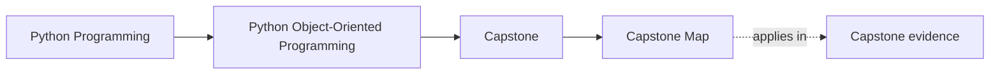
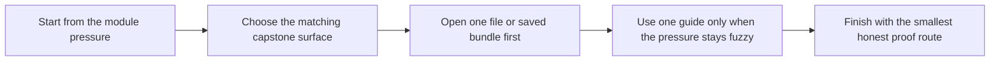

# Capstone Map

<!-- page-maps:start -->
## Page Maps

<!-- page-maps:end -->

Use this page when you know which module you are in but do not yet know which capstone
surface should carry the same pressure. The goal is not to browse every guide. The goal
is to move from chapter pressure to one concrete file, one concrete bundle, and one
concrete proof route.

## The capstone has four kinds of surfaces

| Surface type | What it gives you | Best pages |
| --- | --- | --- |
| scenario surfaces | the human story of policy creation, activation, evaluation, and incidents | [Capstone Walkthrough](capstone-walkthrough.md) |
| code-reading surfaces | a disciplined path through the package without flattening the design | [Capstone File Guide](capstone-file-guide.md) |
| boundary-review surfaces | a way to name the authoritative owner of each responsibility | [Capstone Architecture Guide](capstone-architecture-guide.md) and [Capstone Review Worksheet](capstone-review-worksheet.md) |
| proof surfaces | commands and saved bundles that confirm the design claim | [Command Guide](command-guide.md) and [Capstone Proof Guide](capstone-proof-guide.md) |

## Module-to-capstone bridge

| Module pressure | Open this first | Use this page next | Best proof route |
| --- | --- | --- | --- |
| Module 01: identity, equality, representation, and semantics | `capstone/src/service_monitoring/model.py` | [Capstone File Guide](capstone-file-guide.md) | `make PROGRAM=python-programming/python-object-oriented-programming inspect` |
| Module 02: role design, layering, and ownership | `capstone/src/service_monitoring/application.py` and `model.py` | [Capstone Architecture Guide](capstone-architecture-guide.md) | `make PROGRAM=python-programming/python-object-oriented-programming capstone-walkthrough` |
| Module 03: state transitions, validation, and legal operations | `model.py` plus lifecycle tests | [Capstone Review Worksheet](capstone-review-worksheet.md) | `make PROGRAM=python-programming/python-object-oriented-programming inspect` |
| Module 04: aggregates, events, and derived views | `model.py`, `projections.py`, and `read_models.py` | [Capstone Architecture Guide](capstone-architecture-guide.md) | `make PROGRAM=python-programming/python-object-oriented-programming capstone-verify-report` |
| Module 05: failure handling, rollback, and change pressure | `runtime.py` and `repository.py` | [Capstone Walkthrough](capstone-walkthrough.md) and [Capstone Review Worksheet](capstone-review-worksheet.md) | `make PROGRAM=python-programming/python-object-oriented-programming capstone-verify-report` |
| Module 06: persistence, serialization, and repository contracts | `repository.py` and unit-of-work tests | [Capstone File Guide](capstone-file-guide.md) | `make PROGRAM=python-programming/python-object-oriented-programming capstone-verify-report` |
| Module 07: runtime boundaries, time, and coordination | `runtime.py`, `tests/test_runtime.py`, and walkthrough bundles | [Capstone Proof Guide](capstone-proof-guide.md) | `make PROGRAM=python-programming/python-object-oriented-programming capstone-verify-report` |
| Module 08: tests, confidence, and proof depth | `capstone/tests/` and `pytest.txt` in the verification bundle | [Capstone Proof Guide](capstone-proof-guide.md) | `make PROGRAM=python-programming/python-object-oriented-programming capstone-confirm` |
| Module 09: public routes, extension seams, and compatibility | `application.py`, public tests, and extension notes | [Capstone Extension Guide](capstone-extension-guide.md) | `make PROGRAM=python-programming/python-object-oriented-programming proof` |
| Module 10: stewardship, hardening, and final review | saved bundles, review worksheet, and architecture surfaces | [Capstone Review Worksheet](capstone-review-worksheet.md) and [Capstone Proof Guide](capstone-proof-guide.md) | `make PROGRAM=python-programming/python-object-oriented-programming proof` |

## If you only need one next move

| If you are stuck on... | Do this next |
| --- | --- |
| "I understand the module, but not the system story." | read [Capstone Walkthrough](capstone-walkthrough.md), then run the walkthrough route |
| "I understand the story, but I do not know which file owns it." | open [Capstone File Guide](capstone-file-guide.md) |
| "I know the file, but I cannot defend the boundary." | open [Capstone Architecture Guide](capstone-architecture-guide.md) |
| "I think I understand it, but I do not know how to prove it." | open [Command Guide](command-guide.md), then [Capstone Proof Guide](capstone-proof-guide.md) |
| "I want to change the design, but I do not trust my placement choice." | open [Capstone Extension Guide](capstone-extension-guide.md) |

## What not to do

- do not start with the strongest proof route when you still cannot name the owner
- do not start in `runtime.py` if the current module pressure is still semantic
- do not read projections first if the current question is about authoritative state
- do not treat the capstone as one monolith when the module is only stressing one boundary

## A practical route for missed-class learners

1. Name the current module pressure in plain words.
2. Use the module bridge table above.
3. Open one file or one saved bundle first.
4. Explain who owns the behavior before opening a second page.
5. Use one proof route only after the ownership answer is visible.

## Exit check

Leave this map only when you can complete this sentence:

> For this module, I should start with ____, then check ____, and prove it with ____.
