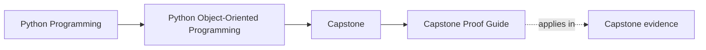
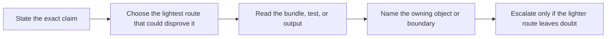

# Capstone Proof Guide

<!-- page-maps:start -->
## Page Maps

<!-- page-maps:end -->

This capstone should not be trusted because the prose sounds tidy. It should be trusted
only when you can point to a concrete route that would expose a wrong ownership choice.
That is the job of this page.

## The proof ladder

Different questions deserve different proof surfaces. Start with the cheapest route that
could prove you wrong.

| Route | What it produces | Best use |
| --- | --- | --- |
| `make PROGRAM=python-programming/python-object-oriented-programming inspect` | saved inspection bundle with `summary.txt`, `rules.txt`, `history.txt`, `timeline.txt`, `retirement.txt`, `rate_of_change.txt`, and `snapshot.json` | when you need to understand current state, lifecycle, or scenario variants |
| `make PROGRAM=python-programming/python-object-oriented-programming capstone-walkthrough` | saved walkthrough bundle with `walkthrough.txt` and matching local docs | when you need the story before the implementation details |
| `make PROGRAM=python-programming/python-object-oriented-programming capstone-verify-report` | pytest output plus saved scenario evidence | when behavior and review bundles must agree |
| `make PROGRAM=python-programming/python-object-oriented-programming capstone-confirm` | the strongest local confirmation route | when the owner is already clear and you need a high-confidence check |
| `make PROGRAM=python-programming/python-object-oriented-programming proof` | the full published learner route | when reviewing the capstone as a public teaching artifact |

## Choose the route by claim

| If the claim is about... | Inspect first | Best route |
| --- | --- | --- |
| lifecycle rules, event emission, or aggregate ownership | `tests/test_policy_lifecycle.py` and `rules.txt` | `inspect` |
| replaceable evaluation behavior | `tests/test_policy_evaluation.py` and `rate_of_change.txt` | `capstone-verify-report` |
| runtime coordination versus domain truth | `tests/test_runtime.py`, `timeline.txt`, and `walkthrough.txt` | `capstone-walkthrough` or `capstone-verify-report` |
| public scenario flow | `application.py`, `demo.py`, and `walkthrough.txt` | `capstone-walkthrough` |
| rollback, persistence, or failure handling | `tests/test_unit_of_work.py`, `tests/test_runtime.py`, and `pytest.txt` | `capstone-verify-report` or `capstone-confirm` |
| whole-capstone trust as a learner-facing artifact | walkthrough, inspection, and verification bundles together | `proof` |

## What each saved artifact is good for

| Artifact | Best question it answers |
| --- | --- |
| `summary.txt` | what policy, rule, and incident state exists right now |
| `rules.txt` | which rules are draft, active, or retired |
| `history.txt` | what derived incident history has accumulated by metric |
| `timeline.txt` | what sequence of steps the scenario actually follows |
| `retirement.txt` | what changes when a rule is retired and open incidents are cleaned up |
| `rate_of_change.txt` | how the alternate evaluation mode behaves without changing aggregate ownership |
| `snapshot.json` | what the shipped state surface looks like in a stable structured format |
| `walkthrough.txt` | how the system reads as a human story before you dive into files |
| `pytest.txt` | which executable checks currently defend the behavior |

## Honest escalation rules

- If the question is "what happened?" start with `inspect`.
- If the question is "how does the story unfold?" start with the walkthrough bundle.
- If the question is "did tests and saved state agree?" use the verification bundle.
- If the question is "does the strongest local route still hold?" use `capstone-confirm`.
- If the question is "is the whole published teaching route still coherent?" use `proof`.

Do not start with `proof` merely because it feels safer. A heavy route can hide a fuzzy
question just as easily as it can answer one.

## Signs you picked the wrong proof route

- the command finished, but you still cannot name the owning object
- the bundle looks rich, but none of its files touch the claim you care about
- the route proves three different things and leaves the original question blurrier
- you escalated because you were uncomfortable with choosing a narrower claim

## A good proof review loop

1. Write the claim in one sentence.
2. Name the object or boundary that should own it.
3. Choose the lightest route that could expose a contradiction.
4. Read the output before rereading the code.
5. Confirm whether the evidence matches the claimed owner.
6. Escalate only if doubt remains.

## Proof routes by course stage

| Course stage | Start here | Escalate to |
| --- | --- | --- |
| semantics and state | `inspect` | `capstone-verify-report` |
| collaboration and runtime pressure | `capstone-walkthrough` or `capstone-verify-report` | `capstone-confirm` |
| public trust and stewardship | `capstone-confirm` | `proof` |

## Exit check

Leave this page only when you can say:

> The claim is ____, the likely owner is ____, the first route I would use is ____,
> and I would escalate to ____ only if that route leaves doubt.
