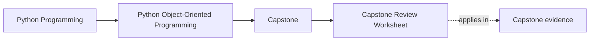
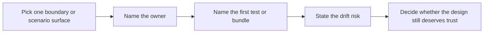

# Capstone Review Worksheet

<!-- page-maps:start -->
## Page Maps

<!-- page-maps:end -->

Use this page after a module, after a rewrite, or before an extension. It is not a page
for praise. It is a page for pressure. The goal is to answer whether the capstone still
teaches good object-oriented design under review.

## Ownership review

- Can you point to one authoritative owner for rule lifecycle?
- Can you point to one authoritative owner for alert creation?
- Can you point to one clear seam for evaluation variation?
- Can you explain why `runtime.py` is not the domain model?
- Can you explain why projections and read models are useful but non-authoritative?

## Boundary review

| Boundary | Review question | Evidence to inspect first |
| --- | --- | --- |
| aggregate | Does `model.py` still decide the legal lifecycle transitions? | `tests/test_policy_lifecycle.py` and `rules.txt` |
| evaluation seam | Can a new evaluation mode land in `policies.py` without widening the aggregate? | `tests/test_policy_evaluation.py` and `rate_of_change.txt` |
| runtime | Does coordination stay outside domain truth? | `tests/test_runtime.py`, `timeline.txt`, and `walkthrough.txt` |
| projections and read models | Are the derived views downstream of events instead of upstream of authority? | `history.txt`, `snapshot.json`, and retirement scenarios |
| persistence and rollback | Would a sink or storage failure roll back state without relocating business rules? | `tests/test_unit_of_work.py`, `tests/test_runtime.py`, and `pytest.txt` |
| public surface | Can a learner drive the scenario without reaching into internals? | `application.py`, `demo.py`, and `walkthrough.txt` |

## Drift warnings

Mark these aggressively. One "yes" is enough to justify a deeper review.

- Does the runtime now answer a question that used to belong to the aggregate?
- Does a projection need to be consulted before the aggregate can decide?
- Does a persistence concern now hide domain policy from a reader?
- Does one feature force changes in aggregate, runtime, and projection code at the same time?
- Does the strongest proof route still pass, but the owning boundary feel less legible?

## Change-safety review

- If a new rule mode arrived tomorrow, would the first edit point be obvious?
- If a new incident sink arrived tomorrow, could it stay outside the aggregate?
- If rollback semantics changed tomorrow, would `repository.py` be the natural pressure point?
- If a learner asked where state truth lives, would you answer with one file, not three?

## Proof review

| Question | Best first route |
| --- | --- |
| What state exists right now? | `inspect` |
| How does the scenario unfold? | `capstone-walkthrough` |
| Do tests and saved review artifacts agree? | `capstone-verify-report` |
| Does the strongest local route still hold? | `capstone-confirm` |
| Does the published learner route still deserve trust? | `proof` |

## Review prompts by course stage

| Course stage | Most important question |
| --- | --- |
| Modules 01-03 | Which semantic or lifecycle rule would fail first if ownership drifted? |
| Modules 04-07 | Which boundary is authoritative once collaboration, projections, and runtime pressure are involved? |
| Modules 08-10 | Which saved route proves the design to someone who did not watch the implementation happen? |

## Minimum honest review notes

When you finish a capstone review, you should be able to fill in all four blanks:

1. The owner is `____`.
2. The strongest supporting boundary is `____`.
3. The first proof route I would show another reviewer is `____`.
4. The first place I would expect drift is `____`.

## Stop conditions

Stop and reopen the architecture or extension pages if either becomes true:

- you can describe behavior, but not ownership
- you can name a route, but not why that route matches the claim

## Exit check

Leave this worksheet only when you have a review verdict that sounds like this:

> The design still deserves trust because `____` owns `____`, `____` remains derived,
> and `____` would fail first if that split drifted.
