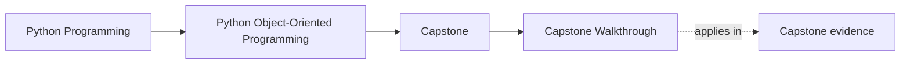
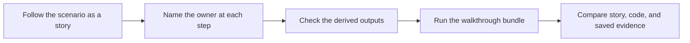

# Capstone Walkthrough


<!-- page-maps:start -->
## Page Maps




<!-- page-maps:end -->

Use this page when you want the capstone as a human story before you read it as a file
tree. That story matters because object-oriented design becomes easier to judge when you
can describe what the system is trying to do in plain language.

## The walkthrough route

Run one of these first:

```bash
make PROGRAM=python-programming/python-object-oriented-programming capstone-walkthrough
```

or inside `capstone/`:

```bash
make tour
```

That route writes a walkthrough bundle containing `walkthrough.txt`, the local capstone
docs, and a bundle manifest. Read `walkthrough.txt` before opening more internals.

## The scenario in plain language

The walkthrough shows a monitoring team doing six things:

1. create one monitoring policy
2. register rules while they are still drafts
3. activate the rules deliberately
4. feed metric samples into the system
5. publish incidents when rule conditions are met
6. inspect the resulting active-rule index and incident state

The point is not merely that those steps happen. The point is that each step has an
owner that remains stable under change.

## What to notice at each step

| Walkthrough step | Owner to notice first | Why it matters |
| --- | --- | --- |
| create policy | `application.py` handing off to `model.py` | the public route should not become the business owner |
| register rules | `MonitoringPolicy` in `model.py` | the aggregate accepts or rejects rule setup |
| activate rules | aggregate lifecycle logic | legal transitions belong to the domain model |
| observe samples | aggregate plus evaluation policies | variation lives in `policies.py` without relocating ownership |
| publish incidents | `runtime.py` coordinating sink and projections | orchestration happens after the domain decides |
| inspect derived state | `read_models.py` and `projections.py` | useful views remain downstream of truth |

## The walkthrough is good if you can answer these

- Who owns lifecycle transitions?
- Who decides whether an alert exists?
- Which outputs are derived views instead of authoritative state?
- Which part of the story is runtime coordination rather than domain meaning?

If you cannot answer those after reading the walkthrough bundle, do not escalate to a
heavier proof route yet. Re-read the walkthrough and compare it with the file guide or
architecture guide first.

## Best companion pages

- [Capstone File Guide](capstone-file-guide.md) when you want to see where the story lives in code
- [Capstone Architecture Guide](capstone-architecture-guide.md) when the owner of a step still feels fuzzy
- [Command Guide](command-guide.md) when you want the next executable route after the walkthrough
- [Capstone Proof Guide](capstone-proof-guide.md) when you want to escalate from narrative to stronger evidence

## Best source files to keep beside the walkthrough

- `capstone/src/service_monitoring/demo.py`
- `capstone/src/service_monitoring/application.py`
- `capstone/src/service_monitoring/model.py`
- `capstone/src/service_monitoring/runtime.py`
- `capstone/src/service_monitoring/read_models.py`

## Common walkthrough mistakes

- reading the bundle as if it were only demo output instead of a boundary map
- focusing on runtime coordination before naming the aggregate owner
- treating the read-model snapshot as if it explained the domain by itself
- using the walkthrough as final proof when the real question is behavioral or architectural

## A strong follow-up route

1. Read `walkthrough.txt`.
2. Name the owner at each step in one sentence.
3. Open `application.py` and `model.py`.
4. Open `runtime.py` only after the aggregate owner is clear.
5. Move to [Capstone Proof Guide](capstone-proof-guide.md) if you now need stronger evidence.

## Exit check

Leave this page only when you can retell the scenario as:

> The learner drives the system through `____`, the domain truth lives in `____`,
> orchestration happens in `____`, and the derived outputs live in `____`.
