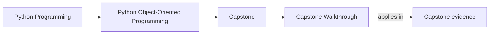
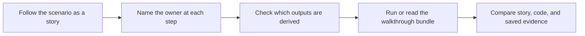

# Capstone Walkthrough


<!-- page-maps:start -->
## Page Maps




<!-- page-maps:end -->

Use this page when you need the system story before you need the file tree. Many learners
read code too early and then mistake orchestration or output surfaces for the domain
center. The walkthrough exists to prevent that.

## Start with the walkthrough route

From the repository root:

```bash
make PROGRAM=python-programming/python-object-oriented-programming capstone-walkthrough
```

Or inside `capstone/`:

```bash
make tour
```

That route writes a walkthrough bundle containing `walkthrough.txt`, matching local docs,
and a manifest. Read `walkthrough.txt` first. Do not start by opening five source files
and hoping the story emerges.

## The scenario in plain language

The walkthrough shows a monitoring team doing six things:

1. creating one monitoring policy
2. registering rules while they are still drafts
3. activating those rules deliberately
4. feeding metric samples into the system
5. publishing incidents when rule conditions are met
6. inspecting active-rule and incident outputs afterward

The educational purpose of the walkthrough is not mere narration. It is ownership
tracking: each step should make it easier to answer who decides, who coordinates, and
which outputs are only downstream views.

## What to notice at each step

| Walkthrough step | Owner to notice first | Why it matters |
| --- | --- | --- |
| create policy | `application.py` handing off to `model.py` | the public route should open the path, not own the business rule |
| register rules | `MonitoringPolicy` in `model.py` | the aggregate decides what rule setup is legal |
| activate rules | lifecycle logic in the aggregate | legal transitions belong to the model, not to nearby helpers |
| observe samples | aggregate plus evaluation policies | variation lives in `policies.py` without moving ownership out of the model |
| publish incidents | `runtime.py` coordinating sink and projections | orchestration happens after the domain has made the decision |
| inspect derived state | `read_models.py` and `projections.py` | useful views remain downstream of authoritative state |

## Questions the walkthrough should answer

After reading the bundle, you should be able to answer:

- who owns lifecycle transitions?
- who decides whether an incident exists?
- which outputs are derived views instead of authoritative truth?
- which part of the story is runtime coordination rather than domain meaning?

If you cannot answer those, do not escalate to stronger proof yet. Re-read the
walkthrough and compare it with one or two source files.

## Best files to keep beside the walkthrough

- `capstone/src/service_monitoring/demo.py`
- `capstone/src/service_monitoring/application.py`
- `capstone/src/service_monitoring/model.py`
- `capstone/src/service_monitoring/runtime.py`
- `capstone/src/service_monitoring/read_models.py`

Read them in roughly that order. The walkthrough is most useful when the story and the
files reinforce each other.

## Best companion pages

| If you now need... | Go here |
| --- | --- |
| a disciplined file-reading order | [Capstone File Guide](capstone-file-guide.md) |
| a sharper boundary explanation | [Capstone Architecture Guide](capstone-architecture-guide.md) |
| the next executable route after the story | [Command Guide](command-guide.md) |
| stronger evidence than narrative | [Capstone Proof Guide](capstone-proof-guide.md) |

## Common walkthrough mistakes

- treating the bundle as if it were only demo output instead of a boundary map
- focusing on runtime coordination before naming the aggregate owner
- reading the read-model snapshot as if it explained the domain by itself
- using the walkthrough as final proof when the real question is behavioral or architectural

## A strong follow-up route

1. Read `walkthrough.txt`.
2. Name the owner at each step in one sentence.
3. Open `application.py` and `model.py`.
4. Open `runtime.py` only after the aggregate owner is clear.
5. Escalate to the proof guide only if the current claim still needs more evidence.

## Exit check

Leave this page only when you can retell the scenario as:

> The learner enters through `____`, domain truth lives in `____`, orchestration happens
> in `____`, and the derived outputs live in `____`.
