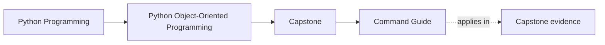
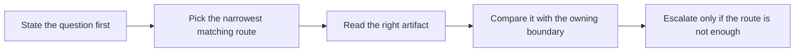

# Command Guide


<!-- page-maps:start -->
## Page Maps




<!-- page-maps:end -->

Use this page when you do not want to reverse-engineer the executable surface. The
capstone has several good commands, but they are not interchangeable. Each one exists to
answer a different review question.

## Stable repository-root commands

```bash
make PROGRAM=python-programming/python-object-oriented-programming docs-build
make PROGRAM=python-programming/python-object-oriented-programming test
make PROGRAM=python-programming/python-object-oriented-programming demo
make PROGRAM=python-programming/python-object-oriented-programming inspect
make PROGRAM=python-programming/python-object-oriented-programming capstone-walkthrough
make PROGRAM=python-programming/python-object-oriented-programming capstone-verify-report
make PROGRAM=python-programming/python-object-oriented-programming capstone-confirm
make PROGRAM=python-programming/python-object-oriented-programming proof
```

## Stable capstone-directory commands

```bash
make test
make confirm
make demo
make inspect
make tour
make verify-report
make proof
```

## Choose the route by question

| If you need to know... | Run this first | Read this first |
| --- | --- | --- |
| what the scenario currently produces | `inspect` | `summary.txt` and `rules.txt` |
| how the story unfolds before reading more code | `capstone-walkthrough` | `walkthrough.txt` |
| whether tests and saved state agree | `capstone-verify-report` | `pytest.txt` and `summary.txt` |
| whether the strongest local route still holds | `capstone-confirm` | `pytest.txt`, then the saved bundles if needed |
| whether the full published learner route still works | `proof` | walkthrough, inspection, and verification bundle outputs together |
| only whether raw tests are green | `test` | pytest terminal output |

## What each command is actually for

| Command | Best use | Weak use |
| --- | --- | --- |
| `demo` | one quick terminal story when you want behavior before bundles | final proof of a design claim |
| `inspect` | reviewing current state, lifecycle state, and shipped variants | proving whole-system trust by itself |
| `capstone-walkthrough` | understanding the scenario as a narrative with saved artifacts | replacing architectural review |
| `capstone-verify-report` | pairing executable checks with saved learner-facing state | replacing extension review |
| `capstone-confirm` | strong local confirmation after the owner is already clear | first contact with a fuzzy question |
| `proof` | full public learner route | shortcut around choosing the right smaller route |

## Bundle locations

- inspection bundle: `artifacts/inspect/python-programming/python-object-oriented-programming/`
- walkthrough bundle: `artifacts/tour/python-programming/python-object-oriented-programming/`
- verification bundle: `artifacts/review/python-programming/python-object-oriented-programming/`

## Good command habits

- start with the lightest route that could reveal a contradiction
- read the saved artifacts before opening more implementation files
- use heavier routes only when the lighter route leaves doubt
- keep the owning file or guide open while you inspect outputs

## Common command mistakes

- using `proof` because the question was not named clearly
- treating `test` as equivalent to the full learner-facing evidence route
- reading only terminal output when the saved bundle is the better review surface
- escalating to `capstone-confirm` before checking whether `inspect` or the walkthrough already answers the question

## Fast route chooser

1. If your question starts with "what state", run `inspect`.
2. If it starts with "what story", run `capstone-walkthrough`.
3. If it starts with "what evidence", run `capstone-verify-report`.
4. If it starts with "does the strong route still hold", run `capstone-confirm`.
5. If it starts with "does the published learner route still hold", run `proof`.

## Exit check

Leave this page only when you can say:

> My question is `____`, so the first command I should run is `____`, and the first
> artifact I should read afterward is `____`.
