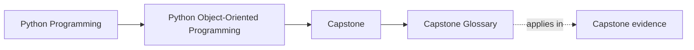
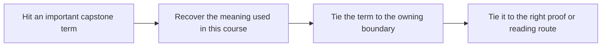

# Capstone Glossary

<!-- page-maps:start -->
## Page Maps

<!-- page-maps:end -->

Use this glossary when a capstone page starts to feel denser than it should. The goal is
not more theory. The goal is stable language so the same words keep the same meaning
across walkthroughs, code reading, proofs, and review.

## Terms that matter in this capstone

| Term | Meaning here |
| --- | --- |
| application surface | the learner-facing command layer in `application.py`, `demo.py`, and `cli.py` that drives the scenario without becoming the owner of domain truth |
| aggregate | the `MonitoringPolicy` object in `model.py` that owns lifecycle rules, alert creation, and domain event emission |
| authoritative state | the state the domain model is allowed to decide directly; in this capstone that authority lives with the aggregate, not with projections or runtime code |
| consecutive threshold policy | the evaluation mode that requires every sample in the current window to stay above the threshold before an alert is produced |
| derived view | any read model or projection built from emitted events after the authoritative decision has already happened |
| evaluation mode | the named strategy used to interpret samples for a rule, such as `threshold`, `consecutive`, or `rate_of_change` |
| incident ledger | the read-model object in `read_models.py` that keeps open incidents and incident history downstream of events |
| inspection bundle | the saved review directory produced by `inspect`, containing state, lifecycle, timeline, retirement, rate-of-change, and JSON artifacts |
| rate-of-change policy | the evaluation mode that compares the earliest and latest samples in the current window and alerts when the change crosses the configured threshold |
| rollback boundary | the point where repository and unit-of-work behavior restores saved state when runtime publication or persistence flow fails |
| runtime coordination | the work in `runtime.py` that fetches samples, publishes alerts, applies projections, and commits work after the domain has decided |
| walkthrough bundle | the learner-facing saved route produced by `capstone-walkthrough` or `make tour`, centered on `walkthrough.txt` |

## Terms that describe the rewritten support pages

| Term | Meaning here |
| --- | --- |
| capstone map | the page that translates module pressure into one file, one guide, and one proof route |
| file guide | the page that teaches how to read the package from authority outward instead of alphabetically |
| architecture guide | the page that explains which boundary owns what and how drift would appear |
| proof guide | the page that chooses the smallest evidence route that could expose a wrong ownership claim |
| review worksheet | the page that turns a capstone pass into an audit instead of a vibe check |
| extension guide | the page that places new work by ownership and drift risk |
| command guide | the page that maps specific review questions to specific executable routes |

## How to use this glossary well

- If a term sounds familiar but you cannot attach it to one file or one route, stop and look it up here.
- If two pages seem to use the same word differently, use the meaning in this glossary as the course contract.
- If a term only describes tooling and never ownership, it is probably not the right word for the lesson you are reading.

## Exit check

Leave this page only when the confusing term now points you to:

- one stable meaning
- one owning boundary or review surface
- one next page or proof route
