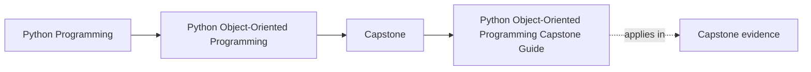
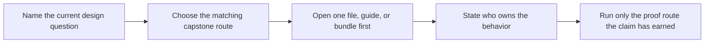

# Python Object-Oriented Programming Capstone Guide

<!-- page-maps:start -->
## Page Maps

<!-- page-maps:end -->

This capstone is the executable spine of the course. It is not a decorative side
project, and it is not a pattern catalog. It exists so that every major course claim can
be checked against one running system with stable boundaries.

The governing question of the capstone is the same as the governing question of the
course:

> If this behavior changed tomorrow, which object or boundary should absorb the change,
> and why is that the least surprising home for it?

## What system this capstone models

The capstone models a monitoring-policy system.

A team can:

1. create a monitoring policy
2. add and configure rules while they are drafts
3. activate those rules deliberately
4. evaluate incoming metric samples
5. publish incidents when rule conditions are met
6. inspect derived views without letting those views become authoritative

The point is not only that those steps happen. The point is that each step has a stable
owner and a reviewable proof route.

## What this capstone is supposed to teach

Use it to learn and review:

- how value objects make domain facts explicit
- how one aggregate can own lifecycle and incident decisions
- how policy variation can live in replaceable objects without relocating authority
- how events, projections, and read models remain downstream of truth
- how application, runtime, and persistence can support the model without swallowing it
- how saved bundles and executable routes can prove design claims honestly

## The system shape underneath the course prose

The executable center is a `MonitoringPolicy` aggregate. A policy owns a collection of
rules. Rules begin in draft state, are activated only under legal conditions, can be
retired for explicit reasons, and produce incidents when incoming samples cross their
configured evaluation boundary.

The rest of the code exists to support that ownership:

- `model.py` holds the domain meaning and lifecycle rules
- `policies.py` holds replaceable evaluation behavior
- `application.py` provides the learner-facing entry route without becoming the domain owner
- `runtime.py` coordinates publication, sources, sinks, and projections after decisions are made
- `repository.py` and the unit of work keep storage concerns visible but downstream
- `read_models.py` and `projections.py` keep derived views useful without making them authoritative

## Start with the route that matches your question

| If your question is... | Start here | What you should gain |
| --- | --- | --- |
| What is the system doing in plain language? | [Capstone Walkthrough](capstone-walkthrough.md) | the system story without premature code spelunking |
| Which file should I read first? | [Capstone File Guide](capstone-file-guide.md) | a code-reading order that preserves the design boundaries |
| Which boundary owns this design decision? | [Capstone Architecture Guide](capstone-architecture-guide.md) | a map of authority, orchestration, projection, and persistence roles |
| Which command or saved bundle proves the claim I care about? | [Command Guide](command-guide.md) and [Capstone Proof Guide](capstone-proof-guide.md) | the smallest honest executable route |
| How should I review this design after a module? | [Capstone Review Worksheet](capstone-review-worksheet.md) | a real audit path instead of vague approval |
| Where should a new feature or change land? | [Capstone Extension Guide](capstone-extension-guide.md) | placement rules that preserve the object model |
| Which capstone term or boundary name is unclear? | [Capstone Glossary](glossary.md) | a stable definition tied to this system |

## Study routes by course stage

| Course stage | First capstone pressure | Best first route |
| --- | --- | --- |
| modules 1 to 3 | semantics, ownership, lifecycle | [Capstone Walkthrough](capstone-walkthrough.md), then `model.py` |
| modules 4 to 7 | collaboration, failures, persistence, runtime boundaries | [Capstone Map](capstone-map.md), then the architecture or file guide |
| modules 8 to 10 | proof depth, public trust, extension, stewardship | [Capstone Proof Guide](capstone-proof-guide.md), [Command Guide](command-guide.md), and the review worksheet |

## The proof surfaces are intentionally layered

Do not jump to the strongest route because it sounds more serious. Different claims
deserve different strengths of evidence.

| Need | Repository root | Capstone directory | Best use |
| --- | --- | --- | --- |
| quick human story | `make PROGRAM=python-programming/python-object-oriented-programming demo` | `make demo` | a fast scenario pass before saved bundles matter |
| saved walkthrough bundle | `make PROGRAM=python-programming/python-object-oriented-programming capstone-walkthrough` | `make tour` | narrative review of the system story |
| saved inspection bundle | `make PROGRAM=python-programming/python-object-oriented-programming inspect` | `make inspect` | lifecycle, state, timeline, and derived-view review |
| executable review bundle | `make PROGRAM=python-programming/python-object-oriented-programming capstone-verify-report` | `make verify-report` | pytest plus saved state for cross-boundary review |
| strongest local confirmation | `make PROGRAM=python-programming/python-object-oriented-programming capstone-confirm` | `make confirm` | local confirmation once the boundary is already clear |
| full published proof route | `make PROGRAM=python-programming/python-object-oriented-programming proof` | `make proof` | the broadest learner-facing review route |

## Questions to keep asking while you read

- which object is authoritative for lifecycle and incident decisions?
- which parts of the system are observers, projections, or delivery mechanisms only?
- where would a new evaluation mode belong?
- which proof route would expose a wrong ownership choice fastest?
- which file should become suspicious first if this behavior changed?

## Strong first session for a solo learner

1. Read [Capstone Walkthrough](capstone-walkthrough.md).
2. Open `capstone/src/service_monitoring/application.py` and `model.py`.
3. Run the walkthrough route.
4. Explain in one sentence who owns lifecycle transitions.
5. Use [Capstone File Guide](capstone-file-guide.md) or [Capstone Architecture Guide](capstone-architecture-guide.md) only after that sentence is visible.

If you still cannot answer who owns the behavior, the right next move is not stronger
proof. The right next move is clearer reading.

## Common misreads this capstone is designed to prevent

- treating `runtime.py` as if it were the business model
- confusing the application facade with the owner of invariants
- reading projections or read models as if they defined truth
- assuming repository or unit-of-work code is where business policy belongs
- using `make proof` as a substitute for understanding smaller routes first

## Exit criteria for this page

Leave this page only when you can say:

> The system is solving `____`, the main owner of lifecycle and incident decisions is
> `____`, and my next capstone move is `____`.
