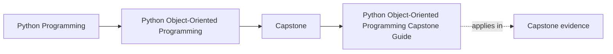
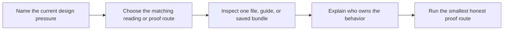

# Python Object-Oriented Programming Capstone Guide

<!-- page-maps:start -->
## Page Maps

<!-- page-maps:end -->

This capstone is the executable spine of the OOP course. It is not a side project, a
toy CLI, or a pattern scrapbook. It is one monitoring-policy system that lets you
practice the question that drives the whole course:

> If this behavior changed tomorrow, which object or boundary should absorb the change,
> and why is that the least surprising home for it?

The system models a team that defines monitoring rules, activates them deliberately,
evaluates incoming metric samples, emits incidents, and maintains downstream read views
without letting runtime or storage code become the source of domain truth.

## What this capstone is meant to teach

- how value objects make domain facts explicit instead of stringly and implicit
- how one aggregate root can own lifecycle rules and incident decisions
- how evaluation variation can live in replaceable policy objects instead of condition ladders
- how events, projections, and read models stay downstream of authoritative state
- how orchestration, publication, and persistence can stay outside the domain model
- how tests and saved bundles can prove ownership claims instead of merely exercising code

## The real system under the course-book prose

The executable capstone centers on a `MonitoringPolicy` aggregate. A policy owns a set
of threshold-based rules. Rules begin in draft state, can be activated only under valid
conditions, can be retired with an explicit reason, and can trigger alerts when incoming
metric samples cross their configured evaluation boundary.

The rest of the system exists to support that ownership without taking it away:

- `application.py` gives a learner-facing entry surface for the common scenario.
- `policies.py` holds replaceable evaluation behavior such as threshold, consecutive breach, and rate-of-change checks.
- `runtime.py` coordinates sources, sinks, and projections after the domain has made its decisions.
- `repository.py` and the unit of work make persistence and rollback visible without hiding the model.
- `read_models.py` and `projections.py` maintain derived views such as active-rule indexes and incident history.
- `tests/` and the saved review bundles prove that those boundaries still hold.

## Start with the right reading route

| If your question is... | Start here | What you should get out of it |
| --- | --- | --- |
| What does this system model in plain language? | [Capstone Walkthrough](capstone-walkthrough.md) | the human story from policy creation to alert publication |
| Which file should I open first? | [Capstone File Guide](capstone-file-guide.md) | a code-reading order that keeps infrastructure from masquerading as the model |
| Which boundary owns the design decision I care about? | [Capstone Architecture Guide](capstone-architecture-guide.md) | a map of authority, orchestration, projections, and persistence |
| Which command or bundle proves the current claim? | [Command Guide](command-guide.md) and [Capstone Proof Guide](capstone-proof-guide.md) | the narrowest honest proof route |
| How should I review the design after a module? | [Capstone Review Worksheet](capstone-review-worksheet.md) | a concrete audit checklist instead of vague approval |
| Where should a new feature or change land? | [Capstone Extension Guide](capstone-extension-guide.md) | change placement rules that preserve the design |

## Study routes by module range

| Module range | First capstone pressure | Best first route |
| --- | --- | --- |
| Modules 01-03 | semantics, lifecycle, and state ownership | open `model.py`, then use [Capstone Walkthrough](capstone-walkthrough.md) and [Capstone File Guide](capstone-file-guide.md) |
| Modules 04-07 | collaboration, events, persistence, and runtime boundaries | use [Capstone Architecture Guide](capstone-architecture-guide.md) and [Capstone Map](capstone-map.md) |
| Modules 08-10 | proof, public trust, extension seams, and stewardship | use [Capstone Proof Guide](capstone-proof-guide.md), [Command Guide](command-guide.md), and [Capstone Review Worksheet](capstone-review-worksheet.md) |

## The capstone proof surfaces are deliberately layered

Do not jump straight to the strongest command by habit. Different questions deserve
different levels of proof.

| Need | Repository root | Capstone directory | Best use |
| --- | --- | --- | --- |
| fast scenario story | `make PROGRAM=python-programming/python-object-oriented-programming demo` | `make demo` | terminal-only walkthrough when you want the behavior before the bundles |
| saved walkthrough bundle | `make PROGRAM=python-programming/python-object-oriented-programming capstone-walkthrough` | `make tour` | learner-facing story with `walkthrough.txt` and matching docs |
| saved inspection bundle | `make PROGRAM=python-programming/python-object-oriented-programming inspect` | `make inspect` | scenario state, lifecycle state, timeline, retirement route, rate-of-change route, and JSON snapshot |
| executable review bundle | `make PROGRAM=python-programming/python-object-oriented-programming capstone-verify-report` | `make verify-report` | pytest results plus saved scenario evidence |
| strongest local confirmation | `make PROGRAM=python-programming/python-object-oriented-programming capstone-confirm` | `make confirm` | confirmation when the boundary is already clear |
| full published proof route | `make PROGRAM=python-programming/python-object-oriented-programming proof` | `make proof` | complete learner-facing review route |

## What to keep asking while you read

- Which object is authoritative for lifecycle and incident decisions?
- Which parts of the system are only projections or delivery mechanisms?
- Where would a new evaluation mode belong?
- Which command or saved bundle would expose a wrong ownership choice fastest?
- If I changed this behavior, which file should become suspicious first?

## Common misreads this capstone is designed to prevent

- treating `runtime.py` as if it were the business model
- confusing the application facade with the authoritative owner of invariants
- reading projections or read models as if they defined truth instead of deriving it
- assuming repository or unit-of-work code is where business policy should live
- treating `make proof` as a substitute for understanding the smaller routes first

## A good first session

1. Read [Capstone Walkthrough](capstone-walkthrough.md).
2. Open `capstone/src/service_monitoring/application.py` and `model.py`.
3. Run the walkthrough route.
4. Explain in one sentence who owns lifecycle transitions.
5. Use [Capstone File Guide](capstone-file-guide.md) or [Capstone Architecture Guide](capstone-architecture-guide.md) only after that answer is visible.

If you cannot yet answer who owns the behavior, you are still too early for the
strongest proof route.

## Keep these pages nearby

- [Capstone Map](capstone-map.md)
- [Capstone File Guide](capstone-file-guide.md)
- [Capstone Architecture Guide](capstone-architecture-guide.md)
- [Capstone Walkthrough](capstone-walkthrough.md)
- [Command Guide](command-guide.md)
- [Capstone Proof Guide](capstone-proof-guide.md)
- [Capstone Review Worksheet](capstone-review-worksheet.md)
- [Capstone Extension Guide](capstone-extension-guide.md)
- [Glossary](glossary.md)

## Exit criteria for this page

Leave this page only when all three are true:

- you can say what operational problem the monitoring system is solving
- you can name the main owner of lifecycle and incident decisions
- you know whether your next move is a file-reading route, a walkthrough route, or a proof route
