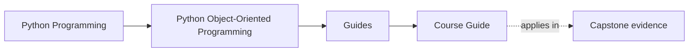

# Course Guide

<!-- page-maps:start -->
## Page Maps

<!-- page-maps:end -->

This page is the working spine of the course.

It is for readers who want to know:

- how the ten modules fit together as one learning path
- what kind of question each stage is meant to answer
- how to keep the capstone connected without turning every session into a full-system
  audit

If the course home is the promise, this page is the study plan.

## The course is one argument

The argument moves in this order:

1. objects must mean something before architecture advice is useful
2. roles and states must be clear before collaboration gets complicated
3. collaboration must be disciplined before persistence and runtime pressure arrive
4. proof, public boundaries, and operations matter only after ownership already makes
   sense

If you skip that order, later modules feel "advanced" only because earlier ownership
work never became stable.

## The three working arcs

| Arc | Modules | What you are trying to earn |
| --- | --- | --- |
| semantic floor | 01-03 | define what objects are, what they own, and what states are legal |
| systems arc | 04-07 | preserve that ownership under collaboration, resources, persistence, time, and concurrency pressure |
| trust arc | 08-10 | prove, expose, govern, and harden the design so it survives review and real use |

This split matters because it tells you what kind of reading discipline the current part
of the course requires.

## A serious session plan for each arc

| If today is about... | Do this first | Then | End by |
| --- | --- | --- | --- |
| semantics | read the module overview and one key lesson | inspect `model.py` or lifecycle tests | restating the ownership rule in plain language |
| collaboration | read the module overview and the matching refactor or boundary page | inspect one capstone collaboration surface | naming the aggregate, policy, runtime, or projection owner |
| trust | read the module overview and one proof or governance page | inspect one saved bundle or test surface | saying which proof route is proportionate and why |

The point is not to finish a checklist. The point is to end the session with one clearer
design claim.

## Module-by-module study route

| Module | Session goal | Best support page | Best capstone cross-check |
| --- | --- | --- | --- |
| 01 Object Semantics | stop confusing value, identity, mutation, and representation | [Module Promise Map](module-promise-map.md) | `model.py`, `rules.txt`, and lifecycle tests |
| 02 Design Roles and Layering | place behavior in values, entities, policies, services, adapters, or protocols with reasons | [Module Checkpoints](module-checkpoints.md) | `application.py`, `model.py`, and the architecture guide |
| 03 State and Typestate | make legal states easier to construct than illegal ones | [Module Checkpoints](module-checkpoints.md) | lifecycle tests and inspection outputs |
| 04 Aggregates and Collaboration | centralize cross-object invariants without tangling authority | [Pressure Routes](pressure-routes.md) | projections, read models, and architecture surfaces |
| 05 Resources and Evolution | keep retries, cleanup, and failure handling attached to clear owners | [Proof Ladder](proof-ladder.md) | `runtime.py`, `repository.py`, and unit-of-work tests |
| 06 Persistence and Schema Evolution | add storage pressure without flattening the domain | [Pressure Routes](pressure-routes.md) | repository boundaries and verification artifacts |
| 07 Time and Concurrency | keep clocks, queues, and tasks from corrupting ownership | [Proof Ladder](proof-ladder.md) | runtime tests and walkthrough artifacts |
| 08 Testing and Verification | choose the right proof depth for the claim | [Proof Ladder](proof-ladder.md) | test suite plus verification bundle |
| 09 Public APIs and Governance | expose stable entrypoints and extension seams deliberately | [Proof Ladder](proof-ladder.md) | application surface, extension guide, and public examples |
| 10 Operational Review | review performance, observability, trust boundaries, and long-term change pressure together | [Module Checkpoints](module-checkpoints.md) | full proof route and capstone review worksheet |

Use this table as a route chooser, not as a reason to skim several modules at once.

## If you missed class and are learning alone

Use this simpler rhythm:

1. read one module overview
2. read one support page from this shelf
3. inspect one named capstone surface
4. run one proof step only if the claim is still fuzzy
5. stop after one question becomes materially easier

That rhythm is better than trying to "cover" too many modules in one sitting.

## What to keep open while reading

| Situation | Keep this page open too |
| --- | --- |
| you forget what the current module promises | [Module Promise Map](module-promise-map.md) |
| you think you are ready to move on | [Module Checkpoints](module-checkpoints.md) |
| the module title is less clear than the real design pressure | [Pressure Routes](pressure-routes.md) |
| you know the claim but not the proof route | [Proof Ladder](proof-ladder.md) |
| you keep escalating to proof that is too heavy | [Proof Ladder](proof-ladder.md) and [Proof Matrix](proof-matrix.md) |

The guides are there to keep your reading proportional, not to replace the lessons.

## Common study mistakes this guide should prevent

- reading Modules 08-10 as if they can repair weak semantics from Modules 01-03
- treating persistence or concurrency as separate from ownership
- opening the strongest proof route before naming the boundary under review
- using the capstone as spectacle instead of as a pressure test for one claim
- trying to finish a module without being able to state what new pressure it added

## One-session rescue route

If the course currently feels too large, do this:

1. read [Course Home](../index.md)
2. pick one pressure from [Pressure Routes](pressure-routes.md)
3. read the matching module overview only
4. inspect the named capstone surface
5. stop after one design question becomes clearer

This is a better rescue than wandering forward because the later modules look more
important.

## Exit check

Leave this page only when you can say:

> I am in the `____` arc, today’s module goal is `____`, the best support page is
> `____`, and the capstone surface I should inspect next is `____`.
