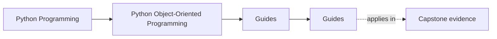
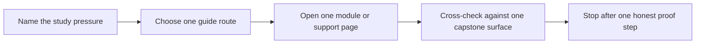

# Guides

<!-- page-maps:start -->
## Page Maps

<!-- page-maps:end -->

Use this shelf when you do not need another lesson yet. These pages exist to help you
choose the next lesson, choose the right amount of proof, and return to the capstone
without wandering.

The strongest use of this shelf is narrow: arrive with one concrete problem, choose one
route, and leave as soon as the next module or capstone surface is clear.

## Pick the guide that matches the job

| If you need to... | Start here | Then go to... |
| --- | --- | --- |
| enter the course honestly for the first time | [Start Here](start-here.md) | [Course Guide](course-guide.md) |
| remember what each module is supposed to change | [Module Promise Map](module-promise-map.md) | [Module Checkpoints](module-checkpoints.md) |
| enter from a real design pressure instead of from the table of contents | [Pressure Routes](pressure-routes.md) | [Proof Matrix](proof-matrix.md) |
| decide how much evidence you need before moving on | [Proof Ladder](proof-ladder.md) | [Capstone Proof Guide](../capstone/capstone-proof-guide.md) |
| connect one course claim to one executable surface | [Proof Matrix](proof-matrix.md) | [Capstone Map](../capstone/capstone-map.md) |
| resume after a break without rereading everything | [Course Guide](course-guide.md) | [Course Map](../module-00-orientation/course-map.md) |
| verify local setup before using published routes | [Platform Setup](platform-setup.md) | the smallest matching capstone command |

## Use the shelf by learner state

| Learner state | Best first page | Why |
| --- | --- | --- |
| absolute beginner to OOP design pressure | [Course Guide](course-guide.md) | it explains the full arc without assuming you already know which module name matters |
| knows the symptom but not the module | [Pressure Routes](pressure-routes.md) | it routes from real design trouble to the smallest honest entry point |
| knows the module but not the promise | [Module Promise Map](module-promise-map.md) | it tells you what the module should settle and what it still does not settle |
| thinks a module is "done" but is unsure | [Module Checkpoints](module-checkpoints.md) | it gives a real exit bar instead of a vague feeling |
| knows the claim but not the proof route | [Proof Matrix](proof-matrix.md) | it maps a design claim to the smallest route and first surface |
| keeps over-escalating to heavy proof | [Proof Ladder](proof-ladder.md) | it right-sizes evidence before you waste time |

## Good companion pages outside this shelf

| Need | Best page |
| --- | --- |
| course-stage orientation | [Course Map](../module-00-orientation/course-map.md) |
| module dependency justification | [Module Dependency Map](../reference/module-dependency-map.md) |
| practice rhythm by module | [Practice Map](../reference/practice-map.md) |
| design review pressure | [Review Checklist](../reference/review-checklist.md) |
| capstone entry point | [Capstone](../capstone/index.md) |
| capstone file route | [Capstone File Guide](../capstone/capstone-file-guide.md) |
| capstone architecture review | [Capstone Architecture Guide](../capstone/capstone-architecture-guide.md) |

## Common misuse of the guide shelf

- reading every guide before opening one real module
- opening proof pages before the claim is clear
- using the capstone as a shortcut around weak semantics
- browsing the shelf for comfort instead of choosing one next move

## A strong guide-shelf rhythm

1. Name the current pressure.
2. Choose one guide page only.
3. Open one module or capstone page from that guide.
4. Use one proof step if needed.
5. Leave the shelf and continue the course.

## Exit check

Leave this page only when you can say:

> My pressure is `____`, the best guide for it is `____`, and the next actual teaching
> surface I should open is `____`.
