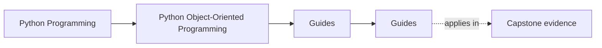
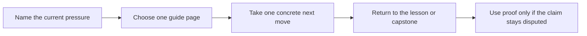

# Guides

<!-- page-maps:start -->
## Page Maps

<!-- page-maps:end -->

Use this shelf when the course is not blocked by lack of content, but by lack of
direction. These pages exist for moments like:

- "I know roughly where I am, but I do not know what to open next."
- "I read the lesson, but I cannot tell whether I actually understood it."
- "I want proof, but I do not know how much proof is honest."
- "I can feel design pressure, but I do not yet know which module or capstone surface
  should carry it."

If you still need the lesson itself, leave this shelf and go back to the module. Guides
are routing tools, not a substitute for the teaching.

## Start from the real blockage

| If the blockage is... | Open this page first | Then do this |
| --- | --- | --- |
| I am new and do not yet trust my study route | [Start Here](start-here.md) | continue to [Course Guide](course-guide.md) |
| I know the module name, but not what success looks like | [Module Promise Map](module-promise-map.md) | check [Module Checkpoints](module-checkpoints.md) |
| I know the symptom, but not the owning concept | [Pressure Routes](pressure-routes.md) | jump into the matching module or capstone page |
| I think I understand the idea, but I cannot prove it honestly | [Proof Matrix](proof-matrix.md) | escalate with [Proof Ladder](proof-ladder.md) only if needed |
| I keep over-studying because I do not know when to stop | [Module Checkpoints](module-checkpoints.md) | write down the first failed checkpoint |
| I am returning after a break and need to re-enter fast | [Course Guide](course-guide.md) | confirm the stage with [Course Map](../module-00-orientation/course-map.md) |
| I suspect the capstone, not the lesson, is my next move | [Pressure Routes](pressure-routes.md) | open [Capstone Map](../capstone/capstone-map.md) |
| I am blocked by environment or command trust | [Platform Setup](platform-setup.md) | verify the smallest supported route |
| I need to know what the course expects from me | [Learning Contract](learning-contract.md) | choose a study and evidence practice you can sustain |

## Do not read guides in table-of-contents order

These pages solve different problems. Reading them all in sequence usually means you
are delaying the harder move: opening a lesson, a file, an exercise, or a proof route.

Use this shelf with a narrow contract:

1. Name one concrete blockage.
2. Open one guide page that matches it.
3. Decide the next real teaching surface.
4. Leave the shelf.

If you have opened a second guide page without naming a new blockage, you are probably
browsing for comfort instead of studying with intent.

## Good routes by learner state

| Learner state | Best first page | Why it works |
| --- | --- | --- |
| absolute beginner who needs a trustworthy entrance | [Start Here](start-here.md) | it lowers the pressure and tells you how to read the course without pretending you already know the vocabulary |
| learner who keeps losing the thread between modules | [Course Guide](course-guide.md) | it restores the course arc and explains why the order matters |
| learner who understands examples but not ownership | [Pressure Routes](pressure-routes.md) | it translates vague trouble into boundary questions |
| learner who finishes pages but cannot tell whether they are done | [Module Checkpoints](module-checkpoints.md) | it turns progress into claims you can defend |
| learner who reaches for heavy proof too early | [Proof Matrix](proof-matrix.md) | it starts with the first honest route instead of the loudest route |
| learner who keeps revisiting setup doubts | [Platform Setup](platform-setup.md) | it separates environment trust from design confusion |

## Good routes by study session length

| If you have... | Best guide move |
| --- | --- |
| 10 minutes | name the blockage and use [Pressure Routes](pressure-routes.md) or [Module Checkpoints](module-checkpoints.md) |
| 25 minutes | use one guide page, then return to one lesson page or capstone route immediately |
| 45 to 60 minutes | use [Course Guide](course-guide.md) or [Proof Matrix](proof-matrix.md), then complete one full study loop |
| a full review session | use [Course Guide](course-guide.md), [Module Promise Map](module-promise-map.md), and one capstone page, but only if each page is serving a different question |

## When to leave the guide shelf

Leave as soon as one of these becomes clear:

- the next lesson page
- the next exercise set
- the next capstone surface
- the next proof route
- the exact reason setup must be repaired before learning can continue

If none of those becomes clearer, the guide page failed and you should switch to a more
direct page: the module itself, the capstone, or the relevant reference page.

## Companion pages outside this shelf

| Need | Best page |
| --- | --- |
| stage-of-course orientation | [Course Map](../module-00-orientation/course-map.md) |
| first-pass route through modules 1 to 3 | [First-Contact Map](../module-00-orientation/first-contact-map.md) |
| middle-course authority and systems pressure | [Mid-Course Map](../module-00-orientation/mid-course-map.md) |
| final proof and stewardship pressure | [Mastery Map](../module-00-orientation/mastery-map.md) |
| module-to-capstone bridge | [Capstone Map](../capstone/capstone-map.md) |
| durable review language | [Reference](../reference/index.md) |

## Common misuse

- reading every guide before opening one real lesson
- treating guides as summaries of modules instead of as route selectors
- escalating to proof because direction feels emotionally safer than judgment
- reopening setup pages when the real problem is conceptual ownership

## Exit check

Leave this page only when you can say:

> My blockage is `____`, the guide that matches it is `____`, and the next real study
> surface is `____`.
