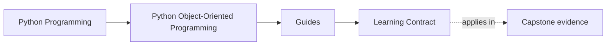
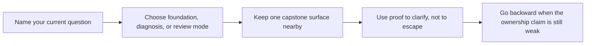

# Learning Contract

<!-- page-maps:start -->
## Page Maps

<!-- page-maps:end -->

This course asks for deliberate reading.

The chapters are designed to improve design judgment, not only recall. That works only
if you keep the prose, code, capstone, and proof surface tied together.

This page states the bargain clearly:

- what the course promises to give you
- what habits you need to bring back to it

## What the course promises to you

The course promises:

- the modules build from simple semantic questions to harder systems questions
- the capstone gives one stable domain so abstractions stay grounded
- the prose tries to name trade-offs and failure modes directly instead of hiding them
- the support shelf exists to make solo reading more honest, not to decorate the book

Those promises only matter if you use the material in the way it was designed to be
used.

## What you should promise back

You should agree to these habits:

- read module overviews before diving into leaf pages
- do not skip the refactor, checkpoint, and answer-key pages as if they were optional
- keep asking which object owns the current invariant
- inspect code or tests when the prose makes a concrete design claim
- go backward without pride when a later module depends on vocabulary you do not truly
  own yet
- use the capstone as a design proof, not only as an implementation example

This is not extra discipline for its own sake. It is what keeps the course dense without
becoming slippery.

## Your side of the contract in plain terms

This course works best when you hold these four habits:

1. Name the current design question before reading.
2. Keep one capstone surface open whenever the prose makes a concrete claim.
3. Use proof routes to clarify a question, not to escape one.
4. Go backward when a later page depends on ownership language you have not yet earned.

If you do those four things, the course can stay ambitious without losing readability.

## Choose a reading mode deliberately

Do not blur these modes together.

| Mode | Use it when | What success looks like |
| --- | --- | --- |
| foundation | the topic is still new and you need the sequence | you can restate the ownership rule in plain language |
| diagnosis | one real design pressure is already in front of you | one current problem gets smaller and more concrete |
| review | the design exists and you need to judge whether it deserves confidence | you can name the proof route and the first likely failure boundary |

If you switch modes, name it. The course feels clumsy when you try to do review work
with foundation-level gaps still unresolved.

## What progress should look like

Progress in this course is not:

- I have seen this pattern before
- I remember the module titles
- I can repeat the vocabulary

Progress is:

- you can reject an unnecessary class with confidence
- you can justify why a rule belongs in one object instead of another
- you can explain why a projection is useful but not authoritative
- you can predict where a feature change should land before editing code

That is the level of judgment this course is trying to build.

## What failure looks like

Watch for these signs:

- treating diagrams as decoration instead of decision maps
- treating the capstone as a sample app instead of a design proof
- reading advanced modules as isolated techniques without the earlier ownership model
- using proof commands because the prose felt hard instead of because the claim needed
  confirmation

If one of those appears, the right move is usually to shrink the question, not to keep
scrolling.

## How to disagree productively

Disagreement is useful here, but only if it is precise.

Do not stop at:

- I would design it differently

Instead:

1. name the specific owner you would change
2. name the neighboring owner you would shrink or expand
3. name the first proof route that should reveal whether your alternative is better

That keeps disagreement educational instead of impressionistic.

## How to recover when a module feels dense

Use this reset route:

1. return to the module overview
2. reduce the question to one ownership decision
3. inspect the corresponding capstone surface
4. re-run the smallest proof route that could confirm or disprove the claim
5. continue only after the ownership sentence becomes clear again

If the sentence is still blurry, the right move is more orientation or earlier-module
work, not brute-force persistence.

## Minimum honest route

If time is tight, do this instead of random skipping:

1. read the current module overview
2. read only the chapter sequence that supports that overview
3. inspect one matching capstone file
4. run one matching proof command
5. write one sentence beginning with:
   `This object owns...`

If you cannot finish that sentence, the reading was not yet honest enough.

## Build your personal study note

Keep one short note beside the course with:

- current reading mode
- current design question
- current capstone surface
- smallest proof route you are willing to use next

This sounds simple, but it prevents the most common self-study failure: consuming too
many pages without knowing what problem they are supposed to settle.

## Exit check

Leave this guide only when you can say:

> I am reading in `foundation` / `diagnosis` / `review` mode, my current question is
> `____`, and the first capstone surface I need is `____`.
