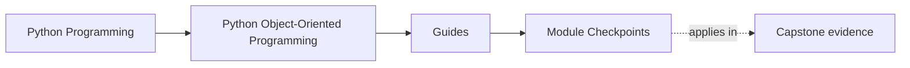
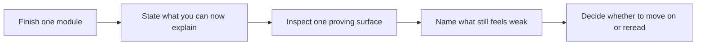

# Module Checkpoints

<!-- page-maps:start -->
## Page Maps

<!-- page-maps:end -->

Use this page at the end of a module.

The goal is not to feel "generally familiar." The goal is to test whether one real
design ability has been earned.

If you cannot name the ability, point to the capstone surface that proves it, and say
what pressure the next module adds, the checkpoint is not done yet.

## Checkpoints by module

| Module | You should now be able to... | Prove it first by... | Do not move on if... |
| --- | --- | --- | --- |
| 01 Object Semantics | explain when identity matters more than equality, when aliasing becomes dangerous, and when a type’s representation is part of its contract | opening `model.py`, `rules.txt`, and lifecycle tests | "object" still means only "instance of a class" to you |
| 02 Design Roles and Layering | justify whether behavior belongs in a value, entity, policy, adapter, service, or plain function | comparing `application.py`, `model.py`, and the architecture guide | your role choices still sound like taste instead of reasons |
| 03 State and Typestate | describe which states are legal, who guards transitions, and how the API makes bad states harder to construct | checking lifecycle tests and inspection outputs | you still accept invalid transitional objects as normal |
| 04 Aggregates and Collaboration | name the aggregate root and defend why other objects should not own the same invariant | reviewing projections, read models, and architecture surfaces | you still confuse authoritative state with useful derived state |
| 05 Resources and Evolution | explain who owns retries, cleanup, recovery, and extension cost | inspecting `runtime.py`, `repository.py`, and unit-of-work tests | failure handling still feels like random plumbing around the model |
| 06 Persistence and Schema Evolution | explain how persistence adapts to the domain instead of flattening it | inspecting repository boundaries and verification artifacts | you still think storage shape and domain shape should be identical |
| 07 Time and Concurrency | explain where clocks, queues, async tasks, or threads enter the design without stealing ownership from the model | checking runtime tests and walkthrough artifacts | concurrency still feels like permission to blur boundaries |
| 08 Testing and Verification | choose the right proof depth for a claim instead of defaulting to the heaviest route | mapping one claim to one test file and one saved bundle | you still call any passing test "enough evidence" |
| 09 Public APIs and Governance | name what is public, what is internal, and where extension is allowed | reviewing the application surface, extension guide, and proof routes | your extension story depends on reaching into internals casually |
| 10 Operational Review | explain which boundaries are hottest, most observable, and most exposed to trust or failure pressure | using the full proof route and review worksheet | production pressure still sounds separate from object ownership |

## The plain-language exit test

Before moving on, say the module lesson in one sentence without using the module title.

Good example:

> This module taught me where legal lifecycle transitions must be enforced and why
> downstream views are not allowed to decide them.

Weak example:

> This module was about typestate and validation.

If the plain-language sentence is weak, the module is not done yet.

## What to do when the checkpoint fails

| If the failure is... | Return to... |
| --- | --- |
| the vocabulary is still fuzzy | the module overview and [Module Promise Map](module-promise-map.md) |
| the design claim sounds true only in prose | one named capstone surface from the module |
| the proof route still feels too heavy or too random | [Proof Ladder](proof-ladder.md) and [Proof Matrix](proof-matrix.md) |
| the real question is different from the module title | [Pressure Routes](pressure-routes.md) |

This is not backtracking for its own sake. It is how you stop later modules from
resting on unearned confidence.

## Honest move-on rule

Move on only when all three are true:

- you can explain the checkpoint plainly
- you can point to one capstone surface that makes it concrete
- you know what new pressure the next module adds

If only one or two are true, keep the current module open.

## Build a completion note

At the end of each module, write one short note with:

- what you can now explain
- what capstone surface proves it
- what still feels weak
- what the next module is about to pressure

That note is valuable because it makes rereading honest. When you come back later, you
can see whether the weakness was really solved or only postponed.

## Exit check

Leave this page only when you can say:

> I earned this module because I can now `____`, I can show it in `____`, and the next
> pressure I am ready for is `____`.
