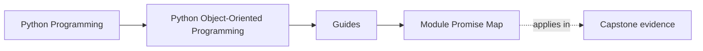
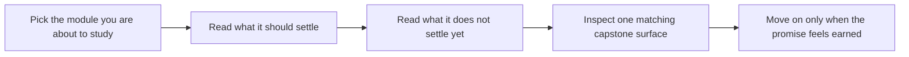

# Module Promise Map

<!-- page-maps:start -->
## Page Maps

<!-- page-maps:end -->

Use this page before opening a module. It tells you what that module is supposed to
change in your thinking, what it does not settle yet, and which capstone surface should
make the promise concrete.

## The ten module contracts

| Module | By the end of this module you should be able to... | Do not expect this module to settle yet | Best capstone cross-check | What it prepares you for next |
| --- | --- | --- | --- | --- |
| 01 Object Semantics and the Data Model | explain identity, equality, representation, aliasing, and key data-model hooks as contracts rather than syntax trivia | system-wide layering or persistence strategy | `model.py`, `rules.txt`, and lifecycle tests | role assignment and state design |
| 02 Design Roles, Interfaces, and Layering | place behavior in values, entities, policies, services, adapters, and protocols with reasons you can defend | cross-object consistency or runtime orchestration | `application.py`, `model.py`, and the architecture guide | legal state transitions and typestate |
| 03 State, Validation, and Typestate | design APIs so legal states are easier to construct than illegal ones | aggregate-level collaboration or storage boundaries | lifecycle tests, `rules.txt`, and inspection outputs | aggregates and collaboration boundaries |
| 04 Aggregates, Events, and Collaboration Boundaries | identify the authoritative owner of a cross-object invariant and separate it from downstream views | persistence strategy, retries, or concurrency pressure | projections, read models, and architecture surfaces | failure handling and change pressure |
| 05 Resources, Failures, and Safe Evolution | attach cleanup, retries, translation of failures, and extension cost to visible owners | storage mapping or async runtime design | `runtime.py`, `repository.py`, and unit-of-work tests | persistence and schema evolution |
| 06 Persistence, Serialization, and Schema Evolution | adapt repositories, codecs, and storage records to the domain without flattening away meaning | clocks, queues, or concurrency boundaries | repository boundaries and verification bundles | time and runtime pressure |
| 07 Time, Scheduling, and Concurrency Boundaries | keep time, tasks, threads, queues, and async boundaries outside the core ownership model | test strategy or public API governance | runtime tests, walkthrough bundle, and coordination surfaces | verification depth and confidence |
| 08 Testing, Contracts, and Verification Depth | choose the right test depth for a claim and map design promises to real evidence | extension governance or operational hardening | tests, verification bundle, and proof routes | public APIs and extension seams |
| 09 Public APIs, Extension Seams, and Governance | expose a stable surface and controlled extension points without dissolving the model | production telemetry, hot paths, or trust boundaries under attack | application surface, extension guide, and proof routes | operational review and stewardship |
| 10 Performance, Observability, and Security Review | review an object system under performance, telemetry, input-hardening, and trust-boundary pressure without abandoning earlier ownership decisions | no later module; this is the integrated review pass | full proof route, review worksheet, and architecture surfaces | long-term stewardship |

## How to read the promises honestly

- Read the promise before the module overview.
- Read the non-goal so you do not demand a later answer too early.
- Use the capstone cross-check as soon as the promise starts to sound abstract.
- Use the "prepares you for next" column to understand why the sequence is strict.

## The three course-level promises underneath the table

| Arc | Underlying promise |
| --- | --- |
| Modules 01-03 | you will know what an object means, what role it should play, and what states it may inhabit |
| Modules 04-07 | you will preserve that meaning under collaboration, resources, persistence, and runtime pressure |
| Modules 08-10 | you will defend, expose, and harden the resulting design instead of trusting it on taste |

## If a module feels too dense

That usually means one of three things:

- the previous promise was never fully earned
- the capstone cross-check was skipped
- the reader is asking a later question too early

Use that diagnosis before assuming the module itself is the problem.

## Exit check

Leave this page only when you can say:

> This module promises `____`, does not promise `____` yet, and I will cross-check it in
> `____`.
