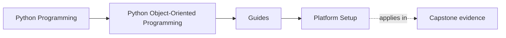

# Platform Setup

<!-- page-maps:start -->
## Page Maps




<!-- page-maps:end -->

Use this page only when the real blocker is environment trust. Do not come here because a
lesson feels difficult. Come here when you need to answer a narrower question:

> Can I trust the documented commands enough that any remaining confusion is about
> object-oriented design rather than about shell drift, interpreter drift, or missing
> dependencies?

This course uses the monitoring-system capstone as its executable proof surface. The
environment is therefore not a side concern. If the supported commands are unstable, the
rest of the course becomes noisy and misleading.

## Setup is finished only when the commands are trustworthy

Setup is not finished when a virtual environment merely exists. Setup is finished when
all four of these are true:

1. you can build the supported environment from the documented Make target
2. you can run the raw executable checks inside that environment
3. you can run at least one saved learner-facing route and inspect its output
4. you can tell which commands are supported and which commands would be improvisation

If only the first item is true, you have an environment. You do not yet have a course
platform you should trust.

## Minimum local requirements

You need:

- Python 3.10 or newer
- Git on the command line
- a writable filesystem for repository `artifacts/`
- the willingness to use the documented Make targets instead of ad hoc command variants

The course does not promise support for arbitrary global package layouts. The supported
contract is the repository-managed route.

## Authoritative setup surfaces

Treat these as the sources of truth:

| Surface | Why it matters |
| --- | --- |
| `capstone/pyproject.toml` | it tells you the supported Python floor and packaging contract |
| `capstone/Makefile` `install` target | it defines the supported environment build |
| `capstone/Makefile` `test`, `inspect`, `verify-report`, and `tour` targets | they define the supported executable proof routes |
| [Command Guide](../capstone/command-guide.md) | it explains when to use each route once setup is stable |

If your local habit conflicts with those surfaces, your habit loses.

## First-day setup route

Use this order the first time through.

From the repository root:

```bash
make PROGRAM=python-programming/python-object-oriented-programming test
make PROGRAM=python-programming/python-object-oriented-programming inspect
```

Or, if you are working directly inside `capstone/`:

```bash
make install
make test
make inspect
```

Why this order:

- `test` proves the environment can build and run the raw executable suite
- `inspect` proves the saved learner-facing inspection route can also run

Do not begin with `proof`. That route is stronger, slower, and less helpful if the
problem is still environment trust.

## What each first-day command proves

| Command | What it proves | What it does not prove |
| --- | --- | --- |
| `make install` | the supported environment can be built | the suite, walkthrough, and saved bundles all work |
| `make test` | the executable checks run inside the supported environment | the learner-facing inspection and review bundles are healthy |
| `make inspect` | the saved inspection route can be generated and reviewed | the full walkthrough or strongest proof route is healthy |
| `make verify-report` | tests and saved review state agree in the supported report route | every possible local command variant is supported |

## What "healthy setup" looks like

After a healthy setup pass, you should be able to say all of this concretely:

- "The supported environment is built by `make install`."
- "The raw suite is confirmed by `make test`."
- "The first saved bundle I trust is produced by `make inspect`."
- "The outputs live under repository `artifacts/`, not in random local folders."

If you cannot say those sentences without hedging, keep working on setup.

## Common failure shapes

| Symptom | Likely cause | Best next move |
| --- | --- | --- |
| virtual environment build fails | unsupported Python on the path | install Python 3.10+ and rerun the supported route |
| tests fail with import or package errors | environment build incomplete or stale | rerun `make install`, then rerun `make test` |
| saved inspection route fails after tests pass | the environment is only partially healthy or the route was run from the wrong place | rerun `make inspect` from the documented location |
| commands behave differently across terminals | global Python or shell aliases are interfering | return to the documented Make targets and stop improvising |
| artifacts show up outside repository `artifacts/` | an unsupported local command path was used | discard the ad hoc route and rerun the supported one |

## Setup drift signals

Re-check the setup contract when any of these happen:

- Python was upgraded locally
- the capstone environment was deleted or partially recreated
- tests pass, but `inspect` or `verify-report` now fail
- command names in the docs and the Makefile no longer match what you are running
- a global tool update changed behavior you did not intentionally request

## Strong habits

- trust Make targets before trusting memory
- prove one small route before escalating to stronger proof
- inspect the saved artifact, not just the shell exit code
- repair setup before diagnosing architecture or ownership questions

## Weak habits

- treating one passing import as proof that the environment is correct
- treating one passing test run as proof that every saved learner route works
- mixing repository-root and `capstone/` commands without noticing
- debugging domain design while command trust is still unresolved

## When this page is the wrong page

Leave this page if:

- the commands work, but you still do not understand which object owns the rule
- the environment is stable, but you do not know which proof route matches the claim
- the real question is conceptual progression, not command trust

In those cases, use [Proof Matrix](proof-matrix.md), [Course Guide](course-guide.md),
or the relevant capstone page instead.

## Exit check

Leave this page only when you can say:

> I trust `____` as the supported environment build, `____` as the first executable
> proof, and `____` as the first saved artifact that confirms the route is stable.
