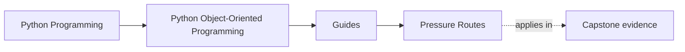
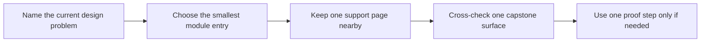

# Pressure Routes

<!-- page-maps:start -->
## Page Maps

<!-- page-maps:end -->

Use this page when the module titles are slower than the real problem in front of you.

It routes from design pressure to the smallest honest starting point.

This page is especially important for a missed-class learner because it lets you enter
by the pressure you can already name instead of pretending you always know the perfect
module order in advance.

## Route by problem

| If the real problem is... | Start with | Keep nearby | Capstone cross-check |
| --- | --- | --- | --- |
| I cannot explain what kind of object this is | Modules 01-03 | [Module Promise Map](module-promise-map.md) | `model.py` and lifecycle tests |
| I do not know where behavior belongs | Module 02 | [Module Checkpoints](module-checkpoints.md) | `application.py`, `model.py`, and policies |
| illegal states keep leaking through | Module 03 | [Module Checkpoints](module-checkpoints.md) | lifecycle tests and inspection outputs |
| one invariant is scattered across several objects | Module 04 | [Proof Ladder](proof-ladder.md) | aggregate, projections, and architecture surfaces |
| retries, cleanup, or error handling feel accidental | Module 05 | [Proof Ladder](proof-ladder.md) | `runtime.py`, `repository.py`, and unit-of-work tests |
| persistence is flattening the domain | Module 06 | [Proof Ladder](proof-ladder.md) | repository boundaries and verification artifacts |
| clocks, queues, threads, or async work are stealing ownership | Module 07 | [Proof Ladder](proof-ladder.md) | runtime tests and walkthrough artifacts |
| tests exist, but I do not trust what they prove | Module 08 | [Module Checkpoints](module-checkpoints.md) | test suite and verification bundle |
| I need a stable public route or extension seam | Module 09 | [Proof Ladder](proof-ladder.md) | application surface and extension guide |
| I need to review whether the design survives production pressure | Module 10 | [Proof Ladder](proof-ladder.md) | full proof route and review worksheet |

The goal of the table is not to replace the course sequence. The goal is to stop a real
problem from turning into random browsing.

## Route by learner situation

| Situation | Start here | Why |
| --- | --- | --- |
| you missed class and only know the symptom | the table above | it lets you enter by pressure instead of by title |
| you know the module name but the examples still feel vague | the named capstone cross-check | it forces one concrete executable surface |
| you keep jumping to late modules | [Module Promise Map](module-promise-map.md) | it reminds you what earlier modules were supposed to settle first |
| you keep over-proving everything | [Proof Ladder](proof-ladder.md) | it sizes the evidence to the question |

This second table exists because learners often need a route not only by topic, but by
study situation.

## Fast paths that are usually safe

- object meaning is weak: go to Modules 01, 02, then 03
- collaboration authority is weak: go to Modules 04, then 05
- persistence or runtime pressure is weak: go to Modules 06, then 07
- trust and governance are weak: go to Modules 08, then 09, then 10

These are safe shortcuts because they still preserve the arc logic of the course.

## Bad route choices to reject

- starting at Module 09 when object roles are still unclear
- starting at Module 10 when authoritative ownership is still unsettled
- reading concurrency material when shared-state discipline is already broken
- using the capstone proof routes as a substitute for learning the earlier ownership
  lessons

When one of these sounds tempting, the right move is usually to narrow the question,
not to jump higher in the stack.

## One-hour rescue route

If you are stuck but want one honest hour:

1. read [Course Guide](course-guide.md)
2. pick one pressure from this page
3. read the matching module overview only
4. inspect the named capstone surface
5. stop after one design question becomes clearer

That is a better rescue than trying to absorb several late-module pages at once.

## Build a pressure note

Before you leave this page, write:

- my real pressure is...
- the smallest module entry is...
- the capstone surface I should inspect is...
- the first proof step I might need is...

That note keeps you from turning a good route into another vague intention.

## Exit check

Leave this page only when you can say:

> My real pressure is `____`, so I should start with `____`, keep `____` nearby, and
> cross-check it in `____`.
