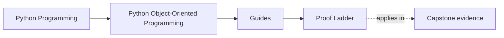
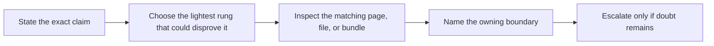

# Proof Ladder

<!-- page-maps:start -->
## Page Maps

<!-- page-maps:end -->

Use this page when the question is not:

- where is the evidence?

but:

- how much evidence is proportionate?

The wrong proof size wastes time and often hides the real design problem. Too little
proof leaves a claim decorative. Too much proof turns every question into a full-system
investigation when a lighter route would have answered it honestly.

## The ladder

| Need | Smallest honest rung | Move up when... |
| --- | --- | --- |
| understand the course arc | [Course Guide](course-guide.md) and [Course Map](../module-00-orientation/course-map.md) | you still cannot place the current pressure |
| understand one module contract | [Module Promise Map](module-promise-map.md) and the module overview | the promise still sounds true only in prose |
| decide whether a module is earned | [Module Checkpoints](module-checkpoints.md) | you cannot point to a concrete capstone surface |
| find the right capstone surface | [Capstone Map](../capstone/capstone-map.md) and [Capstone File Guide](../capstone/capstone-file-guide.md) | you need executable evidence |
| review ownership and architecture | [Capstone Architecture Guide](../capstone/capstone-architecture-guide.md) and [Capstone Walkthrough](../capstone/capstone-walkthrough.md) | the saved or executable evidence still matters |
| inspect saved state or scenario evidence | `make PROGRAM=python-programming/python-object-oriented-programming inspect` or `capstone-walkthrough` | the claim crosses behavior and test agreement |
| review executable confirmation | `make PROGRAM=python-programming/python-object-oriented-programming capstone-verify-report` | you need the strongest local confirmation route |
| confirm the full learner-facing route | `make PROGRAM=python-programming/python-object-oriented-programming capstone-confirm` or `proof` | you are reviewing a public teaching artifact, not a narrow claim |

The ladder works only if you state the claim first. If the claim is vague, every rung
will feel too heavy or too weak.

## What each rung cannot do by itself

- reading pages can clarify intended ownership, but it cannot prove current behavior
- maps and walkthroughs can make the design legible, but they cannot replace targeted
  checks
- inspection bundles can show state and sequence, but they cannot prove every contract
- confirmation routes can prove the current local route, but they cannot rescue a vague
  question

This is why the ladder is not about proving more. It is about proving the right thing at
the right cost.

## Escalation rules

- read before you run when the question is architectural
- run before you speculate when the question is behavioral
- use the lightest rung that could prove you wrong
- escalate one rung at a time instead of jumping directly to the strongest command

The "prove you wrong" test matters because it stops proof from becoming ceremony.

## Common misuse

- using `capstone-confirm` to answer a question settled by a module checkpoint
- reading saved artifacts before naming the owner under review
- treating `proof` as if it were a substitute for understanding the module promise
- escalating because the lighter route felt uncomfortable, not because it failed

The goal is not to avoid strong proof. The goal is to make sure strong proof is earned.

## Quick chooser

| If the question starts with... | Start here |
| --- | --- |
| "what is this module supposed to teach?" | promise map |
| "am I ready to move on?" | checkpoints |
| "which capstone surface matches this?" | capstone map |
| "how does the story look?" | walkthrough |
| "what does the current state prove?" | inspect |
| "do tests and artifacts agree?" | verify-report |
| "does the strongest route still hold?" | capstone-confirm |

Use this table when you know the question shape but not the rung name.

## Build a proof note

Before you use a proof route, write:

- the exact claim is...
- the lightest honest rung is...
- I will escalate only if...

This note sounds small, but it prevents one of the most common self-study mistakes:

- reaching for a heavy proof route because the lighter one felt less impressive

## Exit check

Leave this page only when you can say:

> The claim is `____`, the lightest honest rung is `____`, and I would escalate to
> `____` only if that rung leaves doubt.
