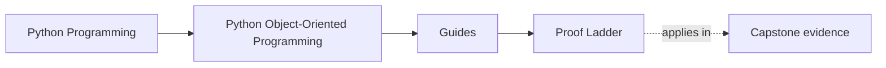
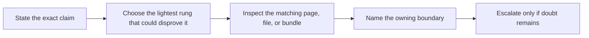

# Proof Ladder

<!-- page-maps:start -->
## Page Maps

<!-- page-maps:end -->

Use this page when the question is not "where is the evidence?" but "how much evidence
is proportionate?" The wrong proof size wastes time and often hides the real design
problem.

## The ladder

| Need | Smallest honest rung | Move up when... |
| --- | --- | --- |
| understand the course arc | [Course Guide](course-guide.md) and [Course Map](../module-00-orientation/course-map.md) | you still cannot place the current pressure |
| understand one module contract | [Module Promise Map](module-promise-map.md) and the module overview | the promise still sounds true only in prose |
| decide whether a module is earned | [Module Checkpoints](module-checkpoints.md) | you cannot point to a concrete capstone surface |
| find the right capstone surface | [Capstone Map](../capstone/capstone-map.md) and [Capstone File Guide](../capstone/capstone-file-guide.md) | you need executable evidence |
| review ownership and architecture | [Capstone Architecture Guide](../capstone/capstone-architecture-guide.md) and [Capstone Walkthrough](../capstone/capstone-walkthrough.md) | the saved or executable evidence still matters |
| inspect saved state or scenario evidence | `make PROGRAM=python-programming/python-object-oriented-programming inspect` or `capstone-walkthrough` | the claim crosses behavior and test agreement |
| review executable confirmation | `make PROGRAM=python-programming/python-object-oriented-programming capstone-verify-report` | you need the strongest local confirmation route |
| confirm the full learner-facing route | `make PROGRAM=python-programming/python-object-oriented-programming capstone-confirm` or `proof` | you are reviewing a public teaching artifact, not a narrow claim |

## What each rung cannot do by itself

- reading pages can clarify intended ownership, but it cannot prove current behavior
- maps and walkthroughs can make the design legible, but they cannot replace targeted checks
- inspection bundles can show state and sequence, but they cannot prove every contract
- confirmation routes can prove the current local route, but they cannot rescue a vague question

## Escalation rules

- Read before you run when the question is architectural.
- Run before you speculate when the question is behavioral.
- Use the lightest rung that could prove you wrong.
- Escalate one rung at a time instead of jumping directly to the strongest command.

## Common misuse

- using `capstone-confirm` to answer a question settled by a module checkpoint
- reading saved artifacts before naming the owner under review
- treating `proof` as if it were a substitute for understanding the module promise
- escalating because the lighter route felt uncomfortable, not because it failed

## Quick chooser

| If the question starts with... | Start here |
| --- | --- |
| "what is this module supposed to teach?" | promise map |
| "am I ready to move on?" | checkpoints |
| "which capstone surface matches this?" | capstone map |
| "how does the story look?" | walkthrough |
| "what does the current state prove?" | inspect |
| "do tests and artifacts agree?" | verify-report |
| "does the strongest route still hold?" | capstone-confirm |

## Exit check

Leave this page only when you can say:

> The claim is `____`, the lightest honest rung is `____`, and I would escalate to
> `____` only if that rung leaves doubt.
