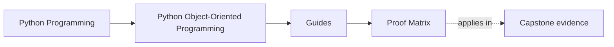
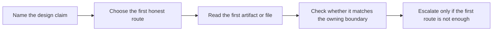

# Proof Matrix

<!-- page-maps:start -->
## Page Maps

<!-- page-maps:end -->

Use this page when the claim is already clear and the remaining problem is route choice.
The question here is precise: which first piece of evidence should you inspect before
you go wider or heavier?

## Core claim-to-evidence routes

| Claim | First route | First surface |
| --- | --- | --- |
| current policy and incident state stay readable without spelunking into internals | `inspect` | `summary.txt` and `snapshot.json` |
| lifecycle rules are explicit rather than hidden in loose flags or callers | `inspect` | `rules.txt`, `model.py`, and `tests/test_policy_lifecycle.py` |
| derived history and active indexes remain downstream of authority | `inspect` | `history.txt`, `timeline.txt`, `read_models.py`, and `projections.py` |
| retirement and alternative evaluation modes remain reviewable under change | `inspect` | `retirement.txt`, `rate_of_change.txt`, and evaluation tests |
| one executable scenario still tells the system story honestly | `capstone-walkthrough` | `walkthrough.txt`, `demo.py`, and `tests/test_demo.py` |
| raw executable checks still defend the ownership model | `test` or `capstone-verify-report` | `pytest.txt` and the targeted test files |

## Bundle and public-route claims

| Claim | First route | First surface |
| --- | --- | --- |
| the capstone can be reviewed through one bounded walkthrough | `capstone-walkthrough` | `walkthrough.txt` and the walkthrough docs |
| tests and saved review state still agree | `capstone-verify-report` | `pytest.txt`, `summary.txt`, and `history.txt` |
| the strongest local confirmation route still holds | `capstone-confirm` | executable suite plus saved bundles |
| the full public learner route still works end to end | `proof` | inspection, walkthrough, and verification bundles together |

## Course outcome to first proof surface

| Course outcome | First route | First surface |
| --- | --- | --- |
| model values and entities without confusing their contracts | `inspect` | `rules.txt`, lifecycle tests, and `model.py` |
| assign behavior to values, entities, policies, or adapters deliberately | `capstone-walkthrough` | `application.py`, `model.py`, and the architecture guide |
| make illegal states harder to construct | `inspect` | lifecycle tests and inspection outputs |
| preserve cross-object invariants through aggregates | `capstone-verify-report` | projections, runtime tests, and saved review state |
| evolve persistence without flattening the model | `capstone-verify-report` | repository boundaries and verification artifacts |
| expose safe extension seams and public routes | `proof` | extension guide, application surface, and saved bundles |

## Route chooser by module band

| Module band | Main question | First evidence surface |
| --- | --- | --- |
| 01-03 | what does this object mean and what states are legal | `rules.txt`, lifecycle tests, and `model.py` |
| 04-05 | where do invariants, failures, and collaboration really live | `history.txt`, `timeline.txt`, runtime and unit-of-work tests |
| 06-07 | how do persistence and runtime pressure stay outside the aggregate | repository boundaries, retirement outputs, and runtime tests |
| 08-10 | which route or surface actually defends the design in public | verification bundle, confirm route, and proof route |

## What this matrix prevents

- reaching for the strongest route before the first honest route
- reading tests first when a saved bundle would answer the question faster
- treating one artifact as if it proves every layer of the design
- forgetting to compare evidence with the owning boundary

## Exit check

Leave this page only when you can say:

> My claim is `____`, the first route is `____`, and the first surface I should inspect
> is `____`.
