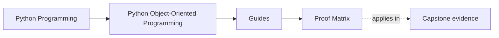

# Proof Matrix

<!-- page-maps:start -->
## Page Maps



```mermaid
flowchart LR
  claim["Name the exact claim"] --> class["Classify the claim type"]
  class --> route["Choose the first honest route"]
  route --> artifact["Inspect the first artifact"]
  artifact --> compare["Compare evidence to the owning boundary"]
  compare --> escalate["Escalate only if the claim is still not settled"]
```
<!-- page-maps:end -->

Use this page when the design question is already clear and the remaining uncertainty is
about proof. This is not the page for "what does the system do?" or "which module should
I study?" It is the page for:

> I think the claim is `____`. What is the smallest honest route that can actually test
> it?

The main mistake this page is trying to prevent is proof inflation: reaching for the
strongest command, the largest test sweep, or the most artifacts before the claim has
earned that weight.

## First classify the claim

Most OOP proof trouble comes from mixing unlike claims. Decide which family you are in
before choosing a route.

| Claim family | Typical question | First thing you need |
| --- | --- | --- |
| semantics claim | what kind of thing is this object, and what does equality or representation mean | model and lifecycle surfaces |
| ownership claim | which object or boundary is authoritative for this rule | owner-facing files plus one supporting artifact |
| lifecycle claim | which states are legal and where illegal transitions are blocked | lifecycle tests and inspection outputs |
| collaboration claim | how several objects participate without stealing authority | aggregate, projection, and runtime relationship surfaces |
| persistence or runtime claim | how storage, publication, or coordination stay downstream of truth | repository/runtime boundaries plus saved evidence |
| public-trust claim | what is safe to expose, extend, or depend on | public route docs, extension surfaces, and stronger proof bundles |

If you cannot classify the claim yet, step back to [Pressure Routes](pressure-routes.md)
or the relevant module page. Proof is premature until the claim itself is stable.

## First honest routes by claim family

| Claim family | First route | First artifact to inspect | Escalate to... |
| --- | --- | --- | --- |
| semantics | `inspect` | `rules.txt`, `model.py`, lifecycle-focused tests | `capstone-verify-report` if the claim reaches beyond one object contract |
| ownership | `capstone-walkthrough` or `inspect` | `walkthrough.txt`, `application.py`, `model.py` | `capstone-verify-report` if collaboration or runtime evidence is needed |
| lifecycle | `inspect` | `rules.txt`, `snapshot.json`, lifecycle tests | `capstone-verify-report` if the claim spans projections or persistence |
| collaboration | `capstone-verify-report` | `history.txt`, `timeline.txt`, `projections.py`, `read_models.py` | `proof` if the claim reaches public review or stewardship level |
| persistence or runtime | `capstone-verify-report` | `pytest.txt`, repository/runtime tests, saved bundles | `proof` if you need the full review route |
| public trust or extension | `proof` | extension docs, public tests, complete saved bundle set | only after smaller routes have already made the boundary legible |

## Concrete capstone claim routes

| Exact claim | First route | First surface | Why this is the honest start |
| --- | --- | --- | --- |
| `MonitoringPolicy` owns lifecycle transitions | `inspect` | `rules.txt`, `model.py`, lifecycle tests | the claim is about domain legality, not full-system behavior |
| evaluation variation does not relocate ownership | `capstone-walkthrough` | `walkthrough.txt`, `policies.py`, `model.py` | the walkthrough shows the policy in use without pretending runtime owns the decision |
| projections stay downstream of truth | `capstone-verify-report` | `history.txt`, `timeline.txt`, `read_models.py`, `projections.py` | you need both executable confirmation and saved derived outputs |
| repository and runtime do not become domain owners | `capstone-verify-report` | `pytest.txt`, `repository.py`, `runtime.py` | the claim reaches beyond one file and needs cross-boundary evidence |
| the public learner route still tells the truth end to end | `proof` | walkthrough, inspection, and verification bundles together | this is an end-to-end claim and should be treated as one |

## Course-outcome to proof route

| Course outcome | First route | First artifact |
| --- | --- | --- |
| distinguish value, entity, policy, and adapter roles | `inspect` | `model.py`, `rules.txt`, lifecycle tests |
| defend the owner of a rule | `capstone-walkthrough` | `walkthrough.txt`, `application.py`, `model.py` |
| make illegal states harder to construct | `inspect` | lifecycle tests and `snapshot.json` |
| preserve invariants through collaboration | `capstone-verify-report` | `history.txt`, `timeline.txt`, aggregate and projection surfaces |
| keep storage and runtime outside the model | `capstone-verify-report` | `repository.py`, `runtime.py`, executable review bundle |
| defend public seams and extension governance | `proof` | public docs, extension surfaces, full saved bundle set |

## Escalation rules

Move to a stronger route only when one of these is true:

- the first route answers only part of the claim
- the claim crosses more boundaries than the first artifact can cover
- the first artifact and the owning code disagree
- you now need public review confidence rather than local design confidence

Do not escalate just because a stronger route exists.

## Bad proof habits

- starting with `proof` because it feels safer than judgment
- reading raw tests first when a saved bundle would answer the question faster
- using one artifact as if it proved semantics, ownership, runtime, and public trust all at once
- treating a green command as proof without checking whether the output actually addresses the claim

## Good proof habits

- write the claim in one sentence before choosing a route
- inspect the first artifact before opening more code
- compare the evidence with the claimed owner directly
- stop as soon as the claim is honestly settled

## When this page is not enough

If you know the claim family but still do not know which route feels proportionate, move
to [Proof Ladder](proof-ladder.md). If you know the route but not the capstone surface,
move to [Capstone Map](../capstone/capstone-map.md).

## Exit check

Leave this page only when you can say:

> My claim is `____`, it is a `____` claim, the first honest route is `____`, and the
> first artifact I should inspect is `____`.
