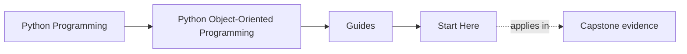
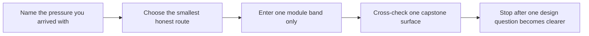

# Start Here

<!-- page-maps:start -->
## Page Maps

<!-- page-maps:end -->

This page is the shortest honest route into the course.

Read it before browsing the module tree. The subject is not class syntax. The subject is
how Python object models stay coherent when they carry:

- state
- invariants
- collaboration
- persistence
- runtime pressure
- public compatibility obligations

If you arrive without a route, the course is easy to wander and harder to learn from.

## Use this course if

- you design or review Python systems where object semantics, invariants, or ownership
  are still fuzzy
- you need clearer boundaries around state, collaboration, persistence, or orchestration
- you want stronger criteria for deciding whether an object-heavy design is trustworthy

## Do not start here if

- you only want syntax review or pattern trivia without system trade-offs
- you want inheritance advice before you understand object meaning and ownership
- you want to treat the capstone as an optional appendix

These limits matter because they keep the course from being misused as a style catalog.

## Readiness check

You are ready for this course if most of these already feel routine:

- writing a small class with a meaningful constructor and a `pytest` test
- explaining the difference between identity and equality in plain Python terms
- using `dataclass` for a simple value type without guessing what it generates
- describing why shared mutable state can create non-local bugs

If those still feel shaky, do not stop. Slow down and treat
[Orientation](../module-00-orientation/index.md) plus
[Module 01](../module-01-object-semantics-data-model/index.md) as a deliberate on-ramp.

## Choose a reading mode before you continue

Do not blend these together.

| Mode | Use it when | Your next move |
| --- | --- | --- |
| foundation | the topic is still new and you need the argument in sequence | read the overview, key lessons, and checkpoint pages in order |
| diagnosis | one real design problem is already in front of you | use [Pressure Routes](pressure-routes.md) to find the smallest honest module |
| review | the design already exists and your question is whether it deserves confidence | start from a capstone surface and the lightest honest proof route |

If you switch modes, name it explicitly. The course feels clumsy when you try to review
architecture with foundation-level gaps still unresolved.

## Best reading route

If you want the safest full entry route, do this:

1. read [Course Home](../index.md)
2. read [Course Guide](course-guide.md)
3. read [Learning Contract](learning-contract.md)
4. read [Proof Ladder](proof-ladder.md)
5. read [Orientation](../module-00-orientation/index.md)
6. open [Capstone](../capstone/index.md) only after the current ownership question is
   clear enough to name

This route is slightly slower than random browsing, but far faster than getting lost in
late-module vocabulary too early.

## If you need a session-sized plan

Use one of these instead of opening everything:

| Time | Honest session plan |
| --- | --- |
| 20 minutes | read one module overview, inspect one named capstone surface, stop after one stable ownership answer |
| 45 minutes | read one overview, one key lesson, and one support page, then inspect one capstone file and one proof surface |
| 90 minutes | read one full module, inspect the matching capstone guide and source surface, then use the narrowest proof route that actually answers the question |

If the second half of the course is the real source of density, switch to
[Pressure Routes](pressure-routes.md) instead of opening late modules at random.

## If you only have one hour

1. read [Course Home](../index.md)
2. read [Orientation](../module-00-orientation/index.md)
3. read [Module Promise Map](module-promise-map.md)
4. choose one row from [Pressure Routes](pressure-routes.md)
5. end with one named capstone surface, not the heaviest proof command

The point is to reduce one real question, not to accumulate pages.

## If you are tired but still want honest progress

1. read one module overview only
2. read one support page that narrows the question:
   [Pressure Routes](pressure-routes.md) or
   [Module Checkpoints](module-checkpoints.md)
3. inspect one capstone surface named by that page
4. stop after you can say which boundary owns the behavior

This route keeps tired reading from becoming fake progress.

## Fast safe arcs

Use these when the course still feels too large:

- Modules 01 to 03 when object semantics, equality, or state design feel fuzzy
- Modules 04 to 07 when the main difficulty is collaboration, persistence, or runtime
  pressure
- Modules 08 to 10 when the design already exists and the question is whether it is
  trustworthy under tests, public use, and operations

## First pages to keep open

- [Course Home](../index.md)
- [Course Guide](course-guide.md)
- [Orientation](../module-00-orientation/index.md)
- [Module Checkpoints](module-checkpoints.md)
- [Capstone](../capstone/index.md)

Keep them open only if they are helping you make the next move smaller and clearer.

## Success signal

You are using the course correctly if each module makes one design question easier to
answer in the capstone:

- what changed
- who should own it
- why that owner is the least surprising place for it to live

If the pages are increasing vocabulary without increasing clarity, route back to
[Course Home](../index.md) and [Pressure Routes](pressure-routes.md).

## Exit check

Leave this page only when you can say:

> I am reading in `____` mode, my current pressure is `____`, and the smallest honest
> next route is `____`.
