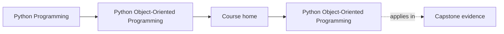
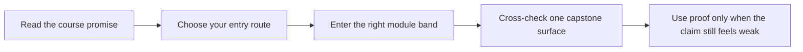

# Python Object-Oriented Programming

<!-- page-maps:start -->
## Page Maps

<!-- page-maps:end -->

This course teaches object-oriented Python as a discipline of explicit semantics, clear
responsibilities, and durable system boundaries.

The subject is not class syntax in isolation. The subject is how Python object models
behave when they carry:

- state
- invariants
- collaboration boundaries
- persistence pressure
- runtime pressure
- public compatibility obligations

Read this home page as a contract about what kind of learning path you are entering, not
as a decorative landing page.

## What this course is trying to change

By the end of the course, you should be able to answer all of these cleanly:

- what does this object mean?
- what is it allowed to decide?
- where should that decision boundary stop?
- what pressure would reveal that the design is lying?

If those questions become easier to answer, the course is working.

If you finish with only more vocabulary, it is not.

## Use this course if

- you already know basic Python class syntax and want stronger design judgment
- you review systems where object meaning, ownership, or lifecycle still feel blurry
- you want OOP material that stays tied to tests, capstone proof, and long-lived change
- you need one course that carries the topic all the way from object semantics to
  operational review

## Do not use this course as

- a first introduction to `class`, `self`, or inheritance syntax
- a pattern catalog detached from Python runtime behavior
- a reason to force classes into problems that should stay functions or plain data
- a skim-only reference where later modules can replace earlier semantic work

These exclusions matter because they protect the course from being misread as style
advice or pattern trivia.

## The one question that holds the course together

Keep this question visible from beginning to end:

> Which object should own this decision, and what makes that ownership boundary the
> least surprising place for it to live?

That question is the thread connecting all ten modules.

Once you stop treating the modules as isolated topics and start treating them as
repeated pressure tests for that ownership discipline, the full course becomes much
easier to use.

## The course is one argument, not ten disconnected topics

The argument moves in this order:

1. objects must mean something before architecture advice is useful
2. roles and states must be clear before collaboration gets complicated
3. collaboration must be disciplined before persistence and runtime pressure arrive
4. proof, public boundaries, and operations matter only after ownership already makes
   sense

If you skip that order, later modules feel "advanced" only because earlier ownership
work never became stable.

## The three working arcs

| Arc | Modules | What you are trying to earn |
| --- | --- | --- |
| semantic floor | 01-03 | define what objects are, what they own, and what states are legal |
| systems arc | 04-07 | preserve that ownership under collaboration, resources, persistence, time, and concurrency pressure |
| trust arc | 08-10 | prove, expose, govern, and harden the design so it survives review and real use |

This matters for self-study because it tells you which kind of density you are facing.
If you struggle in the trust arc because the semantic floor is weak, the fix is usually
to go backward, not to push harder.

## Fast entry routes

Choose one route before you open more pages.

| If you need... | Start with | Then |
| --- | --- | --- |
| the shortest honest entry | [Start Here](guides/start-here.md) | [Orientation](module-00-orientation/index.md) |
| the full ten-module arc first | [Course Guide](guides/course-guide.md) | [Module Promise Map](guides/module-promise-map.md) |
| a pressure-based entry | [Pressure Routes](guides/pressure-routes.md) | the smallest matching module overview |
| a proof-sized entry | [Proof Ladder](guides/proof-ladder.md) | one capstone surface and then the smallest honest proof route |
| a review bar before moving on | [Module Checkpoints](guides/module-checkpoints.md) | the current module overview |

If you do not choose a route, the book is easy to browse and harder to learn from.

## If you missed class and are studying alone

Use this rhythm:

1. read one module overview
2. read one support page that narrows the question
3. inspect one named capstone surface
4. run one proof route only if the design claim still feels weak
5. stop after one design question becomes materially easier

That rhythm is better than trying to "cover" several modules in one sitting.

## If you only have one hour

Use this sequence:

1. [Start Here](guides/start-here.md)
2. [Orientation](module-00-orientation/index.md)
3. [Module Promise Map](guides/module-promise-map.md)
4. one row from [Pressure Routes](guides/pressure-routes.md)
5. one capstone surface named by that row

Do not jump straight to the heaviest proof command if the ownership question is still
unclear.

## What to keep open while reading

| When you need... | Keep this page open too |
| --- | --- |
| the course promise translated into module promises | [Module Promise Map](guides/module-promise-map.md) |
| the move-on bar for the current module | [Module Checkpoints](guides/module-checkpoints.md) |
| a pressure-based route into the course | [Pressure Routes](guides/pressure-routes.md) |
| the lightest honest proof route | [Proof Ladder](guides/proof-ladder.md) |
| the strongest review prompts nearby | [Reference Review Checklist](reference/review-checklist.md) |

These support pages are not filler. They are there to keep a solo learner from turning a
reader-first course into a random shelf of pages.

## Module table of contents

| Module | Title | What it is really doing |
| --- | --- | --- |
| [Module 00](module-00-orientation/index.md) | Orientation and Study Practice | teaches how to read the course, use the support shelf, and reconnect every module to the capstone |
| [Module 01](module-01-object-semantics-data-model/index.md) | Object Semantics and the Python Data Model | defines identity, equality, copying, aliasing, and representation as contracts |
| [Module 02](module-02-design-roles-interfaces-layering/index.md) | Design Roles, Interfaces, and Layering | places behavior in values, entities, policies, services, adapters, and protocols with reasons |
| [Module 03](module-03-state-validation-typestate/index.md) | State, Validation, and Typestate | makes legal states easier to construct than illegal ones |
| [Module 04](module-04-aggregates-events-collaboration-boundaries/index.md) | Aggregates, Events, and Collaboration Boundaries | keeps cross-object invariants from dissolving into accidental collaboration |
| [Module 05](module-05-resources-failures-safe-evolution/index.md) | Resources, Failures, and Safe Evolution | keeps retries, cleanup, and recovery tied to named owners |
| [Module 06](module-06-persistence-serialization-schema-evolution/index.md) | Persistence, Serialization, and Schema Evolution | adapts storage to the domain without flattening meaning |
| [Module 07](module-07-time-scheduling-concurrency-boundaries/index.md) | Time, Scheduling, and Concurrency Boundaries | adds clocks, tasks, queues, and concurrency without stealing ownership |
| [Module 08](module-08-testing-contracts-verification-depth/index.md) | Testing, Contracts, and Verification Depth | turns verification into a design discipline instead of afterthought coverage |
| [Module 09](module-09-public-apis-extension-governance/index.md) | Public APIs, Extension Seams, and Governance | publishes stable routes and narrow extension seams without losing review control |
| [Module 10](module-10-performance-observability-security-review/index.md) | Performance, Observability, and Security Review | reviews the design under pressure, visibility, trust, and long-term stewardship |

## The running example

The course uses a monitoring-system domain as the running capstone.

That domain is:

- small enough to reason about
- rich enough to force real design choices
- operational enough to test persistence, runtime, governance, and review discipline

Use the capstone as a design mirror, not only as a sample application.

## What you should be able to do by the end

By the end of the course, you should be able to:

- model value objects and entities without confusing their contracts
- choose composition, inheritance, protocols, or plain functions deliberately
- design state transitions so illegal states are difficult to construct
- enforce cross-object invariants through aggregate roots and disciplined APIs
- evolve storage, codecs, and compatibility boundaries without flattening the domain
- keep time, concurrency, logging, retries, and observability explicit
- publish public APIs and extension points that remain governable under change
- review one design change across semantics, proof, public contract, and operations

## Common failure modes this course is trying to prevent

- treating classes as containers instead of contracts
- using inheritance because it feels reusable rather than because it preserves a stable
  role
- hiding invalid states behind `None`, flags, or informal conventions
- scattering invariants across multiple objects with no clear owner
- mixing domain rules, orchestration, persistence, and integrations in the same class
- letting serialized shapes, async wrappers, or plugin hooks bypass the intended
  boundaries
- optimizing or instrumenting the system in ways that quietly change semantics or expose
  secrets

## Reading order

- Start with [Start Here](guides/start-here.md).
- Continue with [Orientation](module-00-orientation/index.md).
- Keep [Course Guide](guides/course-guide.md), [Learning Contract](guides/learning-contract.md), and [Module Promise Map](guides/module-promise-map.md) nearby.
- Work through Modules 01 to 10 in order unless [Pressure Routes](guides/pressure-routes.md) gives you a narrower honest entry.
- Use [Capstone](capstone/index.md) and [Proof Ladder](guides/proof-ladder.md) to connect prose to runnable proof only when the claim still feels weak.

## Exit check

Leave this page only when you can say:

> My entry route is `____`, the ownership question I am carrying is `____`, and the
> first module band I actually need is `____`.
