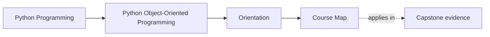
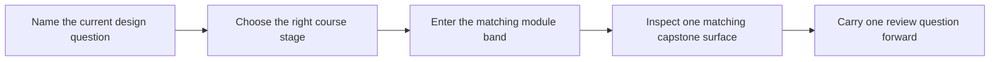

# Course Map

<!-- page-maps:start -->
## Page Maps

<!-- page-maps:end -->

This page is the orientation hub for the whole course. Its job is simple: help a reader
see where they are, what kind of question the current stage is meant to answer, and why
the modules are grouped the way they are.

## The course in one view

| Stage | Modules | Main question |
| --- | --- | --- |
| first contact | 01-03 | what is this object, what should it own, and what states are legal |
| system pressure | 04-07 | how do those objects collaborate, persist, and survive runtime pressure |
| trust and stewardship | 08-10 | how do we prove, expose, govern, and harden the design over time |

## How to read the course

- Start with the stage that matches your current question, not your anxiety.
- Use one stage map at a time instead of trying to hold all ten modules in memory.
- Return to the capstone after each module band so the ideas stay executable.
- Treat the support pages as route tools, not as substitute lessons.

## Route by question

| If your question is... | Start here | Then |
| --- | --- | --- |
| What is this object and what contract does it carry? | [First-Contact Map](first-contact-map.md) | Modules 01-03 |
| Where should collaboration, invariants, or orchestration live? | [Mid-Course Map](mid-course-map.md) | Modules 04-07 |
| Is this design trustworthy to test, expose, extend, or ship? | [Mastery Map](mastery-map.md) | Modules 08-10 |

## What each stage is really for

### First-contact stage

Modules 01-03 give you the language of the course:

- object meaning
- role placement
- legal state and transition design

If this stage is weak, later architecture advice sounds advanced only because the
ownership model never became stable.

### System-pressure stage

Modules 04-07 show what happens when the object model meets real pressure:

- aggregates and cross-object invariants
- failure handling and change cost
- persistence and schema evolution
- time, queues, and concurrency boundaries

This is where the course stops being "about classes" and becomes about survivable design.

### Trust-and-stewardship stage

Modules 08-10 ask whether the design deserves to live:

- do tests prove the right contracts
- what is public and what is internal
- what breaks under performance, observability, or trust pressure

## Best support pages for each stage

| Stage | Best support pages |
| --- | --- |
| first contact | [Module Promise Map](../guides/module-promise-map.md) and [Module Checkpoints](../guides/module-checkpoints.md) |
| system pressure | [Pressure Routes](../guides/pressure-routes.md) and [Proof Matrix](../guides/proof-matrix.md) |
| trust and stewardship | [Proof Ladder](../guides/proof-ladder.md) and [Review Checklist](../reference/review-checklist.md) |

## Best capstone surfaces for each stage

| Stage | Best capstone surfaces |
| --- | --- |
| first contact | `model.py`, lifecycle tests, `rules.txt` |
| system pressure | architecture guide, projections, repository and runtime surfaces |
| trust and stewardship | verification bundle, extension guide, review worksheet, and full proof route |

## Common orientation mistakes

- entering late modules because they sound more "advanced"
- treating persistence or concurrency as separate from ownership
- reading the capstone proof routes before choosing the stage and question
- forgetting that each later stage is supposed to be a consequence of the earlier one

## Exit check

Leave this page only when you can say:

> My current question belongs to the `____` stage, so I should start with `____`,
> move through `____`, and inspect `____` in the capstone.
