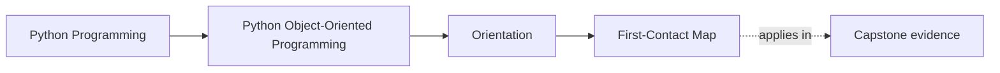
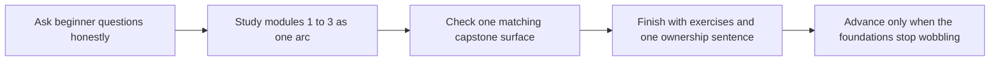

# First-Contact Map

<!-- page-maps:start -->
## Page Maps

<!-- page-maps:end -->

Use this map when you are entering the course for the first time or when you realize the
foundations still feel shaky. This opening stretch is not "basic OOP" in the thin sense.
It is where the course teaches the judgment that later modules assume:

- what an object means
- where behavior belongs
- how legal state stays legal over time

If those three answers are still unstable, later modules will feel advanced for the
wrong reason.

## What this stretch must settle

By the end of modules 1 to 3, you should be able to answer three questions without
guessing:

1. What kind of thing is this object really?
2. Which object should own this rule?
3. Which states are legal, and where are illegal ones blocked?

Everything else in the course builds on those answers.

## Read modules 1 to 3 as one teaching sequence

| Module | Core question | Design mistake it prevents | What you should be able to say afterward |
| --- | --- | --- | --- |
| Module 1: object semantics and the data model | what does this object mean in Python and in the domain | confusing syntax familiarity with semantic clarity | "I know what equality, identity, representation, and aliasing mean for this object." |
| Module 2: roles, interfaces, and layering | who should own the behavior | smearing logic across nearby classes or reaching for inheritance too early | "I can defend the owner and reject the tempting non-owner." |
| Module 3: state, validation, and typestate | how legal state is preserved through time | tolerating half-built objects and vague transition rules | "I can name legal transitions and where illegal ones are stopped." |

## What to focus on in Module 1

Module 1 is about object meaning, not class syntax. Stay here until you can reason about:

- identity versus value
- representation versus domain meaning
- aliasing and copying consequences
- which data-model hooks become public contract

The right beginner question is not "can I write `__eq__`?" It is "what promise would
`__eq__` make if I wrote it here?"

## What to focus on in Module 2

Module 2 turns isolated objects into a design. The important move is ownership
comparison.

When behavior placement feels fuzzy:

1. name the chosen owner
2. name the closest rejected owner
3. explain why the rejected owner would make the design harder to reason about

If you skip step 3, you probably do not understand the boundary yet.

## What to focus on in Module 3

Module 3 makes state a first-class design surface. The question is no longer "which
fields does this class have?" but:

- which states are legal
- which transitions are legal
- which transitions are impossible by construction
- which optional values are actually missing lifecycle design

This is where many object models stop being hopeful and start becoming trustworthy.

## A strong first-pass route for independent learners

1. Read the module overview for Module 1.
2. Complete the first three core lessons before touching advanced-looking side topics.
3. Open one capstone surface that shows the same pressure in real code.
4. Finish the module exercises and answers.
5. Write one sentence beginning with `This object means...`.
6. Repeat the same rhythm for Modules 2 and 3, changing the sentence stem to match the
   module.

Recommended sentence stems:

- Module 1: `This object means...`
- Module 2: `The authoritative owner is...`
- Module 3: `The legal transition is...`

## Best capstone checks for this stage

| Module | Best first capstone surface | Why |
| --- | --- | --- |
| Module 1 | `capstone/src/service_monitoring/model.py` | it exposes object meaning, identity, and representation choices directly |
| Module 2 | `model.py` and `application.py` together | they show the line between public entry and authoritative domain owner |
| Module 3 | lifecycle-focused tests plus `rules.txt` from the inspection bundle | they make legal and illegal transitions visible |

Do not start with `runtime.py` in this stage. Runtime coordination is not the first
question yet.

## Signs you are moving too fast

- you are talking about patterns before you can explain equality or aliasing
- you are adding helper services because ownership feels uncomfortable
- you are calling something "optional" when the real issue is a missing state model
- you want Module 4 because it sounds more advanced, not because Modules 1 to 3 feel settled

## Signs you are ready for the middle stretch

You are ready for Modules 4 to 7 when you can do all of these without hand-waving:

- classify an object by meaning instead of by syntax
- defend where a rule belongs and where it does not belong
- describe one legal lifecycle and one illegal lifecycle for a core object

## Exit check

Leave this map only when you can say:

> My first-pass route is `____`, the question I am currently settling is `____`, and I
> will know I can advance when `____`.
