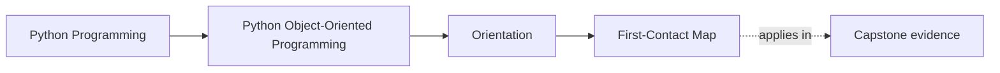

# First-Contact Map

<!-- page-maps:start -->
## Page Maps

<!-- page-maps:end -->

Read the first diagram as a placement map: this page is one concept inside its parent module, not a detached essay, and the capstone is the pressure test for whether the idea holds. Read the second diagram as the working rhythm for the page: name the problem, study the example, identify the boundary, then carry one review question forward.

Use this map when you are new to the course, returning after a break, or unsure
whether you should begin with syntax review or with design review. This part of the
course is where you build the vocabulary that later modules assume without re-teaching.

## What this opening stretch is for

Modules 1 through 3 answer three beginner-to-intermediate questions that many OOP
courses leave blurry:

1. What kind of thing is this object really?
2. Which object should own this rule?
3. How do I stop illegal states from leaking into everything else?

If those questions still feel unstable, do not jump ahead to aggregates, persistence,
or extension points. Later modules become much easier once these three answers feel
natural.

## Read these modules as one progression

| Module | The pressure it resolves | The mistake it prevents | The sign you are ready to move on |
| --- | --- | --- | --- |
| Module 1: object semantics and the data model | understanding what Python objects mean at runtime | inventing classes without understanding identity, equality, aliasing, or representation | you can explain why an object is compared by identity, value, or not at all |
| Module 2: roles, interfaces, and layering | deciding where behavior belongs | stuffing logic into whichever class is closest, or reaching for inheritance too early | you can defend one owner and reject a nearby non-owner |
| Module 3: state, validation, and typestate | keeping rules true over time | tolerating half-built objects, nullable drift, and silent illegal transitions | you can name legal transitions and the first place invalid ones are blocked |

## Module 1: learn Python object meaning before architecture

Read Module 1 if you still hear yourself saying things like "it is just a class" or
"I guess this object stores some state." The module exists to make object meaning
concrete.

Focus questions:

- What makes two instances the same, different, or dangerously confusing?
- Which parts of state are real domain meaning, and which are only representation?
- Which data-model hooks change the public contract with containers, iteration, or copying?

Read in this order:

1. object identity, state, and behavior
2. attribute layout and lookup
3. construction and invariants
4. representation, equality, hashing, aliasing, and copying
5. the data model as a contract surface
6. the refactor chapter

Do not leave Module 1 merely because the code examples look familiar. Leave only when
you can explain the consequences of one design choice, not just recognize the syntax.

## Module 2: turn objects into roles with clear authority

Read Module 2 when single objects make sense in isolation but whole designs still feel
like crowded rooms. The goal is not to add patterns. The goal is to make each role
less surprising.

Focus questions:

- Is this object a value, entity, service, adapter, policy, or something else?
- Why is composition better here than inheritance?
- Which layer should know about this decision, and which layer should stay ignorant?

The most important recovery move in Module 2 is comparison. When a boundary feels
arbitrary, compare the chosen owner with the closest rejected owner and write down why
the rejected one would make the design harder to reason about.

## Module 3: make state transitions explicit instead of hopeful

Read Module 3 when object responsibilities are clearer but object lifecycles still feel
fragile. This module turns state from "fields on a class" into an explicit design
surface.

Focus questions:

- Which states are legal, illegal, draft-only, active-only, or retired?
- Which validation belongs at construction, and which belongs at transition time?
- Which optional value is actually a missing state model?

The refactor in this module matters because it forces you to redesign APIs around state
transitions rather than adding another validation helper.

## A good first-pass study route

If you are studying alone, use this route instead of sampling pages randomly:

1. Read the index page for Module 1, then the first three core lessons.
2. Inspect one capstone file or test that makes identity or representation decisions visible.
3. Finish Module 1 with the refactor and exercises.
4. Repeat the same rhythm for Modules 2 and 3.
5. After each module, write one sentence beginning with `The authoritative owner is...`.

## Warning signs that you are moving too fast

- You are talking about patterns before you can explain equality or aliasing.
- You are adding services because ownership feels unclear.
- You are calling something "optional" when the real problem is a missing lifecycle step.
- You are reading Module 4 because it sounds advanced, not because Modules 1 to 3 feel stable.

## Exit check

You are ready for the middle stretch of the course when you can do all three of these:

- classify an object by meaning instead of by syntax
- defend where a rule belongs and where it does not belong
- describe one legal lifecycle and one illegal lifecycle for a core object
