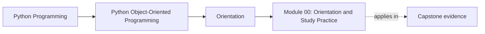

# Module 00: Orientation and Study Practice

<!-- page-maps:start -->
## Page Maps

<!-- page-maps:end -->

Read the first diagram as a placement map: this page sits between the course promise,
the orientation maps listed below, and the capstone surfaces that pressure-test the
whole program. Read the second diagram as the study route for this page, so the diagrams
point you toward the `Orientation map`, `Capstone roadmap`, and `Closing criteria`
instead of acting like decoration.

Python gives you enough flexibility to model almost anything. That flexibility becomes
useful only when you can answer three questions clearly:

- what does this object mean?
- what is it allowed to decide?
- where should that decision boundary stop?

This course is organized to make those questions habitual. The technical topics grow
from syntax and semantics into persistence, runtime coordination, verification, public
API discipline, and operational review, but the ownership question stays central the
whole time.

Keep one question in view while reading the full course:

> Which object should own this decision, and what makes that ownership boundary the least surprising place for it to live?

That question is the thread connecting all ten modules. The course is easier to use once
you stop treating the modules as separate topics and start treating them as repeated
pressure tests for the same ownership discipline.

## Why this orientation matters

Many learners struggle with advanced object-oriented material not because the concepts
are impossible, but because they start the course with the wrong expectation.

This course is not mainly about:

- Python syntax review
- inheritance tricks
- pattern names without context

It is about using Python’s object model deliberately so later architectural and
operational choices still make sense under change.

That means you should approach the course like a guided design review, not like a syntax
catalog.

## What this course is not

- It is not a first introduction to `class`, `self`, or inheritance syntax.
- It is not a defense of classes for every problem.
- It is not a pattern glossary detached from Python’s runtime behavior.
- It is not a collection of isolated refactoring tips.

These exclusions matter because they stop you from reading advanced design pages as
though they were merely style opinions.

## What this course is

This course is six things at once, in a deliberate order:

- a semantics-first guide to Python objects and the data model
- a design guide to responsibility, collaboration, and layering
- a lifecycle guide to validation, typestate, and state transitions
- a systems guide to aggregates, repositories, events, projections, and runtime boundaries
- a verification and governance guide to public APIs, extension seams, and long-lived change
- an operational hardening guide to performance, observability, security, and production review

Reading the course with that full arc in mind helps later modules feel like progression
instead of topic jumps.

## Readiness check

You are ready for the course if most of these already feel routine:

- defining a class with a meaningful constructor and instance methods
- explaining the difference between class attributes and instance attributes
- writing a small `pytest` test for object behavior
- using `dataclass` for a simple value type
- explaining why mutating shared state can create non-local bugs

If some of those are still shaky, do not stop. Instead, slow down and treat examples as
things to run and inspect rather than as things to understand only by intuition.

## How to use this orientation module

Do not skim this page and jump straight into Module 01 with no plan.

Instead:

1. read the full [Course Map](course-map.md)
2. read [Module Promise Map](../guides/module-promise-map.md) so the ten-module contract stays visible
3. read [Module Checkpoints](../guides/module-checkpoints.md) so you know what each module is supposed to change in your judgment
4. choose which checkpoint map you will revisit first based on where you expect to struggle

This keeps the course reader-first. You should know how to navigate before the design
pressure increases.

## Orientation map

- [Course Map](course-map.md)
- [First-Contact Map](first-contact-map.md)
- [Mid-Course Map](mid-course-map.md)
- [Mastery Map](mastery-map.md)

These four pages are not filler. They are there so you can re-enter the course from
different states:

- first contact when the full scope still feels large
- mid-course when the topics start overlapping
- mastery review when you want the course to function like one system again

## Capstone roadmap

The monitoring-system capstone matures with the course.

- Module 01 establishes the value, entity, and object-meaning discipline needed to trust its core types.
- Module 02 explains the split between domain, policy, runtime orchestration, adapters, and the composition root.
- Module 03 explains lifecycle states, validation boundaries, and typestate discipline.
- Module 04 explains aggregates, events, projections, and cross-object collaboration surfaces.
- Module 05 explains failure handling, cleanup duties, and safe evolution pressure.
- Module 06 explains repositories, codecs, sessions, and schema change without flattening the model.
- Module 07 explains clocks, queues, schedulers, and async boundaries without leaking them into aggregates.
- Module 08 turns testing into contract-driven proof instead of loose example coverage.
- Module 09 explains how a stable facade and governed extension seams could be published safely.
- Module 10 reviews the whole design for performance, observability, trust boundaries, and operational readiness.

This roadmap matters because every later module assumes you still understand what the
capstone was supposed to preserve from the earlier ones.

## Common ways learners get lost

- treating the course as if modules can be learned independently with no retained ownership story
- focusing on syntax familiarity and ignoring semantic meaning
- reading the capstone as finished code instead of as a pressure-tested teaching artifact
- skipping the checkpoint and promise guides, then losing the thread of what each module is adding

If one of these sounds familiar, use the orientation maps actively instead of passively.

## Exercises

- Write the core ownership question of the course in your own words, then name one design mistake it should prevent.
- Identify the prerequisite that feels least automatic for you, then name the first module where that weakness would create review confusion.
- Open [Course Map](course-map.md), [Module Promise Map](../guides/module-promise-map.md), and [Module Checkpoints](../guides/module-checkpoints.md), then decide which one you will revisit after Module 01 and why.

## Closing criteria

- You can explain what this course means by object-oriented design discipline rather than syntax familiarity.
- You know which orientation guide to revisit when you need a full map, a promise map, or a checkpoint bar.
- You can describe how the capstone grows from semantic example to operational review surface across Modules 01 to 10.

## Stable vocabulary

Use [Reference Glossary](../reference/glossary.md) when you want the recurring language
in this course kept stable while you move between orientation, modules, guides, and
capstone proof.
