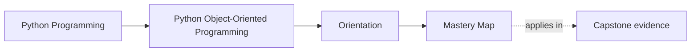
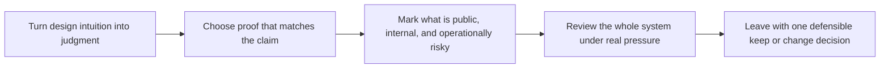

# Mastery Map

<!-- page-maps:start -->
## Page Maps

<!-- page-maps:end -->

Use this map when the question is no longer "can I model this object?" but "can I defend
this design to another engineer, keep it healthy under change, and know what evidence is
strong enough to trust it?" The final stretch of the course is about stewardship, not
feature accumulation.

## What mastery means here

Mastery in this course does not mean collecting the most patterns or the most Python
tricks. It means you can do three hard things repeatedly:

1. choose evidence that matches the strength of the claim
2. decide what should be public, internal, extensible, or unsupported
3. review the design under operational pressure without flattering yourself

These are the skills that distinguish "I can write objects" from "I can steward a
system."

## Read modules 8 to 10 as one stewardship sequence

| Module | Main question | Late-course trap it prevents | What you should be able to say afterward |
| --- | --- | --- | --- |
| Module 8: testing, contracts, verification depth | what proof is honest for this claim | using heavy proof everywhere or weak proof for serious claims | "I know the first honest route and why stronger routes are unnecessary or necessary." |
| Module 9: public APIs and extension governance | what others may safely rely on | exposing convenience internals and calling them supported later | "I know what is public, what is internal, and what support promise each choice implies." |
| Module 10: performance, observability, security, capstone review | can this design survive real operational pressure | treating operations, trust, and performance as bolt-on concerns | "I can name one real risk, the signal that reveals it, and the judgment it forces." |

## Module 8: make proof proportionate

Module 8 is where confidence stops being emotional and becomes reviewable. The main
question is not "do we have tests?" It is:

- what claim are we making?
- what is the first honest route that can test it?
- which stronger route would be wasteful, and which weaker route would be misleading?

Stay here until you can explain why one route is right and another one is wrong. That is
stronger evidence of mastery than any raw test count.

## Module 9: govern public dependence deliberately

Module 9 matters because systems become fragile when every useful seam quietly becomes a
supported contract. This module teaches deliberate permission.

Keep asking:

- which names, modules, behaviors, and protocols are intentionally public?
- which customization seam is narrow enough to support without exposing internals?
- which compatibility promise must be visible before change pressure arrives?

If your answer is "we can always clean it up later," the governance decision is not yet
made.

## Module 10: review the whole design under operational pressure

Module 10 brings the course together. It is not just a performance chapter and not just
a security chapter. It is a system judgment chapter.

Ask:

- what should be measured before optimized?
- which signals would reveal ownership drift in production?
- where are the trust boundaries, serialization hazards, or operational weak points?
- which current design choice is acceptable today but dangerous under extension pressure?

The point is to leave with explicit review judgment, not with a vague feeling that the
design is "good enough."

## A strong final-pass route for independent learners

1. Finish Module 8 and write one sentence beginning with `The first honest evidence is...`.
2. Finish Module 9 and write one sentence beginning with `The supported public boundary is...`.
3. Finish Module 10 and write one sentence beginning with `The operational risk I would watch first is...`.
4. Use the capstone review surfaces to defend one keep decision and one change decision.

This final-pass route turns understanding into judgment you can actually communicate.

## Best capstone checks for this stage

| Module | Best first capstone surface | Why |
| --- | --- | --- |
| Module 8 | verification bundle, walkthrough bundle, proof guide | they show how evidence strength changes with claim scope |
| Module 9 | `application.py`, public tests, extension guidance | they expose what others might depend on and what should stay private |
| Module 10 | review worksheet, saved bundles, architecture surfaces | they force a whole-system judgment with named evidence |

## Late-course traps

- treating mocks or helper assertions as proof of architecture by default
- exposing an internal helper because it feels useful today
- optimizing before naming the hot path or the user-facing cost
- calling the design secure because tests pass
- assuming observability is only about process health rather than object-model drift

## Signs you are ready to leave the course

You are ready to leave the course only when you can do all of these without hand-waving:

- defend a proof route as proportionate to the claim
- mark a boundary public or internal with reasons and support implications
- name one operational, performance, or trust risk and the evidence that would reveal it

## Exit check

Leave this map only when you can say:

> The current judgment I need to make is `____`, the evidence I would show first is
> `____`, and the boundary or risk I can now defend is `____`.
