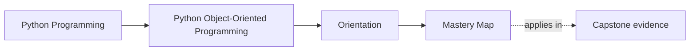

# Mastery Map

<!-- page-maps:start -->
## Page Maps

<!-- page-maps:end -->

Read the first diagram as a placement map: this page is one concept inside its parent module, not a detached essay, and the capstone is the pressure test for whether the idea holds. Read the second diagram as the working rhythm for the page: name the problem, study the example, identify the boundary, then carry one review question forward.

Use this map when you are no longer asking "how do I write this object?" and are now
asking "is this design trustworthy enough to ship, extend, and defend?" The final
stretch of the course is about stewardship: proof, public contracts, and operational
honesty.

## What mastery means in this course

Mastery here does not mean knowing the most patterns, the most decorators, or the most
Python tricks. It means you can do three hard things reliably:

1. choose an evidence route that matches the strength of your claim
2. decide what is public, extensible, and safe to depend on
3. judge whether the system is ready for production pressure without lying to yourself

These closing modules exist to turn design intuition into reviewable judgment.

## Read these modules as a stewardship sequence

| Module | Main question | Common late-course mistake | Completion signal |
| --- | --- | --- | --- |
| Module 8: testing, contracts, and verification depth | how do I prove this design honestly? | using heavyweight tests everywhere or shallow tests for serious claims | you can choose the narrowest proof that still tells the truth |
| Module 9: public APIs and extension governance | what should others be allowed to rely on? | exposing convenient internals and calling them extension points later | you can state what is public, what is internal, and why |
| Module 10: performance, observability, security, and capstone review | can this design survive real operational pressure? | treating operations, trust, and performance as bolt-on concerns | you can defend one keep/change decision with concrete evidence |

## Module 8: make proof proportional to the claim

This module teaches mature verification, not test accumulation. The question is never
"do we have tests?" The question is "does the current proof surface actually cover the
claim we are making?"

Read this module with these questions:

- Is this a behavior claim, a state-transition claim, a boundary contract, or a system claim?
- Which proof route is the first honest one?
- Which route would be wasteful, misleading, or too weak?

Stay here until you can explain why one proof route is right and another one is wrong.
That is a stronger sign of mastery than test-count comfort.

## Module 9: govern what becomes public

This module matters because systems rot when every convenient seam quietly becomes a
supported contract. A learner who skips this module often writes designs that work
locally but become unmaintainable once others build on them.

Read Module 9 with these questions:

- Which names, modules, protocols, and behaviors are intentionally public?
- Which customization seam is narrow enough to support without exposing internals?
- Which deprecation or compatibility rule should be visible before change pressure arrives?

This is where you move from "my code works" to "other people can depend on this
without guessing."

## Module 10: review the whole design under real pressure

The final module brings the whole course together. It is not a performance-only unit
and not a security-only unit. It is a stewardship review of the whole system.

Read this module when you need to answer:

- What should be measured before optimized?
- Which signals tell me the object model is drifting in production?
- Where are the trust boundaries, serialization hazards, and operational weak points?

The capstone review chapters matter because they force one explicit judgment backed by
named evidence rather than by a vague feeling that the design is "pretty good."

## A good final-pass route

1. Complete Module 8 before making strong claims about confidence.
2. Complete Module 9 before proposing plugins, public hooks, or reusable facades.
3. Complete Module 10 before declaring the capstone or your own design review-ready.
4. After each module, write one sentence beginning with `The evidence I would show first is...`.

## Late-course traps

| Trap | Better move |
| --- | --- |
| treating mocks as proof of architecture | ask which contract or ownership claim they actually prove |
| exposing an internal helper because it feels useful | decide whether you are willing to support it over time |
| optimizing before naming the hot path | measure first and document why that path matters |
| calling the design secure because tests pass | inspect trust boundaries, serialization paths, and defaults directly |
| assuming observability belongs only to operations | decide which signals reveal object drift, not just process health |

## Questions to carry into the capstone

- Which proof route would fail first if the ownership model drifted?
- Which public entrypoint would you be willing to support for a year?
- Which runtime signal would expose a broken lifecycle or boundary fastest?
- Which current design choice is acceptable today but dangerous under extension pressure?

## Exit check

You are ready to leave the course when you can do all of these without hand-waving:

- defend a proof route as proportionate
- mark a boundary public or internal with reasons
- name one operational, performance, or trust risk and the evidence that reveals it
