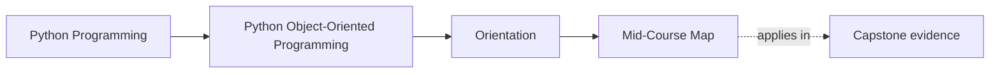

# Mid-Course Map

<!-- page-maps:start -->
## Page Maps

<!-- page-maps:end -->

Read the first diagram as a placement map: this page is one concept inside its parent module, not a detached essay, and the capstone is the pressure test for whether the idea holds. Read the second diagram as the working rhythm for the page: name the problem, study the example, identify the boundary, then carry one review question forward.

Use this map when you are past basic object design and are ready to see how object
models survive contact with real systems. This stretch of the course is about pressure:
multiple objects, failures, storage, clocks, and concurrency all pushing against your
design at once.

## What changes in the middle of the course

In the opening modules, most questions sound like "what is this object?" In the middle
modules, the harder questions sound like this instead:

- Which object or boundary stays authoritative when several collaborators are involved?
- How do failures, retries, storage, or time pressure change the design without taking it over?
- What should adapt to the domain, and what must never become the domain's accidental owner?

If those questions are now the ones slowing you down, you are in the right part of the
course.

## Read these modules as a four-part system

| Module | Main pressure | Design trap it helps you avoid | Practical outcome |
| --- | --- | --- | --- |
| Module 4: aggregates, events, collaboration boundaries | several objects participating in one rule | letting every participant mutate the truth | you can name the source of truth and defend derived views as derived |
| Module 5: resources, failures, and evolution | runtime failure and change over time | letting cleanup, rollback, or compatibility leak everywhere | you can keep failure-handling pressure local |
| Module 6: persistence and schema evolution | storage and wire boundaries | flattening the domain until storage becomes the real model | you can separate domain meaning from storage shape |
| Module 7: time and concurrency boundaries | multiple timelines, workers, and execution contexts | moving ownership around until nothing is clearly safe to mutate | you can state where time enters and where mutation must stop |

## Module 4: choose one authority when many objects collaborate

This module exists because collaboration is where many promising OOP designs turn vague.
The goal is not to maximize reuse or patterns. The goal is to keep one clear owner for
every cross-object rule.

Read Module 4 with these questions in mind:

- Which object or aggregate gets the final say?
- Which event helps other parts observe a change without stealing authority?
- Which projection is useful for reading but not allowed to make truth claims?

The refactor matters because it forces you to re-express collaboration in a way a
reviewer can still audit quickly.

## Module 5: make failure and change part of the design

Module 5 teaches survivability. A design that looks elegant on a whiteboard often
becomes brittle once resource ownership, rollback, retries, cleanup, and compatibility
arrive.

Read this module when you need to answer questions like:

- Which object owns cleanup?
- Which boundary should absorb retry or rollback pressure?
- Which public seam must stay stable while internals evolve?

The strongest habit in this module is to ask whether a new failure rule belongs in the
domain, in orchestration, or in an adapter. Many designs get worse simply because that
question was never asked explicitly.

## Module 6: let storage adapt to the model, not the other way around

Module 6 is where many learners discover that persistence is not a database topic
alone. It is an object-design topic because storage can quietly redefine meaning.

Use this module to answer:

- Which fields belong to storage bookkeeping only?
- Which serialized shape is a public or operational contract?
- Which rehydration path preserves invariants instead of bypassing them?

If a storage concern is forcing domain objects to become flatter, more nullable, or
less authoritative, stay in this module until you can explain the distortion clearly.

## Module 7: introduce time and concurrency without dissolving ownership

Module 7 adds the hardest pressure because concurrency can make almost any weak
boundary collapse. The goal is not to become an `asyncio` specialist. The goal is to
model execution pressure honestly.

Read this module with these questions:

- Where does time enter the model?
- Which object owns expiration, scheduling, retry, or timeout rules?
- Which state may be observed concurrently, and who is still allowed to mutate it?

Do not treat this module as runtime trivia. It is a design module about ownership under
competing execution paths.

## A safe mid-course route for independent learners

1. Read the overview page for Module 4 and complete its refactor before skimming later modules.
2. Move to Module 5 only after you can explain one collaboration boundary without hedging.
3. Read Module 6 before you build storage abstractions of your own.
4. Read Module 7 before you treat queues, timeouts, or async as "just infrastructure."
5. After each module, record one sentence beginning with `The authority stays with...`.

## Common mid-course confusions

| Confusion | Better interpretation |
| --- | --- |
| "Events mean nobody owns the rule anymore." | Events help observers react; they do not replace the authoritative owner. |
| "Persistence is later plumbing." | Persistence is already shaping your model, whether you admit it or not. |
| "Concurrency can be patched on later." | Concurrency exposes weak ownership immediately; it rarely waits politely. |
| "More adapters always means cleaner design." | Extra layers help only when they protect a real boundary. |

## Exit check

You are ready for the final stretch of the course when you can do all of these:

- identify the one authoritative owner in a multi-object workflow
- explain where failure or storage pressure should terminate
- state where time or concurrency enters and why that boundary is safe enough
