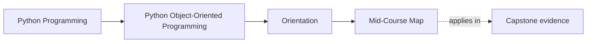
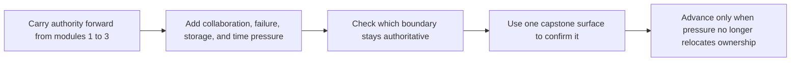

# Mid-Course Map

<!-- page-maps:start -->
## Page Maps

<!-- page-maps:end -->

Use this map when you no longer struggle to name an object, but you do struggle to keep
object ownership clear once the system gets larger. The middle stretch of the course is
where promising designs usually start to blur:

- several objects collaborate on one rule
- failures and rollback pressure arrive
- persistence starts pushing on the model
- time and concurrency threaten to dissolve authority

This part of the course is about surviving that pressure without surrendering the design.

## What changes after the opening stretch

Earlier modules mostly ask:

- what is this object?
- who owns this rule?
- what states are legal?

Modules 4 to 7 ask harder versions:

- which boundary stays authoritative when several objects participate?
- where should failure, retry, rollback, or cleanup pressure terminate?
- how do storage and runtime adapt to the model without becoming the real model?
- where does time enter, and who is still allowed to mutate state safely?

If those are now the questions slowing you down, you are in the right part of the course.

## Read modules 4 to 7 as one systems arc

| Module | Main pressure | Design trap it prevents | What you should be able to say afterward |
| --- | --- | --- | --- |
| Module 4: aggregates, events, collaboration boundaries | several objects participating in one rule | letting every participant mutate the truth | "I know which boundary is authoritative and which views are derived." |
| Module 5: resources, failures, safe evolution | failure, rollback, cleanup, and compatibility pressure | leaking survivability concerns everywhere | "I know where this failure pressure should stop." |
| Module 6: persistence and schema evolution | storage and serialization pressure | flattening the domain until storage becomes the real model | "I know what storage must adapt to, and what it must not redefine." |
| Module 7: time and concurrency boundaries | multiple timelines, workers, and execution paths | moving mutation rights around until nothing is clearly safe | "I know where time enters and where mutation must stop." |

## Module 4: keep one owner when many objects collaborate

This module teaches a crucial upgrade: collaboration does not cancel ownership.

Study Module 4 with these questions:

- which object or aggregate gets the final say?
- which event exists for observation rather than for ownership?
- which projection is useful for reading but forbidden from making truth claims?

If you cannot answer those distinctly, stay in Module 4 longer. Later modules assume you
can separate authority from observation cleanly.

## Module 5: make failure pressure local

This module teaches survivability without design panic. The question is not "how do I
handle every failure?" The question is "which boundary should absorb this particular
failure pressure?"

Keep asking:

- which object owns cleanup?
- where should rollback pressure terminate?
- which compatibility promise must stay stable while internals evolve?

If you answer all three with "everywhere," the design is leaking.

## Module 6: make storage downstream of meaning

Module 6 is where many learners accidentally let persistence rewrite the model. The
important discipline here is distortion detection.

Ask:

- which fields belong to domain meaning, and which belong to storage bookkeeping only?
- which serialized shape is operationally useful but not semantically authoritative?
- which rehydration path preserves invariants instead of bypassing them?

If storage is making your model flatter, more nullable, or less authoritative, that is
not just an implementation detail. It is a design warning.

## Module 7: add time without dissolving responsibility

Concurrency is dangerous mainly because it exposes ownership lies. Module 7 is not
about collecting async techniques. It is about preserving authority under multiple
execution paths.

Study with these questions:

- where does time enter the model?
- who owns expiration, retry, timeout, or scheduling rules?
- which state may be observed concurrently, and who may still mutate it?

If you cannot answer those concretely, the design is not ready for concurrency pressure.

## A strong mid-course route for independent learners

1. Complete Module 4 before you skim later modules.
2. After Module 4, write one sentence beginning with `The source of truth is...`.
3. Move to Module 5 and write one sentence beginning with `This failure pressure stops at...`.
4. Move to Module 6 and write one sentence beginning with `Storage must adapt to...`.
5. Move to Module 7 and write one sentence beginning with `Time enters at...`.

These sentence stems are not busywork. They force you to carry the ownership model
forward as the pressure changes.

## Best capstone checks for this stage

| Module | Best first capstone surface | Why |
| --- | --- | --- |
| Module 4 | `model.py`, `projections.py`, `read_models.py` | they show authority, events, and derived views in one place |
| Module 5 | `runtime.py`, `repository.py`, and saved walkthrough or review outputs | they make survivability pressure visible without pretending runtime owns the domain |
| Module 6 | `repository.py`, unit-of-work tests, verification artifacts | they show whether storage is adapting to the model honestly |
| Module 7 | `runtime.py`, runtime tests, verification bundles | they expose where time and coordination enter the design |

## Mid-course warning signs

- you are calling everything an event because ownership feels awkward
- you are adding persistence fields directly to the domain because it feels convenient
- you are discussing queues, retries, or async without naming the owner of the rule first
- you are introducing layers that do not protect any real boundary

## Signs you are ready for the final stretch

You are ready for Modules 8 to 10 when you can do all of these:

- identify the authoritative owner in a multi-object workflow
- explain where failure or storage pressure should terminate
- state where time or concurrency enters and why that boundary is safe enough

## Exit check

Leave this map only when you can say:

> The current pressure is `____`, the authoritative boundary is `____`, and I will know
> this stage is complete when `____`.
