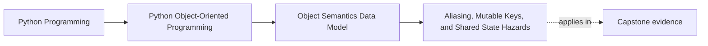

# Aliasing, Mutable Keys, and Shared State Hazards

<!-- page-maps:start -->
## Page Maps




<!-- page-maps:end -->

Read the first diagram as a placement map: this page is one concept inside its parent
module, not a detached essay, and the capstone is the pressure test for whether the
idea holds. Read the second diagram as the working rhythm for the page: name the
problem, study the example, identify the boundary, then carry one review question
forward.

## Why this lesson matters

Aliasing is one of the fastest ways for object-oriented code to become spooky:

- a value changes "somewhere else"
- two parts of the program silently share one mutable object
- a dictionary key becomes unreliable after mutation
- a constructor accepts state that still belongs to the caller

These bugs feel magical only until you say the ownership story out loud.

## Start with the simplest truth

Assignment in Python usually shares references. It does not clone objects for you.

```python
numbers = [1, 2]
alias = numbers
alias.append(3)
print(numbers)  # [1, 2, 3]
```

That is not weird behavior. It is the language doing exactly what it promised.

The design question is:

> Did you mean to share that mutable object?

If the answer is no, you need a different ownership decision.

## What aliasing actually is

Aliasing means two or more names point at the same mutable object.

That matters when:

- one owner believes it has isolated state
- another owner mutates the same state
- a review cannot tell who is authoritative anymore

The bug is rarely "lists are bad." The bug is usually "shared mutable state has no clear
owner."

## The classic default-value trap

```python
def add_label(label, labels=[]):
    labels.append(label)
    return labels
```

That list is created once, then shared across calls.

The lesson is larger than one Python trick:

- defaults can accidentally become shared mutable storage
- once that happens, later callers inherit earlier state

The repair is not only syntactic. It is ownership repair.

## Mutable class state is the same trap at class level

```python
class Job:
    tags = []
```

Now every instance reads and mutates the same list unless you replace it per instance.

If you meant "constant shared meaning," class state is fine.
If you meant "per-instance evolving data," this is a boundary bug.

## Mutable keys are a different but related hazard

If an object is used as a dictionary key or set member, equality and hashing must stay
stable for as long as the object is stored there.

That is why this is dangerous:

```python
class BadKey:
    def __init__(self, value):
        self.value = value

    def __eq__(self, other):
        return isinstance(other, BadKey) and self.value == other.value

    def __hash__(self):
        return hash(self.value)
```

If `value` changes after insertion into a set or dictionary, the container can no longer
trust the key.

This is not a separate lesson from aliasing. It is aliasing plus unstable meaning.

## A better ownership lens

Use this table when reviewing mutable state:

| Question | Healthy answer | Warning sign |
| --- | --- | --- |
| Who owns this mutable object? | one clear boundary | "several parts update it as needed" |
| Is sharing intentional? | yes, and documented by design | "I think it is probably copied somewhere" |
| Can this object be a key? | only if equality and hash stay stable | mutable equality-relevant fields |
| Can callers keep mutating what they passed in? | only if shared ownership is intended | constructor keeps caller-owned mutable state directly |

## Common repairs

### Prefer immutable values when you can

If the state should be shareable but not editable, make the value immutable.

### Copy at the boundary when ownership changes

If a constructor or method receives caller-owned mutable state but should own its own
copy, make that copy deliberately.

### Keep mutable, equality-bearing objects out of key positions

If mutation matters, the object usually should not be a set member or dictionary key.

### Name the owner

Many aliasing bugs disappear once the code makes one owner explicit and everyone else
reads through that owner instead of mutating shared internals directly.

## Smells to watch for

| Smell | Why it is dangerous |
| --- | --- |
| mutable default values | hidden shared state across calls |
| mutable class attributes for per-instance data | hidden sharing across instances |
| direct storage of caller-owned lists or dicts | caller and callee now co-own mutable state unintentionally |
| hash based on mutable fields | set and dict membership can drift after mutation |
| "fixing" aliasing with random copies everywhere | the ownership model is still unclear |

## Capstone connection

This lesson matters whenever the capstone must decide:

- whether a rule definition is safe to share freely
- whether a workflow object owns its mutable history or only references caller state
- whether a type is safe for deduplication, set membership, or mapping keys

If the ownership story is unclear, aliasing will appear later as a surprise rather than
where it should be solved: at the boundary.

## Exit check

Leave this lesson only when you can do all of these:

- explain one aliasing bug as an ownership bug rather than as Python weirdness
- identify one mutable default or shared class state trap quickly
- explain why mutable equality-bearing objects are dangerous as keys
