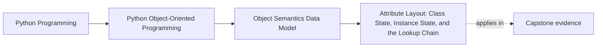

# Attribute Layout: Class State, Instance State, and the Lookup Chain

<!-- page-maps:start -->
## Page Maps




<!-- page-maps:end -->

Read the first diagram as a placement map: this page is one concept inside its parent
module, not a detached essay, and the capstone is the pressure test for whether the
idea holds. Read the second diagram as the working rhythm for the page: name the
problem, study the example, identify the boundary, then carry one review question
forward.

## Why this lesson matters

Many Python learners carry a false mental model for far too long:

> `obj.name` just reads a field from the object.

That model works until it does not. As soon as class attributes, inheritance,
properties, or descriptors appear, "just a field" becomes an unreliable explanation.
This lesson replaces that shortcut with a lookup model you can actually use in reviews
and debugging.

## The first split: instance state versus class state

Start here. Most attribute confusion is really state-placement confusion.

### Instance attributes

Instance attributes belong to one object.

```python
class Counter:
    def __init__(self):
        self.count = 0
```

Each `Counter` instance gets its own `count`.

### Class attributes

Class attributes live on the class and are shared unless shadowed.

```python
class Counter:
    step = 1

    def __init__(self):
        self.count = 0
```

Every instance can read `step`, but the value lives on the class.

## A shadowing example worth keeping in memory

```python
class Service:
    timeout = 30


svc = Service()
print(svc.timeout)       # 30, read from the class

svc.timeout = 10
print(svc.timeout)       # 10, now stored on the instance
print(Service.timeout)   # 30, unchanged on the class
```

That example teaches two things:

- reading through an instance can still be reading class state
- assigning through an instance may create instance state instead of changing the class

If a bug feels like "why did only this one object change?", shadowing is often the real
story.

## The lookup chain you should remember

For most ordinary review work, this model is enough:

1. check for a data descriptor on the class or its bases
2. check the instance's own stored attributes
3. check the class and then the rest of the method resolution order
4. if still missing, fall back to `__getattr__` if the class defines it

You do not need to memorize a language-reference paragraph. You do need to know that
attribute access is a resolution process, not only a dictionary read.

## Why properties and methods are not "just attributes"

Properties and methods look attribute-like at the call site because Python lets class
level objects participate in access.

```python
class User:
    def __init__(self, first, last):
        self.first = first
        self.last = last

    @property
    def full_name(self):
        return f"{self.first} {self.last}"
```

`user.first` is stored state.

`user.full_name` is computed access that is intentionally shaped to look like an
attribute.

Methods are similar: a function on the class becomes a bound method when read through an
instance.

The lesson is simple: two things that both look like `obj.name` may have very different
lookup stories.

## Method resolution order is the inheritance part of the story

When Python cannot finish lookup on the instance, it searches the class hierarchy in
method resolution order, or MRO.

```python
class A:
    label = "A"


class B(A):
    pass


class C(A):
    label = "C"


class D(B, C):
    pass

print(D.__mro__)
print(D().label)
```

You do not need to master every detail of C3 linearization to use Python well. You do
need to remember that:

- the search order is deterministic
- the order is inspectable through `__mro__`
- inheritance bugs should be diagnosed by inspecting lookup, not by guessing

## Mutable class state is one of the easiest self-inflicted bugs

This is a classic trap:

```python
class QueueConfig:
    tags = []
```

That list is shared by every instance unless you replace it per instance. If one object
mutates it, the others observe the change too.

When you mean "shared constant", class attributes are fine.
When you mean "per-instance mutable state", put it on `self`.

## `__slots__` belongs late in the discussion

`__slots__` changes layout by restricting which instance attributes can exist and by
removing the normal per-instance dictionary in many cases. It can matter for memory and
performance, but it is not the first thing to learn from this lesson.

The main point is smaller:

- ordinary Python objects usually carry per-instance state dynamically
- some designs intentionally trade that flexibility for a tighter layout

Do not reach for `__slots__` before your attribute contract is already clear.

## Design rules that follow from this lesson

- Put per-instance mutable state on the instance, not on the class.
- Use class attributes for true shared constants or intentionally shared behavior.
- Use properties when they protect or clarify a contract, not when they hide expensive work.
- Keep inheritance shallow enough that the lookup story is still explainable.
- Do not override `__getattribute__` in normal application code unless you can defend the complexity.

## Quick diagnostic table

| Symptom | Likely cause |
| --- | --- |
| only one instance changed | instance shadowing or per-instance state |
| every instance changed | shared class state |
| attribute behaves like a computation | property or descriptor |
| inherited behavior surprises you | MRO or shadowing confusion |
| debugging requires folklore about "Python magic" | the lookup contract was never named clearly |

## Capstone connection

This lesson matters in the capstone whenever a learner must distinguish:

- value state stored directly on an instance
- shared configuration or policy surfaces defined at class level
- computed views that should stay readable without becoming deceptive

If you cannot explain where an attribute comes from, you cannot review whether the
boundary is honest.

## Exit check

Leave this lesson only when you can do all of these:

- explain the difference between instance state and class state with one example
- describe `obj.name` as lookup rather than "just a field"
- identify one good use of a property and one place where a property would only hide complexity
