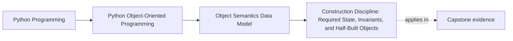

# Construction Discipline: Required State, Invariants, and Half-Built Objects

<!-- page-maps:start -->
## Page Maps




<!-- page-maps:end -->

Read the first diagram as a placement map: this page is one concept inside its parent
module, not a detached essay, and the capstone is the pressure test for whether the
idea holds. Read the second diagram as the working rhythm for the page: name the
problem, study the example, identify the boundary, then carry one review question
forward.

## Why this lesson matters

Construction is where an object first makes its promises. If construction is vague, the
rest of the object model becomes damage control:

- invalid objects are created and repaired later
- optional fields hide missing lifecycle steps
- callers must remember undocumented setup rules
- methods spend their lives defending against states that should never have existed

Good construction is not about clever `__init__` signatures. It is about making illegal
states harder to create than legal ones.

## The main rule

An object should leave construction already honest about what it is.

That means:

- required state should really be required
- invalid combinations should fail immediately
- objects should not escape while they are only partially initialized

If you need a long setup dance after `__init__`, you may be modeling the lifecycle
poorly.

## What construction is responsible for

Use the constructor to answer these questions:

- What information must exist before this object can make any trustworthy claim?
- Which inputs are optional because the domain truly allows them?
- Which invariants should hold the moment construction finishes?

That is the teaching target of this page. The mechanics of `__new__` matter, but the
design question matters first.

## Required state versus optional state

A required parameter should mean:

> without this, the object is not ready to exist.

An optional parameter should mean:

> the object still makes sense without this, and the absence is a real domain state.

That distinction is more important than the syntax itself.

```python
class EndpointConfig:
    def __init__(self, host: str, port: int = 443):
        if not host:
            raise ValueError("host must not be empty")
        self.host = host
        self.port = port
```

`host` is required because the object cannot mean anything without it.

`port` is optional because a real default exists.

## The most common construction mistake

This is the pattern to distrust:

```python
class ReportJob:
    def __init__(self, source=None, template=None, status=None):
        self.source = source
        self.template = template
        self.status = status
```

The constructor looks flexible, but it is actually hiding uncertainty:

- Which combinations are legal?
- Is `None` a real domain value or only "not set yet"?
- What methods are safe before more setup happens?

If you cannot answer those clearly, the constructor is probably tolerating half-built
objects.

## A better way to think about half-built objects

An object is half-built when:

- callers can observe it before its invariants hold
- the constructor stores raw inputs before deciding whether they are valid
- later methods have to finish the real setup

That is not only a cleanliness issue. It becomes a correctness issue as soon as the
object is shared, logged, registered, or passed to another boundary.

## `__new__` matters less often than learners fear

For most ordinary application code, `__init__` is the important construction surface.
You should know that Python allocates the object before initialization and that special
cases such as immutable builtins may use `__new__`, but you do not need to start there.

The practical rule for this course is:

- use `__init__` to establish ordinary object invariants
- reach for `__new__` only when the type truly needs custom allocation semantics

That keeps the lesson grounded in normal design work.

## Constructor discipline checklist

Use this checklist when reviewing a constructor:

| Question | Good sign | Warning sign |
| --- | --- | --- |
| Are required inputs actually required? | missing input raises early | many defaults stand in for unknown state |
| Are invariants checked at creation time? | invalid combinations fail immediately | later methods must repair or re-check everything |
| Can the object escape too early? | object stays local until valid | constructor registers, logs, or exposes `self` before finishing |
| Is absence meaningful? | `None` or a default has domain meaning | `None` only means "we have not modeled lifecycle yet" |

## Constructors versus factories

Sometimes the real problem is that one constructor is being asked to explain too many
creation stories.

That is a good moment to prefer a classmethod or separate creation function:

```python
class ThresholdRule:
    def __init__(self, metric_name, limit):
        self.metric_name = metric_name
        self.limit = limit

    @classmethod
    def from_text(cls, raw: str):
        metric_name, limit_text = raw.split(":")
        return cls(metric_name=metric_name, limit=int(limit_text))
```

The constructor protects the invariant.
The factory explains one creation route.

That split is often clearer than a bloated constructor with many branching code paths.

## Design rules from this lesson

- Prefer constructors that make one honest object, not many ambiguous ones.
- Use defaults only when the default is a real domain choice.
- Treat "optional for convenience" as suspicious.
- Keep object escape until after invariants hold.
- Prefer factories when creation has several input shapes but one stable object contract.

## Common review findings

| Smell | Better move |
| --- | --- |
| many raw primitives with unclear meaning | introduce small value objects or named parameters |
| several nullable fields that must be filled later | model lifecycle explicitly instead of tolerating partial state |
| constructor mutates external systems immediately | finish validation before registration or side effects |
| initialization logic depends on override hooks | move behavior out of construction or tighten the hierarchy |

## Capstone connection

This lesson matters wherever the capstone creates value-like rule objects or
configuration-bearing workflow objects. The important question is always the same:

- what must be true before this object can participate in the system honestly?

If the answer is delayed until "later setup," the object boundary is already weaker than
it should be.

## Exit check

Leave this lesson only when you can do all of these:

- identify one constructor that is enforcing a real invariant
- identify one constructor shape that is only hiding partial state behind defaults
- explain when a factory is clearer than a larger `__init__`
