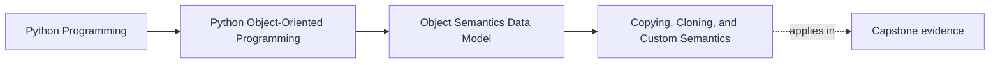

# Copying, Cloning, and Custom Semantics

<!-- page-maps:start -->
## Page Maps




<!-- page-maps:end -->

Read the first diagram as a placement map: this page is one concept inside its parent
module, not a detached essay, and the capstone is the pressure test for whether the
idea holds. Read the second diagram as the working rhythm for the page: name the
problem, study the example, identify the boundary, then carry one review question
forward.

## Why this lesson matters

Learners often ask for a copy when the real question is one of these:

- Do I need independent mutable state?
- Am I trying to protect one boundary from another?
- Is this object a value, an entity, or a resource owner?

That is why copying is a design lesson, not only a library lesson. The `copy` module is
useful, but the real decision comes first:

> What should stay shared, and what should become independent?

## Start with the simplest distinction

### Assignment

Assignment creates another reference to the same object.

### Shallow copy

The outer object is copied, but nested mutable objects may still be shared.

### Deep copy

The nested object graph is copied too, so independence goes further.

That is the mechanics story. The design story is which one matches the contract.

## When copying is appropriate

Copying is usually appropriate when:

- a caller passes mutable state, but the callee should own an independent version
- a value-like object contains nested mutable pieces that should not stay shared
- a snapshot is needed for safe later comparison or review

Copying is often the wrong first move when:

- the real fix is clearer ownership
- the object is a resource owner such as a file, session, or lock
- the object is an identity-bearing workflow entity and "duplicate" is not a meaningful concept

## Value-like objects versus entity-like objects

Use this table when deciding what copy semantics should mean:

| Object style | Usually what you want |
| --- | --- |
| immutable value | often no meaningful copy needed beyond reuse |
| mutable composite value | independent nested state may matter |
| entity with lifecycle | "copy" may be misleading or actively dangerous |
| resource owner | copying should often be forbidden or replaced by explicit snapshot logic |

This is why one generic rule such as "always deepcopy" is bad teaching.

## A practical example

```python
import copy

payload = {"labels": ["cpu", "critical"]}
outer = {"payload": payload}

shallow = copy.copy(outer)
deep = copy.deepcopy(outer)

shallow["payload"]["labels"].append("urgent")
```

After that mutation:

- `outer` and `shallow` still share the nested labels list
- `deep` is independent

The important question is not whether you remember the function names. It is whether the
sharing is intentional.

## Copying can be a smell

Repeated copying often signals one of these design problems:

- too many boundaries are mutating the same state
- callers and callees have unclear ownership of inputs
- an object is carrying too much mutable structure
- a value should have been immutable much earlier

When you keep reaching for copies to feel safe, review the ownership model before adding
another duplication step.

## Custom copy semantics should be rare and explicit

If a type needs special copy behavior, that behavior should reflect the domain story.

Examples:

- a value object may safely return an equivalent independent copy
- a resource-owning type may refuse copying entirely
- a snapshot object may deliberately freeze or normalize state during copy

The important thing is that the copied object still makes semantic sense.

## Review checklist for copying decisions

| Question | Good sign | Warning sign |
| --- | --- | --- |
| Why is a copy needed? | to create intentional independence | "things kept changing somewhere" |
| What must stay shared? | clearly named | nobody has asked |
| Is the object copyable at all? | semantics are explainable | lifecycle or resource meaning becomes fuzzy |
| Would immutability solve this better? | maybe, and considered | copying is used as a reflex |

## Rules of thumb for this course

- Prefer immutability for value-like objects when that matches the domain.
- Copy at ownership boundaries, not randomly inside the codebase.
- Do not pretend a copied entity is automatically a meaningful new entity.
- Be very cautious with deep copies of large or live object graphs.
- If a type cannot be copied honestly, say so explicitly in its API story.

## Capstone connection

This lesson matters in the capstone when deciding:

- whether rule definitions can be shared safely
- whether mutable collections should be owned or copied at entry
- whether a "snapshot" is a safer idea than a generic clone

If a copied object changes the lifecycle story or authority story, the copy semantics are
already suspicious.

## Exit check

Leave this lesson only when you can do all of these:

- explain the difference between shared reference, shallow copy, and deep copy in one small example
- say when copying is solving a real boundary problem and when it is only masking bad ownership
- identify one kind of object that should probably not support casual copying at all
