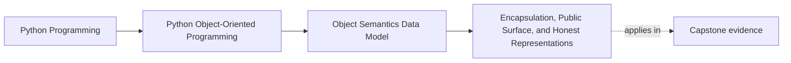

# Encapsulation, Public Surface, and Honest Representations

<!-- page-maps:start -->
## Page Maps




<!-- page-maps:end -->

Read the first diagram as a placement map: this page is one concept inside its parent
module, not a detached essay, and the capstone is the pressure test for whether the
idea holds. Read the second diagram as the working rhythm for the page: name the
problem, study the example, identify the boundary, then carry one review question
forward.

## Why this lesson matters

Python does not enforce privacy for you. That means encapsulation in Python is less
about hiding everything and more about making a trustworthy promise:

- which names are safe to depend on
- which state is only implementation detail
- which representations help reviewers and debuggers without leaking the wrong things

If you do not draw that boundary clearly, other code will depend on whatever happens to
be convenient today.

## What encapsulation means in this course

Encapsulation does **not** mean "nobody can ever read this field."

It means:

- the object has a clear supported surface
- callers do not need internal sequencing knowledge to use it safely
- debugging aids help humans inspect the object without turning internals into contracts

That is a much more useful definition in Python than vague privacy language.

## Public versus internal is a design promise

Use this rule of thumb:

| Kind of surface | What callers may assume |
| --- | --- |
| public name | safe to read or call as part of normal use |
| internal name such as `_cache` | visible in Python, but not promised as stable behavior |
| mangled name such as `__token` | mainly collision avoidance, not true secrecy |

The important thing is not the underscore itself. The important thing is whether the
rest of the codebase is being taught to rely on the name.

## Representation is part of the contract too

`__repr__` and `__str__` are not decoration. They shape how people inspect the object.

Good representations usually do these jobs:

- help a reviewer recognize the object's important state quickly
- avoid leaking irrelevant internal caches or wiring detail
- avoid exposing secrets or misleading partial state

Use this distinction:

- `__repr__` is for developers and debugging
- `__str__` is for user-facing or lighter display

If you only define one, `__repr__` is usually the better place to start.

## A better `__repr__` question

Do not ask only:

> Can I print this object?

Ask:

> If a learner or reviewer sees this object in a test failure, what information would
> help them reason about the contract?

That usually leads to calmer, smaller, more useful representations.

```python
class ThresholdRule:
    def __init__(self, metric_name, limit):
        self.metric_name = metric_name
        self.limit = limit
        self._compiled_matcher = None

    def __repr__(self):
        return f"ThresholdRule(metric_name={self.metric_name!r}, limit={self.limit!r})"
```

That representation shows the public meaning, not the internal optimization state.

## Properties are part of surface design, not decoration

Properties are useful when they make the public contract clearer:

- exposing a derived value that readers naturally expect as an attribute
- enforcing a stable read interface while hiding storage layout

Properties are harmful when they:

- hide expensive work
- perform surprising I/O
- make mutable state look cheap and passive when it is not

The central question is not "can this be a property?" It is "does this access look like
the kind of thing an attribute should mean?"

## A practical review checklist for one object

When you review a public surface, answer these:

1. Which names are intentionally public?
2. Which state is only representation detail?
3. Which attribute access is cheap and unsurprising enough to feel like an attribute?
4. Which representation would help a failing test make sense immediately?
5. Which secret, cache, or temporary state should never become part of the visible story?

If you cannot answer those, the surface is still drifting.

## Common encapsulation mistakes

| Mistake | Why it hurts |
| --- | --- |
| exposing raw mutable internals directly | callers can mutate the object without going through its rules |
| treating every attribute as public because Python allows access | implementation detail hardens into contract accidentally |
| using a property for expensive work | readers assume cheap access and misread performance or effects |
| dumping every field into `__repr__` | debugging becomes noisier and secrets or irrelevant details leak |
| hiding the real contract behind many helper names | callers no longer know which surface is authoritative |

## Capstone connection

This lesson matters whenever a capstone type needs to present:

- a clean public meaning
- a small internal storage story
- a representation that helps review without exposing noise

If you cannot say which fields are real public meaning and which ones are only support
machinery, the object's boundary is still immature.

## Exit check

Leave this lesson only when you can do all of these:

- name one public surface and one internal surface on the same object
- explain why a property does or does not fit one piece of derived information
- write or judge a `__repr__` by asking whether it supports review rather than merely printing everything
